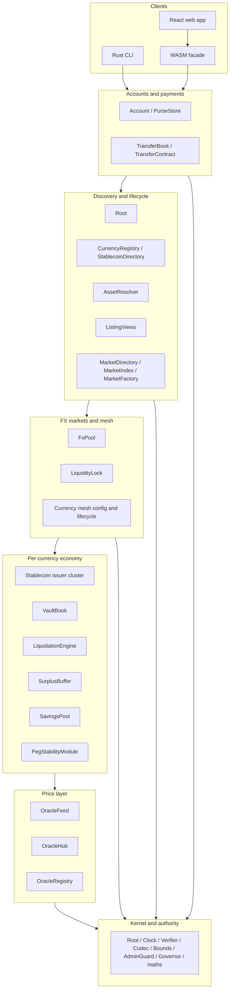

# Architecture at a glance

R-Cash is layered. Each layer assumes the one below it and exposes a smaller, more useful
surface to the one above. Reading the layers in order is the fastest way to understand why a
component exists.

## The layers

### Kernel and authority

The bottom layer is the singleton directory and the primitives every other component uses.
`Root` maps stable keys to versioned URIs and can be frozen. `Clock`, `Verifier`, `Codec` and
`Bounds` provide height, signature checks, canonical encoding and parameter validation.
`AdminGuard` and `Governor` provide 2-of-3 authority and a 100-block timelock. The pure maths
contracts (`AmmMath`, `OracleMath`, `CollateralMath`, `ClaimCode`) contain no state.

Everything resolves through `Root` at arm entry. A component never captures another
component's live capability in a bundle; it resolves the URI and calls the contract.

### Price layer

Each supported currency has an `OracleFeed` with three allowlisted reporters. A feed returns
a median price only when it is active and fresh. `OracleRegistry` binds a feed to a currency
under a sponsor signature. `OracleHub` is stateless: it reads two feeds and returns a
cross-rate plus the age of each side.

Everything that needs a price enforces its own freshness bound. A stale feed refuses mint,
withdraw, liquidation, PSM buy/sell and pool quote/swap/add. Repayment and exits remain
available, because a user must always be able to reduce risk.

### Per-currency economy

This is the largest layer. One signed `31_stablecoin` deploy creates an independent system
for one currency:

| Component | Role |
|---|---|
| `Stablecoin` | ERTP issuer, mint and burn, settlement |
| `CollateralCustody` | Holds the REV collateral |
| `RiskParameters` | Live and genesis parameters |
| `VaultBook` | Vault open, deposit, mint, repay, withdraw, liquidate |
| `LiquidationEngine` | Permissionless liquidation and write-off |
| `SurplusBuffer` | Interest surplus, bad debt (`sin`), savings share |
| `SavingsPool` | Per-owner savings shares |
| `PegStabilityModule` | Par issuance/redemption against a REV reserve |

The eight components are created in one deploy because the mint, burn, custody, settlement,
PSM and buffer capabilities cannot cross a deploy boundary. They are wired by closures at
creation time, not by a later registration step.

Risk isolation is a direct consequence: each currency has its own collateral, debt ceiling,
buffer, savings pool and PSM reserve. A failure in one does not consume another's backing.

### Discovery and lifecycle

The registries make assets and markets discoverable without a central manifest:

- `CurrencyRegistry` and `StablecoinDirectory` map a currency code to its issuer, custody,
  params, vault, liquidation, savings, PSM and buffer URIs.
- `AssetResolver` maps an asset id to the right issuer, including native REV.
- `MarketFactory`, `MarketDirectory` and `MarketIndex` create, bind, stage, activate, pause
  and delist markets.
- `ListingViews` is the client-facing projection: currencies, markets, terms, status and
  indicative rates.

A client discovers what exists; it does not hard-code an asset list. The web app's Accounts
screen, for example, reads the currency list from the chain.

### FX markets and the mesh

Above the economy sit the markets. An `FxPool` holds two currency purses and an LP token kit.
It prices against the oracle, applies a spread and an inventory skew, and keeps fees in
reserves. A `LiquidityLock` holds the seed liquidity until a configured height. The
**currency mesh** is the configuration and lifecycle layer over the markets: a full mesh of
direct pairs, with a tracked config for the supported currencies and priority pairs.

### Accounts and payments

The user-facing layer is deliberately small:

- `AccountFactory` creates one `Account`, one `PurseStore` and one `AccountGate` per owner.
- `PurseStore` creates one purse per asset on first use.
- `TransferBook` creates a per-transfer `TransferContract` holding the escrowed payment.
- The account's `sendTransfer` withdraws the payment, reserves the opId and calls the book.

The account is the only application contract that receives the deployer's `deployerId`, and
only to derive and compare the owner address. Every other authority is a capability.

### Clients

The Rust SDK is the single client logic source. The CLI and WASM facade are thin surfaces over
it; the React app calls the WASM facade. The CLI is the reference client for scripts and
operations. The web app is the human-facing journey. Both use the same signed-deploy path,
the same fixed-point amounts and the same finality rules.

## An end-to-end journey

A conversion shows the layers cooperating:

1. The web app asks the WASM facade for a quote on the NGN/KES pool.
2. The facade signs a read deploy (freshness-gated reads need block context).
3. `FxPool.quote` resolves the oracle pair through `Root`, enforces the `maxPairAgeBlocks`
   bound, reads reserves, and returns the oracle value less the fee.
4. The user confirms. The client builds one deploy that withdraws rNGN from the account,
   calls `FxPool.swap`, and deposits rKES back into the account.
5. `TradabilityGate.admit` checks the market status before any deposit. The pool consumes the
   input payment, computes the output, and transfers it to the caller's deposit facet.
6. The deploy is finalized. The client reports success only when the block is final and the
   deploy is not in `rejectedDeploys`.

If any step fails before value moves, the payment is returned. If a failure happens after a
deposit, the deploy fails and the whole deploy rolls back. There is no intermediate state
where the user has paid but not received.

## The component catalogue

The machine-readable list is
[`contracts/components.json`](https://github.com/PatrickMockridge/r-cash/blob/main/contracts/components.json),
with 40 components grouped into kernel, authority, registry, domain, view, account and
factory kinds. The catalogue is checked against the built terms and arm inventory, so it
cannot drift silently from the contracts.

> **Where to go deeper.** Install order, factories and freeze are in
> [`docs/spec/30-WIRING.md`](https://github.com/PatrickMockridge/r-cash/blob/main/docs/spec/30-WIRING.md).
> The component catalogue is in
> [`docs/spec/10-COMPONENTS.md`](https://github.com/PatrickMockridge/r-cash/blob/main/docs/spec/10-COMPONENTS.md).
> The account and purse details are in [Money, accounts and purses](money-accounts-purses.md).
