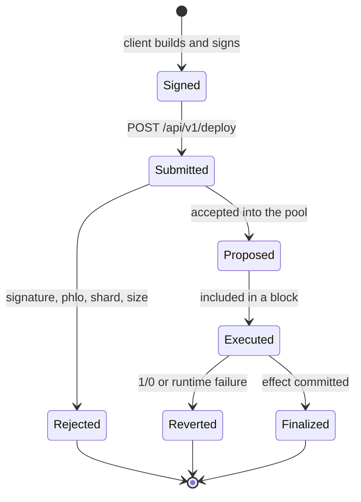

# Deploys, capabilities and authority

R-Cash has no accounts in the Ethereum sense, no `msg.sender` and no token approvals. A
transaction is a **deploy**: a signed Rholang term that runs once, atomically, and replies to
its caller. Understanding the deploy model explains most of the protocol's safety properties.

## What a deploy is

A deploy contains:

- the Rholang term to execute;
- a phlo price and limit (the fee budget);
- a `validAfterBlockNumber` and a block lifespan;
- the deployer's public key and a secp256k1 signature;
- a shard id (the devnet uses `/root`; the public testnet uses `/testnet`).

The client builds the deploy, signs the canonical `DeployData` bytes, and posts it to a node.
The node validates the signature and fee, proposes it, and executes it. The deploy either
succeeds, is rejected before execution, or executes and reverts. A revert rolls back tuple
space and native REV/ERTP state. The fee (phlo) is still charged.



A client must not treat "processed" as success. R-Cash reports success only at a **finalized
block** that does not list the deploy in `rejectedDeploys`. Expiry heights anchor to the
finalized height, never the non-final tip.

## Atomicity and the value-movement rule

One deploy is one transaction. If any arm fails, the whole deploy rolls back. That gives the
protocol a simple rule for handling failures:

- **Before value moves:** a refusal returns `(false, reason)` and returns any payment it still
  holds in the refusal tuple.
- **After value moves:** a later refusal must fail the deploy (`1/0`), not reply `false`, so
  the earlier burn, withdraw or transfer rolls back.

This is invariant I15. It is why a repayment that has already burned principal cannot
"return false" if the savings notification fails; it fails the deploy instead, and the burn
disappears with it.

The same rule shapes composition. A swap is one deploy: withdraw from the account, call the
pool, deposit to the account. A repay is one deploy: accrue, settle, cover, paySavings. There
is no intermediate escrow and no compensating transaction.

## State cells and the commit discipline

State lives in one cell per component. A mutating arm follows:

```
peek → validate → effect → commit
```

The cell carries a `rev`. Before commit, the arm re-reads the cell and checks the `rev`. If a
nested call in the same deploy wrote the cell, a mismatch fails the deploy. If only the arm
writes the cell, it is re-read at commit time. No cell is held consumed across an await on a
caller-supplied name.

The linear-cell discipline is enforced formally. The Lean model defines `peek`, `take` and
`put`, and proves that six defect shapes are rejected:

| Defect | Shape |
|---|---|
| D1 duplicate cell | `peek` then `put` without a `take` |
| D2 lost cell | `take` then a refusal with no `put` |
| D3 nested take | a nested call touching a held cell |
| D4 lost update | `peek ... put` without a `take` |
| D5 duplicate binder | an outer name shadowed before use |
| D6 sort confusion | a value used as a name or vice versa |

The flow YAML records the access pattern for every arm: which cell is peeked, consumed or
posted, by which actor, at which phase. `tools/check_flows.py` rejects an incomplete or
inconsistent record. The [verification chapter](../trust/verification.md) explains the model
and its limits.

## Capabilities

In Rholang, authority is a name. A contract can hold a capability in its closure and never
expose it. R-Cash uses this for every privileged operation:

| Capability | Held by | Authorises |
|---|---|---|
| `mintAuth` / `burnAuth` | `Stablecoin` closure | Issue and destroy the stablecoin |
| `custodyAuth` | `CollateralCustody` | Move collateral |
| `liquidationAuth` | `LiquidationEngine` | Seize collateral in a liquidation |
| `settlementAuth` | `Stablecoin` closure | Split a repayment into principal and interest |
| `psmMintAuth` / `psmBurnAuth` | `PegStabilityModule` | Par issuance and redemption |
| `bufferDepositAuth` / `bufferPayAuth` / `bufferCoverAuth` | `SurplusBuffer` closure | Deposit interest, pay savings, absorb bad debt |
| `savingsNotifyAuth` | `SavingsPool` closure | Lift share value without minting shares |
| `directoryAuth` / `marketAuth` | Registry closures | Write the directory or index |

These capabilities **must not** appear in a reply, a stored map, a bundle or an attestation.
`tools/check_captures.py` enforces that. Caller-supplied deposit facets and payments are
sinks: they may receive value, never authority.

The account is the only contract that receives the deployer's `deployerId`, and only to
compare the derived address with the owner. A capability theft therefore has a narrow attack
surface: there is no global approval to steal.

## Signatures

Not every authority is a capability. Some actions are authorised by a signature because the
signer is off-chain:

- **Sponsor signatures** bind a currency, feed or market to a public key: the issuer creation
  preimage, the feed binding preimage, the market creation preimage.
- **Admin signatures** are 2-of-3 over a domain, nonce, action and args hash. They schedule
  or execute a governed action.
- **Reporter signatures** authorise a price submission for a specific feed slot.

A signature preimage is a canonical string with a version tag, a domain and fixed fields. The
Rust, Rholang and TypeScript encoders must produce byte-identical bytes; that parity is a
blocking gate.

## Root and discovery

`Root` is the only singleton directory. It maps a stable key to `{uri, version, kind,
status}`. During bootstrap, the installer registers each component; after the final step,
`Root.freeze` makes registration terminal.

Every contract resolves what it needs through `Root` at arm entry. A cold-path helper is:

```
resolve(key) -> (uri, version) | (false, reason)
lookup(uri)  -> cap
```

Resolution happens before any consume or value movement. An unknown key or a retired entry is
a refusal, not a silent wait. A resolved capability is never cached across arms. That is why a
component can be replaced by publishing a successor `Root` and switching the client manifest,
without rewriting every caller.

## What this model buys

- **No reentrancy surface in the Ethereum sense.** A deploy is atomic; a nested call cannot
  observe a half-committed state.
- **No allowance phishing.** There is no `approve`; authority is a capability or a signature.
- **No partial settlement.** A failed multi-step operation rolls back completely.
- **A checkable specification.** The access pattern of every arm is written down and checked
  against the source inventory.

The cost is a different mental model. A developer must think in terms of deploys, cells,
capabilities and replies, not accounts, storage slots and events. The rest of this book uses
that model consistently.

> **Where to go deeper.** Deploy and authority requirements are in
> [`docs/SPEC.md` §3](https://github.com/PatrickMockridge/r-cash/blob/main/docs/SPEC.md#3-system-model-and-authority).
> The component calculus and linear-cell rules are in
> [`docs/spec/00-CALCULUS.md`](https://github.com/PatrickMockridge/r-cash/blob/main/docs/spec/00-CALCULUS.md).
> The flow method is in
> [`docs/spec/flows/README.md`](https://github.com/PatrickMockridge/r-cash/blob/main/docs/spec/flows/README.md).
