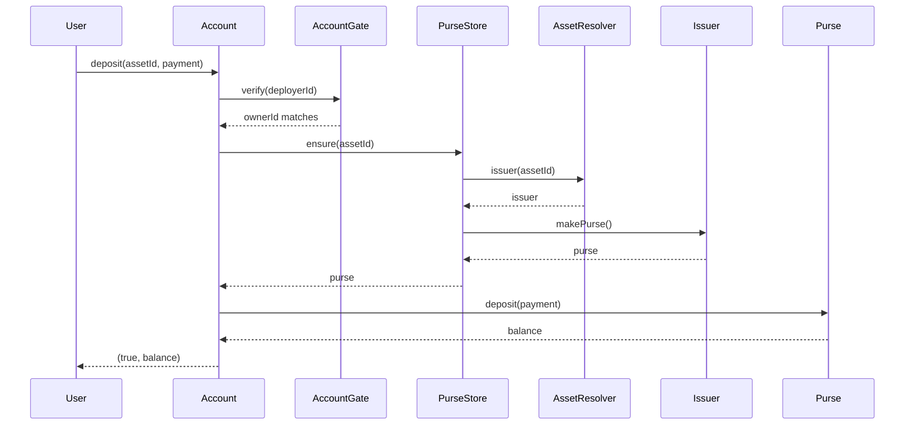

# Money, accounts and purses

Before the economics, there is the money. This chapter explains how value is represented,
who owns it, and how a user's balances are held without a custodian.

## Units and assets

All amounts are **integer base units with 8 decimals**. `100_000_000` is `1.0`. Rates are
quote-per-base in the same scale. Basis points are `1/10000`. Heights are block heights.

There are no floating-point amounts anywhere. The Rust client parses decimal strings to base
units, the WASM facade passes decimal strings, and the contracts do integer arithmetic with
explicit floor or ceil rules. Rounding is part of the protocol: outputs floor, debts and fees
ceil, unless a requirement says otherwise.

An asset is identified by an asset id. Native REV is resolved through the native ERTP issuer.
Every other asset is resolved through `CurrencyRegistry` to a live `Stablecoin` issuer. The
`AssetResolver` is the single place that knows the difference; an unknown asset refuses
`"unknown asset"`.

## What an account is

R-Cash has **one account per owner public key**. `AccountFactory.getOrCreate(pubKeyBytes)`
derives `ownerId = revAddress(pubKey)` and returns the same account on every call. The factory
creates three things per owner:

- an `Account`, which holds state and the transfer op ledger;
- a `PurseStore`, which holds one ERTP purse per asset;
- an `AccountGate`, which checks the caller's deployer id against `ownerId`.

The account is the **only application contract that receives the deployer's `deployerId`**.
It uses it for one purpose: deriving the caller's REV address and comparing it to the stored
owner. It never stores or emits the deployer id.

## Ownership and the deposit facet

Owner arms — withdraw, send, open a vault, and so on — require the caller's derived address
to equal `ownerId`. A different caller is refused `"not owner"`.

The `depositFacet` is deliberately public. It can only receive a payment; it cannot withdraw,
send or act as the owner. That is what makes it safe to hand to a counterparty, a pool or a
transfer contract as a payout destination. A caller-supplied facet is a **sink, not
authority**.

The vault proof follows the same idea. When an owner opens a vault, the account creates a
one-shot vault capability inside the account contract and never returns it. The owner can
operate the vault through the account; another deployer cannot.

## Purses

A `PurseStore` creates one purse per asset the first time it is needed. The flow is:

1. The account asks for a purse for `assetId`.
2. `PurseStore.ensure(assetId)` resolves the issuer through `AssetResolver`.
3. If the asset is unknown, it refuses `"unknown asset"`.
4. Otherwise it creates a purse and stores it under the asset id.

`deposit` measures nothing: the purse's native ERTP deposit validates the payment and its
brand. `withdraw` refuses a non-positive amount. `balance` reads the purse. No arm lets a
caller touch another owner's purse.

## Account state and history

The account state is `{nextTransferId, ops, rev}`. Every mutation revalidates `rev`. The
`ops` map is the transfer op ledger: it records the opId, the state (pending or completed),
the transfer id and the URI. This is what makes an `opId` replay return the original
transfer instead of creating a second escrow.

`Account.transfers` returns the owner's op map so a client can show history. The web app also
keeps an IndexedDB journal, but the on-chain account is the authoritative record for the
owner's transfers.

## What the account does not hold

The account does not hold:

- a private key (the key is in the client; in the browser it stays inside WASM);
- a vault capability that can be extracted (the proof is closure-held);
- another user's funds (purses are owner-gated);
- a global asset list (the chain's registry is the list);
- a claim secret (the secret is never stored on chain; only its hash is).

That last point matters. A transfer stores `secretHash`, not the secret. The sender gives the
secret to the recipient out of band, usually in a URL fragment. A claim checks
`claimHash(secret) == secretHash`. The chain never learns the preimage unless someone
publishes it.

## The user-visible result

Put together, an account is a familiar object: a balance per currency, an address to receive
at, a history of transfers, and a set of operations that only the owner can perform. The
unfamiliar part is that the balance is held in native ERTP purses, the authority is a
capability rather than an allowance, and the account is created lazily on first use rather
than registered in a database.

> **Where to go deeper.** The normative account and purse requirements are in
> [`docs/SPEC.md` §4](https://github.com/PatrickMockridge/r-cash/blob/main/docs/SPEC.md#4-identity-accounts-and-purses).
> The identity flow is specified in
> [`docs/spec/flows/11-identity.yaml`](https://github.com/PatrickMockridge/r-cash/blob/main/docs/spec/flows/11-identity.yaml).
> The payment flow is in [Payments and claim links](../mechanisms/payments.md).
