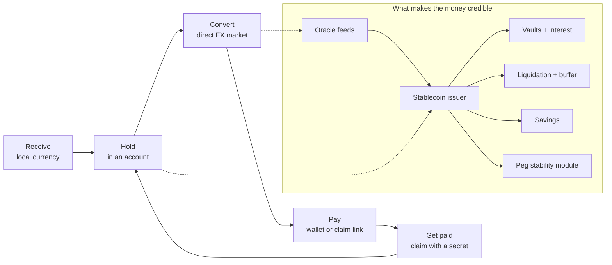

# R-Cash

**A permissionless multi-currency account and cross-border payments network on [rholo](https://github.com/rhovision-org/rholo).**

R-Cash is the on-chain payments core of a Wise-shaped product. A person can hold balances in
local currencies, receive money as if they had a local account, convert directly between
currencies, and pay anyone — with a wallet or with a claim link. Liquidity providers, not
correspondent banks, earn the FX spread.

The protocol is built from four ideas that reinforce one another:

1. **Local-currency stablecoins** give each currency a native on-chain unit that can be held
   and moved.
2. **A DAI-shaped issuer** — REV-collateralised vaults, an oracle, liquidation, a surplus
   buffer, savings and a peg stability module — makes that unit credible and keeps it near
   par.
3. **Direct FX markets** price and settle conversions between any two listed currencies,
   without a mandatory dollar hop.
4. **Accounts and claimable transfers** turn those assets into a payment experience that
   works for people who have never used a wallet.



The core loop is **hold → receive → convert → pay → get paid**. If a component does not
serve that loop, or the solvency and par machinery that make the held currency credible, it
is not in this build.

## The problem

A payment from Kenya to Ghana usually travels KES → USD → GHS through correspondent banks.
Each leg adds a fee, a delay and a counterparty. Local-currency liquidity is fragmented, and
stablecoins for currencies such as the naira or the shilling are scarce because major
infrastructure providers set listing thresholds those markets do not meet. The cost is paid
by people sending money home, freelancers paid by foreign clients, and small businesses
paying suppliers and staff across borders.

R-Cash takes a different route: issue a local stablecoin for each corridor, let a direct
market between the two local units price the conversion, and let a claim link reach a
recipient who does not yet have a wallet. The dollar is a reference price, not a required
stop.

## What is in this book

The book is written to be read in order, but each part stands on its own.

| Part | What it answers |
|---|---|
| [Orientation](orientation/what-is-rcash.md) | What R-Cash is, who it serves, what it believes, and where the honest limits are |
| [The mental model](concepts/architecture.md) | The layered architecture, accounts and purses, deploys and authority |
| [Mechanisms](mechanisms/oracles.md) | Oracles, the stablecoin issuer, vaults, liquidation, the buffer, savings, the PSM, markets, the mesh, payments, governance and registries |
| [Using R-Cash](guides/quickstart.md) | Devnet quickstart, CLI, web app, adding a currency, the public testnet, operations |
| [Trust and verification](trust/security-model.md) | Security model, formal methods, testing, the normative spec, the repository map |
| [Appendix](appendix/glossary.md) | Glossary, FAQ, licensing and legal boundaries |

The book explains and connects. It does **not** replace the normative specification. Exact
requirements, acceptance criteria, refusal strings and arm-level behaviour live in
[`docs/SPEC.md`](https://github.com/PatrickMockridge/r-cash/blob/main/docs/SPEC.md) and
[`docs/spec/`](https://github.com/PatrickMockridge/r-cash/tree/main/docs/spec). Each chapter
ends with pointers to the relevant source.

## Status at a glance

R-Cash is a **v0.5, devnet-only prototype**. There is no fiat custody, no real value on
chain, no external audit and no mainnet deployment. The rholo chain itself is pre-testnet.

| Area | State |
|---|---|
| Contracts | Kernel, oracle, per-currency stablecoin issuer, buffer, savings, PSM, markets, accounts and transfers implemented |
| Clients | Rust SDK and CLI, WASM facade, React web app |
| Static gates | Green: contract build/measure/architecture/capture, market-term vectors, Rust fmt/clippy/tests, wasm32, web typecheck/build, language policy |
| Devnet campaign | 13 behavioural suites and the CLI demo passed on a fresh fixed-node devnet on 2026-10-27; mesh and external-asset suites were added afterwards |
| Public testnet | Rebuilt on 2026-10-29. The 2026-10-28 campaign was blocked by the operator's resource-admission throttle, not by a contract result; it has not been re-run as a full campaign |
| Audit / mainnet | Not done. Do not use with real funds |

The [status chapter](orientation/status-and-scope.md) explains what these claims mean and
what is explicitly excluded.

## Where the code lives

- `contracts/` — the Rholang contracts and deploy terms.
- `crates/` — the Rust SDK, CLI, chain bindings and WASM facade.
- `web/` — the React client.
- `harness/` and `tools/` — devnet/testnet orchestration, installers and verification tools.
- `docs/SPEC.md` and `docs/spec/` — the normative product spec and formal core.
- `spec/lean/` and `spec/tla/` — machine-checked models.
- `book/` — this book.

If you are an AI coding agent, read [`AGENTS.md`](https://github.com/PatrickMockridge/r-cash/blob/main/AGENTS.md)
first. It records the authority order, generated-file rules and the commands that must pass.

## Building this book

The book is an mdBook project. From the repository root:

```sh
make docs        # build to book/book
make docs-serve  # serve at http://localhost:3000
make docs-check  # build and check internal links
```

The source is in `book/src/`. The normative files are linked, not copied, so there is one
source of truth for protocol behaviour.
