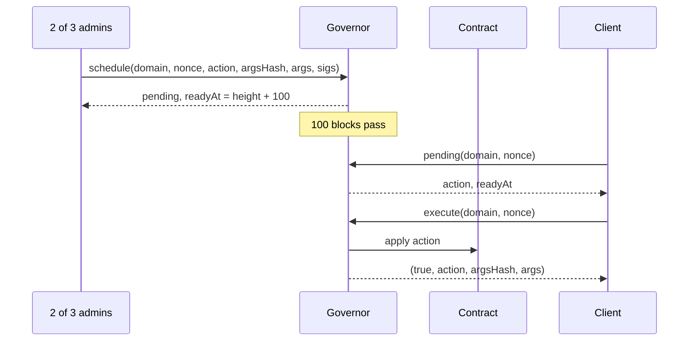

# Governance and the timelock

R-Cash has a narrow governance surface. A 2-of-3 admin set can change risk parameters, pause a
currency, change a market status and schedule a few economic settings. It cannot mint, seize
user funds or upgrade a contract in place. The most consequential changes are timelocked.

## Who governs

`Root` holds the installer, the admin set, a threshold of 2, a `frozen` flag and the
component entries. `Governor` holds the admin set, the threshold, per-domain nonces, a
100-block timelock and a `pending` map.

An admin action is authorised by 2-of-3 signatures over:

```
rcash:admin:v1|domain|nonce|action|argsHash
```

Each domain has its own nonce. An old signature cannot be replayed in another domain or after
the nonce advances. The action and the args hash bind the signature to the exact call.

## Schedule and execute

A timelocked action is a two-step process:

1. `schedule(domain, nonce, action, argsHash, args, sigs)` verifies the signatures and stores
   `pending[domain|nonce] = { action, argsHash, args, readyAt: height + timelock }`.
2. `execute(domain, nonce)` refuses `"unknown"` or `"early"`, rechecks the args hash, and
   returns `(true, action, argsHash, args)`.



The delay is the point. It gives users and LPs time to see a change and exit if they disagree.
It is not a full governance system: there is no token vote, no delegation and no on-chain
proposal discussion. It is a 2-of-3 operational multisig with a delay on the sharp edges.

## What is timelocked

| Action | Why it is timelocked |
|---|---|
| `setRiskParams` (MCR, bonus, close factor, rate, ceiling) | Changes the economics of every vault |
| `setSavingsShare` | Changes the split between savers and the buffer |
| `setPsmPolicy` (fee, ceiling) | Changes the peg band and the PSM's capacity |

## What is immediate

| Action | Why it is immediate |
|---|---|
| Currency pause (emergency) | Stops new risk while an incident is investigated |
| Oracle pause / trial restart | Stops a bad feed from pricing actions |
| Market status (pause, resume, delist) | The market lifecycle needs an operational off-switch |
| Lock cancel | Releases seed liquidity when a market cannot proceed |
| Admin, threshold and timelock changes | The governor domain itself |

The immediate actions use `Governor.authorize`; the timelocked actions use `schedule` then
`execute`. This matches `SPEC-GOV-04` and the flow tables: only risk parameters, the savings
share and PSM policy go through the 100-block delay. The asymmetry is deliberate. An
emergency pause or a market delisting must be fast; a parameter change that redistributes
value must be slow.

## The pause matrix

Pausing a currency is not a full stop. The complete matrix is:

| Action | Currency paused | Market paused/delisted | Feed stale |
|---|---|---|---|
| Account deposit/withdraw/balance | allowed | allowed | allowed |
| Transfer send/claim/refund | allowed | allowed | allowed |
| Vault open/deposit | allowed | allowed | allowed |
| Vault mint | refused `"paused"` | allowed | refused `"stale feed"` |
| Vault withdraw | refused `"paused"` | allowed | refused `"stale feed"` |
| Vault repay | allowed | allowed | allowed |
| Vault liquidate | allowed | allowed | refused `"stale feed"` |
| PSM buy | refused `"paused"` | allowed | refused `"stale feed"` |
| PSM sell | allowed | allowed | refused `"stale feed"` |
| Savings deposit/withdraw | allowed | allowed | allowed |
| Pool quote/swap/add | allowed | refused `"not active"` | refused `"stale feed"` |
| Pool remove / lock release | allowed | allowed (exit) | allowed |

The rule of thumb: a pause stops actions that increase risk or price new exposure; it does
not stop repayment, redemption or exit.

## Market status

Market status is the **sole** pool pause authority. There is no separate `poolState.paused`
field that could drift out of sync. `MarketIndex.setStatus` is governor-gated and transitions
follow the lifecycle state machine; anything else refuses `"transition"`.

`MarketIndex.pauseAsset(code)` pauses every active market containing a currency. This is
useful when a currency has an incident that is not confined to one pair.

## Root freeze

`Root.freeze` is terminal. After it, `register`, `rotate`, `deprecate` and `admin` are
refused. A future upgrade publishes a successor `Root` and the client manifest switches URI.
The freeze is what prevents a late registration from redirecting a stable key after the
protocol is live.

## What governance cannot do

- It cannot mint stablecoin directly.
- It cannot move a user's balance or seize a vault.
- It cannot upgrade a contract in place; it can rotate a URI in `Root` before freeze.
- It cannot change the genesis params hash; it changes live parameters, leaving the genesis
  hash as the registry identity.
- It cannot bypass the timelock for the actions that are timelocked.

These limits are intentional. The governor is an operational safety valve, not an owner of
user funds.

## Failure modes

- Fewer than 2 signatures refuses `"below threshold"`.
- A reused nonce refuses `"replay"`.
- An early execute refuses `"early"`.
- An unknown pending action refuses `"unknown"`.
- A changed args hash refuses.
- A frozen root refuses registration.

> **Where to go deeper.** Governance requirements are in
> [`docs/SPEC.md` §13](https://github.com/PatrickMockridge/r-cash/blob/main/docs/SPEC.md#13-governance-timelock-and-pause).
> The transition table is
> [`docs/spec/flows/09-governance.yaml`](https://github.com/PatrickMockridge/r-cash/blob/main/docs/spec/flows/09-governance.yaml).
> The Lean timelock model is `spec/lean/Rholphin/Model/Governance.lean`.
