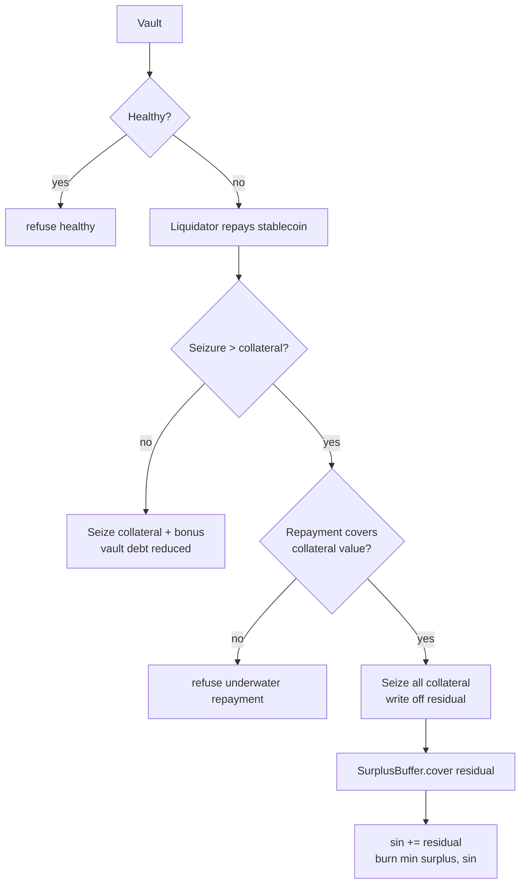

# Liquidation and bad debt

Collateralised debt has a failure mode: the collateral can fall in value until the vault no
longer covers its debt. Liquidation is the mechanism that closes that gap before it becomes a
protocol-wide loss. When it cannot close the gap, the protocol records bad debt honestly
instead of pretending the debt is still good.

## When a vault can be liquidated

A vault is liquidatable only when it is **unhealthy**. With the same health formula as the
previous chapter:

$$
\left\lfloor \frac{\text{collateral} \times \text{rate}}{10^8} \right\rfloor
\times 10{,}000 \;<\; \text{debt} \times \text{mcrBps}
$$

Liquidation is permissionless: any caller holding the stablecoin and phlo can do it. There is
no keeper allowlist, no auction and no bond. A healthy vault refuses `"healthy"`. A stale
feed refuses `"stale feed"`; a liquidator cannot seize collateral at a price the protocol
cannot verify.

## The close factor

A liquidator cannot repay the entire vault in one action. The maximum repayment is:

$$
\text{maxRepay} = \left\lceil \frac{\text{accrued} \times \text{closeFactorBps}}{10{,}000} \right\rceil
$$

A larger payment refuses `"close factor"`. The close factor limits how much of a vault can be
unwound at once, which reduces the chance of a single liquidation cascading through the
market.

## Seizure

The liquidator repays `amount` of stablecoin and receives collateral worth that amount plus a
bonus:

$$
\text{seizure} = \left\lfloor
\frac{\text{amount} \times (10{,}000 + \text{bonusBps}) \times 10^8}
{\text{rate} \times 10{,}000}
\right\rfloor
$$

The bonus compensates the liquidator for taking on the risk and the transaction cost. The
seizure is floored, so the liquidator never receives more than the formula allows.

If the seizure would exceed the vault's collateral, the vault is **underwater**. The
liquidator must repay at least the collateral's value:

$$
\text{amount} \times 10^8 \;\ge\; \text{collateral} \times \text{rate}
$$

Otherwise the arm refuses `"underwater repayment"`. If the collateral is below the
liquidator's `minCollateral`, it refuses `"slippage"`; the liquidator can set a floor to avoid
receiving dust.

## The write-off

When a vault is underwater and the liquidator covers the collateral's value, the whole
collateral is seized and the vault is written off. Let `b = accrued - amount`. The write-off:

- adds `b` to the cumulative `badDebt` memo;
- calls `SurplusBuffer.cover(b, bufferCoverAuth)` in the same deploy:
  - `sin += b`;
  - `cancelled = min(surplus, sin)`;
  - burns `cancelled`;
  - `sin -= cancelled`, `surplus -= cancelled`;
- reduces `totalDebt` by the vault's stored debt;
- increases `totalAccruedInterest` by `delta`;
- reduces `totalCollateral` by the seized amount;
- reduces supply by the liquidator's burn;
- resets the vault to `{collateral: 0, debt: 0}`.

The buffer absorbs as much as it can. The residual `sin` is outstanding bad debt: it remains
on the books and blocks new minting until interest recapitalises the buffer.

## What bad debt is not

Bad debt is **not** a token, an auction or a socialised loss mechanism. There is no MKR
analogue, no debt auction and no recapitalisation token in this build. The accounting residual
is the honest representation of value that could not be recovered.

That choice has consequences:

- If `sin` exceeds `surplus`, new minting stops. The currency can still be repaid,
  liquidated, redeemed through the PSM (if the PSM has REV) and traded on the FX market. It
  cannot inflate its way out of the shortfall.
- A holder is not diluted by a new token. The shortfall is visible in `totals`.
- A future workstream could add a backstop or an auction, but it is not part of v0.5 and the
  protocol does not pretend otherwise.

## Pause and freshness

Liquidation is allowed while a currency is paused, because it reduces risk. It is refused
while the feed is stale, because the seizure arithmetic needs a verified price. A liquidator
who cannot liquidate can wait for a fresh feed; a borrower can always repay in the meantime.

## What a liquidator needs

- the stablecoin to repay (or the ability to acquire it);
- phlo for the deploy;
- a fresh feed;
- a `minCollateral` floor if they want protection from dust;
- an understanding of the close factor and the bonus.

The liquidator receives the seized REV. A refusal returns the stablecoin payment. There is no
partial seizure: the arm either completes or the deploy fails.

> **Where to go deeper.** Liquidation requirements are in
> [`docs/SPEC.md` §8](https://github.com/PatrickMockridge/r-cash/blob/main/docs/SPEC.md#8-liquidation-and-bad-debt).
> The vault transition table is
> [`docs/spec/flows/02-vault.yaml`](https://github.com/PatrickMockridge/r-cash/blob/main/docs/spec/flows/02-vault.yaml).
> The buffer mechanics are in [The surplus buffer](surplus-buffer.md).
