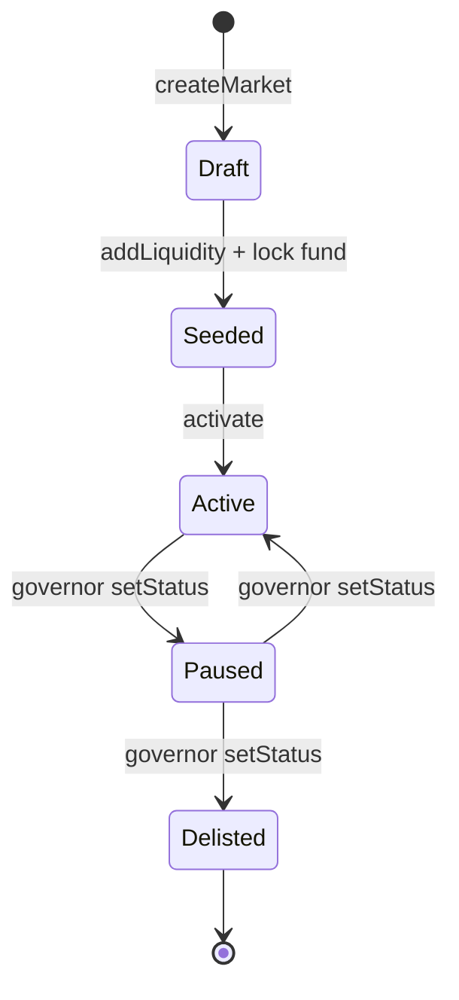
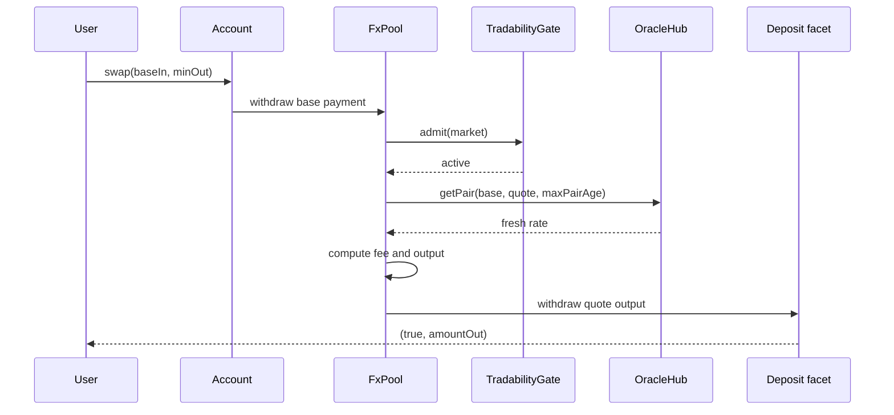

# FX markets and liquidity

The FX market is where a user converts one local stablecoin into another. It is not a
constant-product automated market maker. It is an **oracle-anchored** pool: the oracle says
what the pair is worth, and the pool charges a spread for the service of holding both sides.
Liquidity providers earn that spread.

## One pool, two directions

A market is an unordered pair of currencies. One `FxPool` serves the pair in both directions:
buying base with quote and buying quote with base are the same pool. The `MarketIndex` records
both orientations, so `marketFor(base, quote)` and `marketFor(quote, base)` resolve to the
same market.

This is a deliberate simplification. A single pool per unordered pair means one set of
reserves, one LP token and one spread, rather than two pools that could drift apart.

## The terms

A market is created from sponsor-signed **v4 terms**: 25 fields in a fixed order.

```
marketId, slug, base, quote, version, sponsorPubKey, sponsorOwnerId,
baseFeedPolicyHash, quoteFeedPolicyHash, baseSpreadBps, skewSpreadBps,
maxTradeBps, minLiquidity, firstDepositToleranceBps, depthFloorQuote,
minTicketQuote, seedBase, seedQuote, seedInitialShares,
lockBeneficiaryPubKey, lockMinBlocks, lockUntilHeight,
bookDefaultExpiryBlocks, bookMaxExpiryBlocks, maxPairAgeBlocks
```

The encoding is length-prefixed over UTF-8 decimal strings and hashed with BLAKE2b-256. The
Rholang, Rust and Python encoders must produce byte-identical strings; vectors are checked.
The sponsor signs `rcash:market-create:v1|marketId|termsHash|sponsor`.

Every field is enforced. The important ones for a trader:

| Field | What it controls |
|---|---|
| `base`, `quote` | The pair; both feeds must be listed and active |
| `baseSpreadBps` | The minimum fee |
| `skewSpreadBps` | The extra fee as the pool becomes imbalanced |
| `maxTradeBps` | The maximum trade size relative to the input reserve |
| `minTicketQuote` | The minimum input value |
| `maxPairAgeBlocks` | The oracle freshness bound for the market |
| `minLiquidity` | The first-deposit floor |
| `depthFloorQuote` | The activation depth requirement |
| `seedBase`, `seedQuote`, `seedInitialShares` | The activation lower bounds |
| `lockMinBlocks`, `lockUntilHeight` | The seed lock |

The full field table and its enforcement points are in
[`docs/SPEC.md` §12.1](https://github.com/PatrickMockridge/r-cash/blob/main/docs/SPEC.md#121-terms).

## Pricing

The pool holds reserves `rb` (base) and `rq` (quote). With the oracle rate `rate` (quote per
base):

$$
\text{value} = \left\lfloor \frac{r_b \times \text{rate}}{10^8} \right\rfloor + r_q
$$

$$
\text{baseValue} = \left\lfloor \frac{r_b \times \text{rate}}{10^8} \right\rfloor,
\qquad
\text{weight} = \left\lfloor \frac{\text{baseValue} \times 10^4}{\text{value}} \right\rfloor
$$

The weight is the base side's share of the pool's value, in basis points. A balanced pool is
near 5,000. The fee is:

$$
\text{fee} = \text{baseSpreadBps} +
\left\lfloor \frac{|\text{weight} - 5000| \times \text{skewSpreadBps}}{5000} \right\rfloor
$$

The output is the oracle value of the input less the fee:

$$
\text{out} = \left\lfloor \frac{\text{oracleGross} \times (10{,}000 - \text{fee})}{10{,}000} \right\rfloor
$$

The output floors, so the pool never pays more than the formula allows. The fee stays in the
reserves and accrues to the LP token holders.

The skew is the pool's inventory risk. If the pool is heavy in base, a trade that sells more
base pays a higher fee; a trade that buys base pays a lower one. The pool is nudged back
towards balance.

## Liquidity tokens

The pool mints an ERTP LP token. Shares represent a pro-rata claim on the reserves.

- The first deposit mints `floor(depositValue) - 1e8` shares and must be at least
  `minLiquidity`. The `1e8` is never minted; it is a documented loss that prevents the
  first-depositor inflation attack.
- Later deposits are valued at the oracle ratio and mint shares proportionally.
- Withdrawals are pro-rata reserves. Removing all liquidity sets `seeded = false`; a later
  deposit reseeds the pool.

An LP adds both assets in one deploy. If either deposit fails, the whole deploy rolls back;
there is no half-funded position.

## The lifecycle

A market moves through a small state machine:



1. **Draft.** `MarketFactory.createMarket` verifies the sponsor signature, the terms and the
   feeds. `PoolTemplate.create` builds the pool and lock. `MarketDirectory.bind` and `seal`
   record the slot. `MarketIndex.stage` creates a draft.
2. **Seeded.** An LP adds the initial liquidity, and the seed lock is funded. The lock
   requires `untilHeight >= now + lockMinBlocks`.
3. **Active.** `MarketIndex.activate` checks the sealed slot, the funded lock with
   `untilHeight >= lockUntilHeight`, and a pool attestation with matching terms hash, base
   reserve at least `seedBase`, quote reserve at least `max(seedQuote, depthFloorQuote)`, and
   shares at least `seedInitialShares`.
4. **Paused / Delisted.** The governor changes the status. Paused and delisted markets refuse
   quote, swap and add, but **exit remains available**: `removeLiquidity` and
   `LiquidityLock.release`.
5. **Delisted.** The version can be superseded by a new market with a strictly higher version.

Only the transitions in the diagram are legal. Anything else refuses `"transition"`.

## The tradability gate

`FxPool.swap` calls `TradabilityGate.admit` before any deposit. The gate checks the market
status. A paused or delisted market refuses `"not active"`; a missing or mismatched terms
hash refuses. The gate is the single authority for market status; there is no dead
`poolState.paused` field to drift out of sync.

`quote` and `swap` also require a fresh oracle within `maxPairAgeBlocks`. `addLiquidity` is
allowed on a draft market so the seed can precede activation, but it still requires a fresh
oracle and the seed bounds.

## The seed lock

The seed liquidity is locked to make the sponsor's commitment credible before the market
opens. `LiquidityLock.fund`:

- records the funder and beneficiary;
- requires `untilHeight >= now + lockMinBlocks`;
- takes the LP payment;
- refuses a second fund and returns the payment.

`release` requires the beneficiary and the height. `cancel` is governor-gated and requires
the funder or beneficiary. A released or cancelled lock refuses `"closed"`. The lock is
one-shot.

## A swap, end to end



One deploy. If the gate refuses before the deposit, the base payment returns. If a later step
fails after the deposit, the deploy fails and the whole swap rolls back.

## What can go wrong

- **Stale oracle.** Quote, swap and add refuse until the feed is fresh. Exit remains open.
- **A trade too large.** `maxTradeBps` is measured against the input reserve, not total pool
  value.
- **A tiny trade.** `minTicketQuote` refuses dust.
- **A paused market.** Trading stops; exit continues.
- **A funded lock.** A second fund is refused and the payment is returned.
- **A full removal.** The pool sets `seeded = false`; a new deposit reseeds it.
- **Adverse selection.** The pool prices at an oracle that may lag by up to
  `maxPairAgeBlocks`. A trader with faster information can trade ahead of the update. The
  spread and the max trade size bound the damage, but they do not eliminate it.

> **Where to go deeper.** Market and pool requirements are in
> [`docs/SPEC.md` §12](https://github.com/PatrickMockridge/r-cash/blob/main/docs/SPEC.md#12-amm-markets).
> The transition tables are
> [`07-market.yaml`](https://github.com/PatrickMockridge/r-cash/blob/main/docs/spec/flows/07-market.yaml)
> and [`08-pool.yaml`](https://github.com/PatrickMockridge/r-cash/blob/main/docs/spec/flows/08-pool.yaml).
> The mesh layer above the markets is in [The currency mesh](mesh.md).
