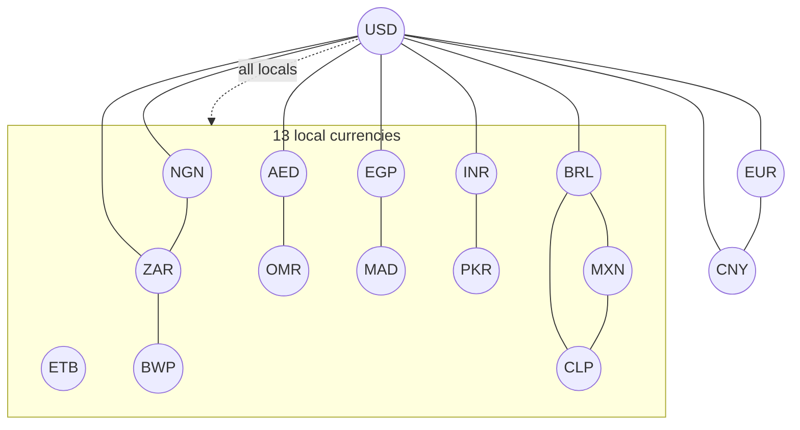

# The currency mesh

The FX market is a full mesh of direct pairs. Every supported currency can be paired directly
with every other supported currency, and each pair is its own pool. There is no hub currency
and no router. The mesh is the configuration and lifecycle layer that decides which pairs
exist at launch and which remain permissionless.

## Why a mesh, not a hub?

A hub design routes every trade through a few deep pools, usually USD. It is capital-efficient
at the hub but it reintroduces the dependency the product is trying to remove: a KES→GHS
payment still stops at a dollar pool. A router also adds a path-finding problem and a
multi-hop failure mode.

A direct mesh removes the mandatory hop. One `FxPool` serves an unordered pair in both
directions, and `marketFor` resolves either orientation to the same market. The cost is more
markets with less liquidity each. The mesh config answers that by seeding **priority pairs**
at launch and leaving the rest permissionless.

## The launch set

`configs/mesh.json` is the tracked source of truth for the supported set. It defines 16 native
currencies:

- **3 majors:** USD, EUR, CNY.
- **13 locals:** NGN, ZAR, OMR, AED, EGP, MAD, ETB, PKR, INR, BWP, BRL, CLP, MXN.

All 16 are native R-Cash issuers. USD is not a bridged token; it is a native R-Cash system
listed like any other currency, and it is the default display, account and new-market quote
currency. A user may choose a different display default in the client; there is no on-chain
preference state.

A complete mesh of 16 currencies has:

$$
\frac{16 \times 15}{2} = 120 \text{ unordered pairs}
$$

Only **24 priority pairs** are created and seeded at launch. They are:

- every local↔USD pair (13);
- the three major hub pairs: USD/EUR, USD/CNY, EUR/CNY;
- eight local–local pairs: NGN/ZAR, ZAR/BWP, AED/OMR, EGP/MAD, INR/PKR, BRL/MXN, BRL/CLP,
  MXN/CLP.

The remaining pairs are not disabled. They are permissionless: anyone can create a market for
a supported pair, and until they do, the pair shows as unavailable. The web client's mesh
matrix shows `active`, `draft`, `paused` and `unlisted` states, and an indicative oracle
cross-rate even when no pool exists.



The diagram is illustrative: every local has a USD pair, and the solid local–local lines are
the eight priority local pairs. The dotted line stands for the remaining local↔USD edges.

## The lifecycle

A mesh entry moves through the same market lifecycle as any other market:

```
Unlisted
  → FeedActive        three reporters submit; the sponsor binds a feed
  → SystemListed      the stablecoin system is deployed and the registry accepts it
  → Draft             the market terms are signed and the pair is staged
  → Seeded            liquidity is added and the lock is funded
  → Active            activation checks the slot, lock and depth
  → Paused            governor pauses the market or the currency
  → Delisted          governor delists the market
```

An external asset follows a parallel path:

```
FeedActive → ExternalListed → Draft → Seeded → Active
```

An external asset is registered through an adapter, not through the stablecoin issuer. It has
`kind: external`, `decimals: 8`, its own feed, and no vault, PSM, savings or liquidation. It
is filtered out of stablecoin-only screens. A bridged USD asset is priced by its own feed; the
protocol does not assume it is worth one dollar.

## The config is executable

`configs/mesh.json` is not a comment. `tools/mesh.py plan` validates it, and
`tools/check_mesh.py` is an **offline falsifiability gate**. It never contacts a node, and it
fails hard if:

- the native code set is not exactly 16;
- the majors are not exactly USD, EUR and CNY;
- the default currency is not USD;
- the native set is not the union of majors and locals;
- the unordered pair count is not 120;
- a priority pair is missing (every local↔USD plus the three majors plus the eight local
  local pairs);
- an enabled external asset has no `adapterUri`;
- a `SPEC-DEX-*` acceptance entry lacks both `static:mesh` and `model:mesh` evidence.

"Falsifiable" is the point. A prose claim that the mesh is complete cannot fail. A config
check can.

`make check-mesh` runs the gate. `tools/mesh.py install` deploys the native systems and feeds
and seeds the priority pairs; `tools/mesh.py pair BASE QUOTE` creates a non-priority pair. The
installer refuses a live endpoint unless `--allow-live` is passed.

## Funding a mesh on a public faucet

A full mesh needs collateral for every native system and liquidity for every priority pair.
On a devnet at a realistic REV price, that is affordable. On the public testnet, whose faucet
is small, it is not. The testnet profile `configs/mesh-testnet.json` therefore sets the REV
reference price to \$100, so 24 pairs cost about 4.3 REV of collateral instead of about 4,300.

This changes the price level only. The contract arithmetic, the pair topology and the
assertions are unchanged. Economic realism remains the devnet campaign at the production
price. The [public testnet chapter](../guides/testnet.md) explains the funding constraints.

## What the mesh does not do

- It does not force every pair to exist. A mesh of 120 pairs with 24 seeded is a launch
  policy, not a protocol rule.
- It does not route. A trade is always against one direct pool.
- It does not make an external asset a stablecoin. An external asset is a separate code with
  its own feed and its own risk.
- It does not guarantee liquidity. An unseeded pair is unavailable until someone provides it.

> **Where to go deeper.** Mesh requirements are in
> [`docs/SPEC.md` §12.4](https://github.com/PatrickMockridge/r-cash/blob/main/docs/SPEC.md#124-currency-mesh-usd-default-and-external-assets).
> The transition table is
> [`docs/spec/flows/13-mesh.yaml`](https://github.com/PatrickMockridge/r-cash/blob/main/docs/spec/flows/13-mesh.yaml).
> External assets are specified in
> [`docs/spec/EXTERNAL-ASSETS.md`](https://github.com/PatrickMockridge/r-cash/blob/main/docs/spec/EXTERNAL-ASSETS.md).
