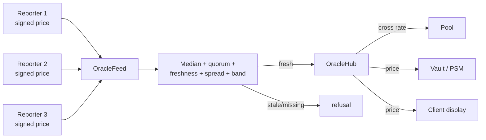

# Price feeds and oracles

Every economic mechanism in R-Cash needs a price: a vault needs to know what its REV
collateral is worth, a pool needs to know the ratio between two currencies, and the peg
stability module needs to know how much stablecoin one unit of REV buys. The oracle layer is
how those prices enter the protocol without a central price feed.

## The feed

Each supported currency has its own `OracleFeed`. The feed is configured by a **policy**:

```
rcash:oracle-policy:v3
currency, k0, k1, k2, sponsor, quorum, maxAgeBlocks, maxSpreadBps,
minPrice, maxPrice, trialBlocks, trialMinSubmits
```

`Bounds.checkFeed` enforces:

- exactly three distinct reporter keys;
- the sponsor occupies at most one reporter slot;
- `quorum` is between 1 and 3;
- `trialMinSubmits >= quorum`;
- the age, spread and price-band ranges are sane.

One feed exists per currency. The sponsor signs the policy; the reporters are allowlisted.

## A submission

A reporter submits `(index, price, height, pubKey, sig)`. The signature is over:

```
rcash:oracle-submit:v3|feedId|currency|index|price|height
```

The feed checks that:

- the slot pubkey matches the reporter's slot;
- the height is monotonic (no going backwards);
- the submission is not more than 1,000 blocks stale;
- the signature verifies.

A submission does not immediately become the price. The feed stores it in its slot. The
median is computed from the fresh submissions.

## Activation and freshness

A new feed starts in a **trial**. `activate` requires the trial length, the minimum number of
submissions, a quorum of reporter slots and a fresh median. Until then, `get` refuses
`"trial"`.

After activation, `get` refuses when:

| Condition | Refusal |
|---|---|
| The feed is paused | `"paused feed"` |
| The feed is still in trial | `"trial"` |
| The median is older than the policy's max age | `"stale feed"` |
| Fewer than quorum reporters are fresh | `"quorum"` |
| The reporter spread exceeds the max spread | `"spread"` |
| The median is outside the price band | `"band"` |

A refusal is a real answer, not a zero price. A consumer must handle it; it must not proceed
with a stale or missing rate.



## The hub and cross-rates

`OracleHub.getPair(base, quote, maxAgeBlocks)` is stateless. It reads both feeds and returns:

```json
{
  "rate": 12345678,
  "fresh": true,
  "basePrice": 65000,
  "quotePrice": 1200000,
  "baseAge": 12,
  "quoteAge": 9
}
```

The rate is:

$$
\text{rate} = \left\lfloor \frac{\text{basePrice} \times 10^8}{\text{quotePrice}} \right\rfloor
$$

`fresh` is true only if both feeds are fresh and both ages are within the caller's bound.
The hub does not decide the bound; the caller passes it and enforces it. A pool, for example,
uses its market's `maxPairAgeBlocks`; a vault uses the currency's `maxOracleAge`.

This is a deliberate separation. The hub is a calculator, not a policy. A caller that wants a
tighter bound can ask for one.

## Binding a feed to a currency

`OracleRegistry.registerFeed` requires:

1. the sponsor is the deployer;
2. a sponsor signature over
   `rcash:feed-bind:v3|code|feedId|feedUri|policyHash|sponsorHex`;
3. a live `feed.info` attestation that matches the policy.

One feed per currency. A bad signature refuses `"bad sponsor signature"`. The registry is
governor-gated for reporter allowlist changes.

The binding is what makes a feed discoverable. A vault, pool or PSM does not hard-code a feed
URI; it resolves the currency through the registry and then the feed.

## What depends on a fresh price

The protocol is explicit about which actions require a fresh feed and which must remain
available:

| Action | Stale feed |
|---|---|
| Vault mint | refused `"stale feed"` |
| Vault withdraw | refused `"stale feed"` |
| Vault liquidate | refused `"stale feed"` |
| PSM buy and sell | refused `"stale feed"` |
| Pool quote, swap, add | refused `"stale feed"` |
| Vault repay | allowed |
| Vault deposit / open | allowed |
| Savings deposit/withdraw | allowed |
| Pool remove / lock release | allowed |

The pattern is: actions that increase risk or move value at a stale price stop; actions that
reduce risk or let a user exit continue. A user can always repay a vault or withdraw
liquidity, even if the oracle is down.

## Why a committee?

A fully decentralised oracle is not free. The protocol could try to derive prices from its own
pools, but that creates a circular dependency: the pool price depends on the oracle, and the
oracle would depend on the pool. A reporter committee is a clear, bounded trust assumption.

The committee is three allowlisted reporters with a quorum of two, a median, and spread and
band checks. It is not trustless. It is a named party that can be replaced by governance. The
[security model](../trust/security-model.md) treats a compromised committee as a first-class
threat.

> **Where to go deeper.** Feed requirements are in
> [`docs/SPEC.md` §6](https://github.com/PatrickMockridge/r-cash/blob/main/docs/SPEC.md#6-oracle-and-feeds).
> The transition table is in
> [`docs/spec/flows/10-oracle.yaml`](https://github.com/PatrickMockridge/r-cash/blob/main/docs/spec/flows/10-oracle.yaml).
> The consumption matrix is in [Governance and the timelock](governance.md).
