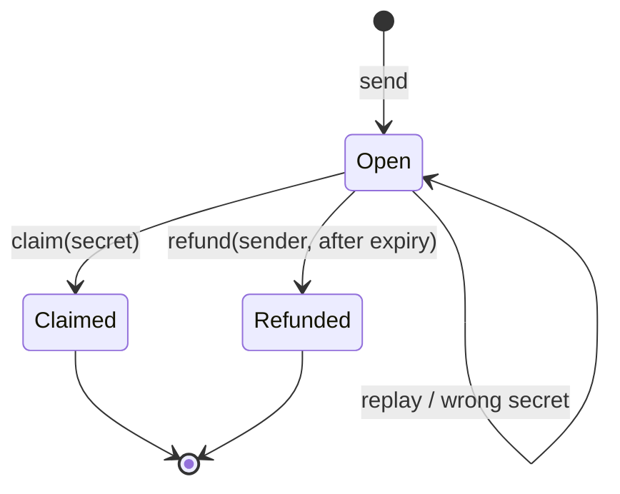

# Payments and claim links

The payment layer is what makes the protocol usable by people who do not have a wallet yet.
A sender escrows value in a per-transfer contract and shares a link. The recipient claims
with a secret. If they never do, the sender refunds after expiry. Exactly one of those two
outcomes can happen.

## Sending

`Account.sendTransfer` is owner-authenticated. It takes:

```
assetId, recipientPub, amount, secretHash, expiry, memo, opId, stipend
```

and:

1. reserves the `opId`;
2. withdraws `amount` of `assetId` into an ERTP payment;
3. calls `TransferBook.send`;
4. optionally sends `stipend` native REV to the recipient's REV address.

`TransferBook.send` then:

1. reads the book parameters;
2. refuses `amount <= 0` or `amount < minAmount` with `"amount"`;
3. refuses `expiry <= now` or `expiry > now + maxExpiryBlocks` with `"expiry"`;
4. refuses a memo over `maxMemoBytes` with `"memo"`, an opId over `maxOpIdBytes` with
   `"opId"`, and a stipend over `maxStipend` with `"stipend"`;
5. **measures** the payment through `AssetResolver.issuer.getAmountOf` and refuses
   `actual != amount` with `"amount mismatch"`, returning the payment;
6. creates a per-transfer `TransferContract` holding the payment and the metadata;
7. registers the transfer and replies `(true, id, uri)`.

The measurement step is the difference between a real payment and a claim. A direct caller
cannot advertise 100 units, pass a 1-unit payment, and have the recipient discover the lie on
claim. The transfer contract holds the measured payment.

## The claim link

The link contains the transfer URI and the claim secret:

```
#/claim/<transfer-uri>/<secret>
```

The secret is generated in the client (32 bytes) and hashed with BLAKE2b-256. Only the hash
is stored on chain. The secret lives in the URL fragment, which is not sent to a server; the
web app keeps it out of localStorage and IndexedDB.

The recipient facet is bound at send time. A forwarded link cannot redirect the funds to a
different account; the claim deposits into the facet the sender chose.

## Claiming

`TransferContract.claim(secret)`:

1. refuses `"expired"` when `now >= expiry`;
2. refuses `"bad secret"` when `claimHash(secret) != secretHash`;
3. deposits the payment into the recipient facet;
4. re-posts `{"status": "claimed"}`.

Expiry is checked **before** the secret. That is deliberate: an expired transfer is closed to
claims regardless of who knows the secret. The sender can then refund.

## Refunding

`TransferContract.refund(dId)`:

1. refuses `"not expired"` before expiry;
2. refuses `"not sender"` unless the caller's REV address equals `senderId`;
3. deposits the payment into the refund facet;
4. re-posts `{"status": "refunded"}`.

A terminal transfer refuses `"closed"`. Claim and refund race on one cell; exactly one wins.
There is no state where both succeed or where the payment is held twice.



## Idempotency

An `opId` is unique per owner. It solves the retry problem: a client that times out after
submitting a send cannot know whether the deploy landed. A blind retry could create a second
escrow.

The account's op ledger records:

- a **pending** reservation when the send starts;
- a **completed** entry with the transfer id and URI when it succeeds.

A replay after completion returns the stored `(id, uri)` and moves no funds. A replay while a
send is in flight returns `(false, "pending", id)`. A refused send removes the reservation,
so the opId can be reused.

An empty `opId` disables idempotency. The client should generate one per send and reuse it on
retry.

## Memo and stipend

A memo is a bounded plaintext string (up to `maxMemoBytes`, 128 bytes in the default book
params). It is useful for an invoice number or a reference. It is public on chain and is not
encrypted; do not put a secret in it.

A stipend is optional native REV sent directly to the recipient's REV address in the same
deploy. It exists because a claim is a signed deploy and costs phlo. The stipend lets a
recipient with no REV balance claim.

Important limits:

- The stipend is **native REV**, not an ERTP REV purse balance. ERTP REV cannot pay phlo.
- It is **non-refundable** if the transfer is never claimed.
- It is capped by `maxStipend`.
- It is a reimbursement, not a meta-transaction. The claim is still signed by the recipient
  (or a third party), and the funds still go to the bound facet.

## Book parameters

The transfer book is configured with `rcash:book-params:v4`:

```
{ defaultExpiryBlocks, maxExpiryBlocks, minAmount, maxMemoBytes, maxOpIdBytes, maxStipend }
```

These are enforced by `Bounds` and `TransferBook`. They are not per-transfer settings; a
sender cannot opt out of the minimum or the maximum.

## Views and history

`info` returns:

```
{ sender, asset, amount, secretHash, expiry, status, id, memo, opId, stipend }
```

The secret is never included. `Account.transfers` returns the owner's op map. The web app
keeps an IndexedDB journal of writes before submission and reconciles pending entries on
boot, so a user can see a send that has not yet finalized.

## The honest limitations

- **The recipient must pay phlo to claim** unless the sender included a stipend or a third
  party executes the claim. The protocol does not sponsor gas.
- **The claim link is bearer authority.** Anyone with the secret before expiry can claim. A
  screenshot or a chat log can leak it.
- **A lost secret is unrecoverable before expiry.** The sender can refund after expiry, but
  cannot recover the funds earlier.
- **The memo is public.** It is not a private message.
- **A pending send is not a completed send.** The client must wait for finality and reconcile
  the opId.

> **Where to go deeper.** Payment requirements are in
> [`docs/SPEC.md` §5](https://github.com/PatrickMockridge/r-cash/blob/main/docs/SPEC.md#5-payments).
> The transfer transition table is
> [`docs/spec/flows/06-transfer.yaml`](https://github.com/PatrickMockridge/r-cash/blob/main/docs/spec/flows/06-transfer.yaml).
> The account and purse model is in [Money, accounts and purses](../concepts/money-accounts-purses.md).
