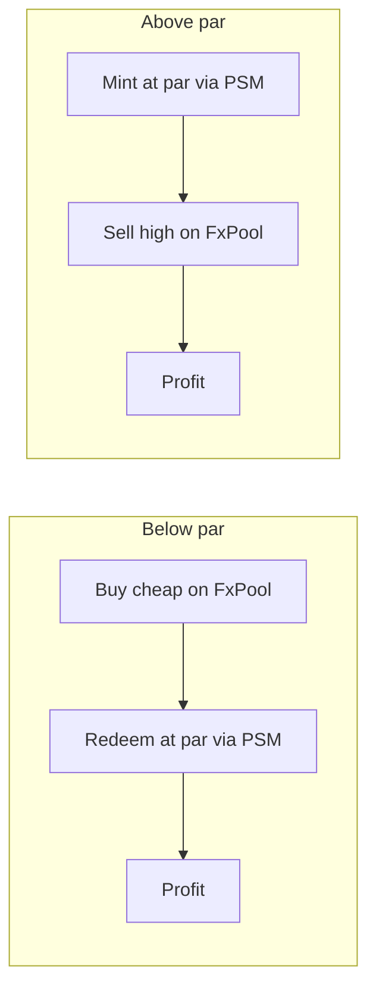

# The peg stability module

The peg stability module (PSM) is the protocol's par window. It lets anyone mint the
stablecoin by depositing REV at the oracle price, and redeem the stablecoin for REV at the
same price, minus a fee. It gives the currency a floor and a ceiling that do not depend on an
FX pool having liquidity at that moment.

## State

The PSM holds:

```
{ stableDebt, feeBps, ceiling, rev }
```

plus two purses: a REV reserve and a stablecoin purse.

- `stableDebt` is **signed**. Positive means the PSM has issued stablecoin against REV;
  negative means it has redeemed more stablecoin than it issued, which is par redemption of
  vault-issued stablecoin.
- `feeBps` is the fee on both sides.
- `ceiling` bounds the positive side.
- The REV purse is the reserve that backs redemptions.

## Funding the reserve

`fundRev(payment)` is permissionless. Anyone can donate REV to the PSM reserve; the arm
returns the amount. The reserve is finite. A redemption is only possible while the reserve
has REV; an empty reserve refuses rather than promising fractional cover.

## Buying stablecoin (minting at par)

`buyStable(payment, stableFacet, minStable)`:

1. measures the REV payment;
2. computes `gross = floor(revIn * rate / 1e8)`;
3. computes `fee = ceil(gross * feeBps / 10000)`;
4. computes `stableOut = gross - fee`;
5. refuses `"min stable"` if `stableOut < minStable`;
6. refuses `"ceiling"` if `stableDebt + stableOut > ceiling`;
7. refuses `"stale feed"` if the REV price is stale;
8. deposits the full REV into the reserve;
9. mints `stableOut` to the `stableFacet`;
10. increases `stableDebt` by `stableOut`.

The full REV is deposited, including the value of the fee. The fee stays in the REV reserve;
it is not minted to the buffer and not paid to savers.

`buyStable` is refused while the currency is paused. New issuance is a risk-increasing
action.

## Selling stablecoin (redeeming at par)

`sellStable(payment, revFacet, minRev)`:

1. measures the stablecoin payment;
2. computes `grossRev = floor(stableIn * 1e8 / rate)`;
3. computes `feeRev = ceil(grossRev * feeBps / 10000)`;
4. computes `revOut = grossRev - feeRev`;
5. refuses `"min rev"` if `revOut < minRev`;
6. refuses `"buffer"` if `revOut` exceeds the REV purse;
7. refuses `"stale feed"` if the price is stale;
8. burns `stableIn`;
9. withdraws and deposits `revOut` to the `revFacet`;
10. decreases `stableDebt` by `stableIn`.

`sellStable` remains available while the currency is paused. Redemption is an exit, and a
pause must not trap a holder.

## The signed debt

`stableDebt` may go negative. That is not an error; it is the accounting of par redemption of
vault-issued stablecoin. Suppose the PSM has issued 1,000 stablecoin and a holder redeems
1,500. The PSM burns 1,500 and pays out REV; `stableDebt` becomes -500. The extra 500 came from
supply that was originally minted by a vault, not by the PSM. The identity

$$
\text{totalDebt} + \text{sin} + \text{psmDebt}
= \text{supply} + \text{totalAccruedInterest}
$$

still holds, with `psmDebt` signed.

The only lower sanity bound is `-maxSupply`. The ceiling bounds the positive side. A policy
change that would set `ceiling < stableDebt` is refused.

## The peg loop

The PSM creates a two-sided arbitrage:

- **Below par:** buy the stablecoin on the FX market for less than its oracle value, redeem it
  through the PSM at par, and keep the difference.
- **Above par:** mint the stablecoin through the PSM at par, sell it on the FX market above
  par, and keep the difference.



The FX pool remains the secondary venue. The PSM is the protocol-level floor and ceiling.
Neither is a guarantee of a fixed exchange rate; both depend on the oracle and on the PSM's
finite REV reserve.

## Fees

Fees apply on both sides and stay in the PSM's REV purse. They compensate the reserve for the
risk and the capital cost, and they widen the no-arbitrage band. A 10 bps fee means the
stablecoin can trade within roughly 0.1% of par before the PSM arbitrage becomes profitable,
before gas and other costs.

`feeBps` is a signed parameter seeded at issuer creation and changeable only through the
governor timelock. A change is validated: `feeBps` is 0–1,000 and `ceiling >= stableDebt`.

## Views

`info` returns `{stableDebt, feeBps, ceiling, revBalance, rev}`. `debt` returns
`stableDebt`. A client can show whether the PSM can redeem (reserve > 0), how much room is
left under the ceiling, and the current fee.

## Failure modes

- An empty REV reserve refuses a sell with `"buffer"` and returns the stablecoin.
- A min-output bound refuses `"min stable"` or `"min rev"` and returns the payment.
- A stale feed refuses both sides.
- A buy above the ceiling refuses `"ceiling"`.
- A sell that would take `stableDebt` below `-maxSupply` is impossible by construction if
  supply is bounded, but the bound is stated for completeness.

The PSM is not a bank. It does not promise unlimited redemption at par; it promises a
redemption window while the reserve lasts. The [security model](../trust/security-model.md)
treats a depleted reserve as a real risk.

> **Where to go deeper.** PSM requirements are in
> [`docs/SPEC.md` §11](https://github.com/PatrickMockridge/r-cash/blob/main/docs/SPEC.md#11-peg-stability-module).
> The transition table is
> [`docs/spec/flows/04-psm.yaml`](https://github.com/PatrickMockridge/r-cash/blob/main/docs/spec/flows/04-psm.yaml).
> The Lean arithmetic is in `spec/lean/Rholphin/Arith/Psm.lean`.
