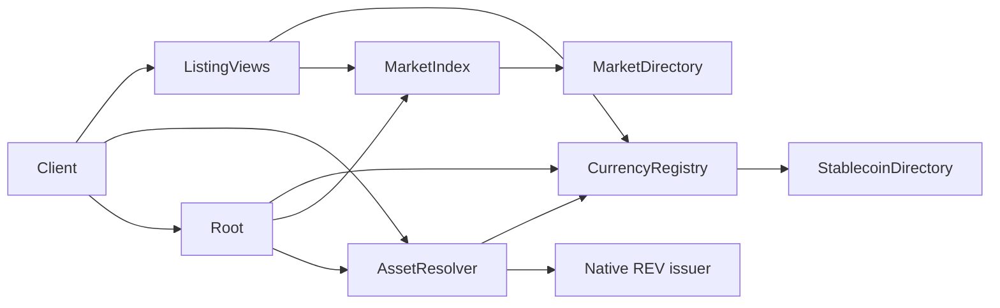

# Registries and discovery

A client should not need a hand-maintained list of contracts. R-Cash discovers currencies,
markets and their components through the chain itself. The registry layer is how that works,
and why a component can be replaced without rewriting every caller.

## Root

`Root` is the only singleton directory:

```
rootState = {
  installer,
  admins,
  threshold: 2,
  frozen: Bool,
  entries: Map<String, { uri, version, kind, status }>
}
```

Every component has a stable key, such as `clock`, `oracle-registry`, `currency-registry` or
`account-factory`. The value is a URI and a version. A caller resolves the key at arm entry:

```
resolve(key) -> (uri, version) | (false, reason)
lookup(uri)  -> cap
```

Resolution happens **before** any consume or value movement. An unknown key or a retired
entry is a refusal, not a silent wait. A resolved capability is never cached across arms.

During bootstrap, `register` authenticates the deploy's `deployerId` public key against the
installer. After the final step, `freeze` makes registration terminal. `rotate` and
`deprecate` are 2-of-3 and versioned.

## The registries

Above Root, each domain has a registry and a directory:

| Registry | Directory | Maps |
|---|---|---|
| `CurrencyRegistry` | `StablecoinDirectory` | currency code → issuer, custody, params, vault, liquidation, savings, PSM, buffer |
| `OracleRegistry` | — | currency code → feed URI and policy hash |
| `MarketFactory` | `MarketDirectory` | marketId → pool, lock, terms hash |
| `MarketIndex` | — | pair → market, status, version, slug |
| `AssetResolver` | — | asset id → issuer (native REV or a listed stablecoin) |
| `ListingViews` | — | client projection of currencies and markets |

The factory is the only writer for its directory. A caller cannot supply a pool, a book, a
lock, a stablecoin or a feed; the factory creates it and binds it.

## A stablecoin entry

A registered stablecoin stores:

```
{
  kind: "stablecoin",
  stablecoinUri, custodyUri, paramsUri, vaultUri,
  liquidationUri, savingsUri, psmUri, bufferUri,
  paramsHash, sponsor, status
}
```

The v3 registration preimage binds all eight URIs plus the params hash and the sponsor:

```
rcash:currency-register:v3|code|sc|custody|params|vault|liq|savings|psm|buffer|paramsHash|sponsor
```

The registry verifies the sponsor signature and the live `attest` before writing. A duplicate
refuses `"currency exists"` or `"duplicate"`. A mismatched attestation is not listed.

## An external entry

An external asset stores:

```
{ kind: "external", assetUri, decimals: 8, sponsor, status }
```

It has no issuer, vault, PSM or savings URIs. It is registered only through
`registerExternal`, with a sponsor signature and an adapter attestation. A bridged asset is
priced by its own feed; the protocol does not assume a dollar peg.

## Asset resolution

`AssetResolver` is the single place that knows how an asset id maps to an issuer:

- native REV → the native ERTP issuer;
- any other asset → `CurrencyRegistry` → the live `Stablecoin` issuer.

A `PurseStore` calls it on first use. A transfer measures a payment through it. A pool
resolves both sides. If the asset is unknown, it refuses `"unknown asset"`.

Resolution is per call. No registry capability is cached in a bundle. That is why a listed
asset can be rotated by governance without every client knowing the new URI in advance.

## Listing views

`ListingViews` is the client-facing projection. It exposes:

- `currencies` — the supported currencies and their kind;
- `markets` — the markets and their status;
- `currency(code)` — one entry;
- `marketFor(base, quote)` — either orientation of an unordered pair;
- `market(id)` — one market;
- `isActive(id)` — status;
- `terms(id)` — the signed v4 terms.

A client discovers what exists from this view. The web Accounts screen does not hard-code an
asset list; it reads the chain. The Markets screen shows the mesh matrix from the same source.



## Install order

The bootstrap order is fixed:

```
Root → AdminGuard → Clock/Verifier/Codec → Bounds → Governor →
AmmMath → CollateralMath → OracleMath → ClaimCode →
OracleRegistry → OracleHub → CurrencyRegistry → AssetResolver →
TransferBook → PoolTemplate → Market* → AccountFactory
```

Each step registers in Root. The installer verifies the keys at the carrying block before
the next step, so a failed step cannot leave a half-wired system. The manifest is written
only after the final step.

The order is not arbitrary. OracleRegistry must exist before a currency can be listed;
AssetResolver must exist before an account can create a purse; PoolTemplate must exist before
a market factory can create a pool; AccountFactory is last because it depends on the asset
layer.

## Rotation and freeze

`Root.rotate` requires the expected version and 2-of-3 signatures over
`(key, expectedVersion, newUri, newVersion)`. It is available only while the root is not
frozen. `deprecate` marks an entry `retired`; reads still see it with a status so old clients
can drain, but writes refuse.

`freeze` is terminal. A future upgrade publishes a successor Root and the client manifest
switches URI. This is how the protocol can evolve without an in-place contract upgrade.

## Why this matters

Without the registry layer, every client would need a manifest of URIs baked into its binary.
A currency listing would require a client release. A market creation would require a manual
entry. The registry layer makes the protocol **discoverable**: a new currency is listed once,
and every client sees it.

The cost is a trust assumption during bootstrap. The installer writes Root before freeze; a
malicious installer could register the wrong URI. The window is trusted by design, and the
freeze ends it. Production deployments should use signed URI-bound registration.

> **Where to go deeper.** Registry requirements are in
> [`docs/SPEC.md` §14](https://github.com/PatrickMockridge/r-cash/blob/main/docs/SPEC.md#14-registries-and-wiring).
> The wiring and install order are in
> [`docs/spec/30-WIRING.md`](https://github.com/PatrickMockridge/r-cash/blob/main/docs/spec/30-WIRING.md).
> The transition table is
> [`docs/spec/flows/05-registry.yaml`](https://github.com/PatrickMockridge/r-cash/blob/main/docs/spec/flows/05-registry.yaml).
