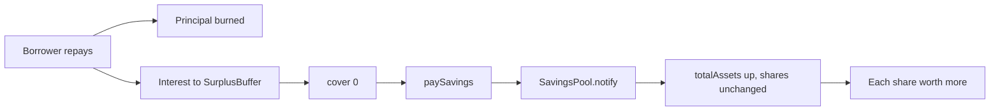

# Savings

The savings pool gives a stablecoin holder a way to earn the interest borrowers pay. It is
the `pot` to the issuer's `vow`: a share-based pool that receives the surplus share from the
buffer and lifts every saver's claim without minting new shares.

## State

The pool holds:

```
{ totalShares, totalAssets, shares: {ownerId: shares}, rev }
```

plus a stablecoin purse. `totalAssets` is the stablecoin the pool owns. `totalShares` is the
sum of all shares. Each owner has a share balance.

`ownerId` is derived from the caller's `deployerId`. No arm accepts an arbitrary owner, so a
caller cannot credit or debit someone else.

## Depositing

`deposit(dId, payment)` measures the payment, then:

- if `totalShares == 0`, `shares = amount` (the first deposit is 1:1);
- otherwise `shares = floor(amount * totalShares / totalAssets)`.

A zero-share result refuses `"shares"` and returns the payment. Otherwise the pool deposits
the payment, increments `totalShares` and `totalAssets`, and adds the shares to the owner.

The first-deposit rule avoids the classic share-inflation attack: an attacker cannot donate a
large amount to make a later depositor's shares round to zero, because the share price is
computed from total assets and there is no public donation arm. A donation would have to go
through `notify`, which is capability-only.

## Withdrawing

`withdraw(dId, shares)` requires `0 < shares <= shares[ownerId]`, then:

$$
\text{amount} = \left\lfloor \frac{\text{totalAssets} \times \text{shares}}{\text{totalShares}} \right\rfloor
$$

It withdraws the amount, returns it to the owner, and decrements all three counters. The
withdrawal is pro-rata and floored. A holder cannot withdraw more than their share of the
pool.

## Notify: yield without new shares

`notify(payment, savingsNotifyAuth)` deposits a payment and adds it to `totalAssets` **without
minting shares**. The capability is held by the `SurplusBuffer`; a caller cannot notify
directly.

This is the yield mechanism. When a borrower repays interest, the buffer:

1. deposits the interest into its own surplus;
2. covers bad debt;
3. pays the configured share to the savings pool via `notify`.

The pool's assets rise while its shares stay constant, so every share is worth more. The
savers do not need to claim, stake or compound; the value accrues in the share price.



## Share value

`info` returns `{totalShares, totalAssets, shareValueE8, rev}`, where:

$$
\text{shareValueE8} = \left\lfloor \frac{\text{totalAssets} \times 10^8}{\text{totalShares}} \right\rfloor
$$

and is 0 when the pool is empty. `position(ownerId)` returns the owner's shares and current
value. The client shows both: the number of shares is the ownership unit, the value is what
it is currently worth.

## What the pool is not

- **No lock.** A saver can withdraw at any time.
- **No minimum.** A small deposit is allowed if it produces at least one share.
- **No promised rate.** The yield depends on borrower interest and the buffer's savings share.
  If borrowers stop paying or the share is set to zero, the yield stops.
- **No claim on REV collateral.** A share is a claim on the pool's stablecoin purse, not on
  the issuer's collateral. A run on the stablecoin does not give savers a direct claim on
  vault collateral.
- **No public donation arm.** Yield arrives only through `notify`, which is capability-only.

## The empty-pool rule

If `totalShares == 0`, `paySavings` skips the notification. The interest stays in the buffer.
This avoids a situation where a payment is sent to an empty pool and stranded: with no
shares, there is no one to own the assets. When the first saver deposits, they receive shares
1:1 against the pool's current assets, not a windfall from a previous notification.

## Failure modes

- A zero-share deposit refuses `"shares"` and returns the payment.
- A withdrawal above the owner's shares refuses.
- A notify from a caller without the capability refuses.
- A withdrawal of all shares leaves the pool empty; the next deposit is 1:1 again.

> **Where to go deeper.** Savings requirements are in
> [`docs/SPEC.md` §10](https://github.com/PatrickMockridge/r-cash/blob/main/docs/SPEC.md#10-savings).
> The transition table is
> [`docs/spec/flows/03-buffer-savings.yaml`](https://github.com/PatrickMockridge/r-cash/blob/main/docs/spec/flows/03-buffer-savings.yaml).
> The buffer's role is in [The surplus buffer](surplus-buffer.md).
