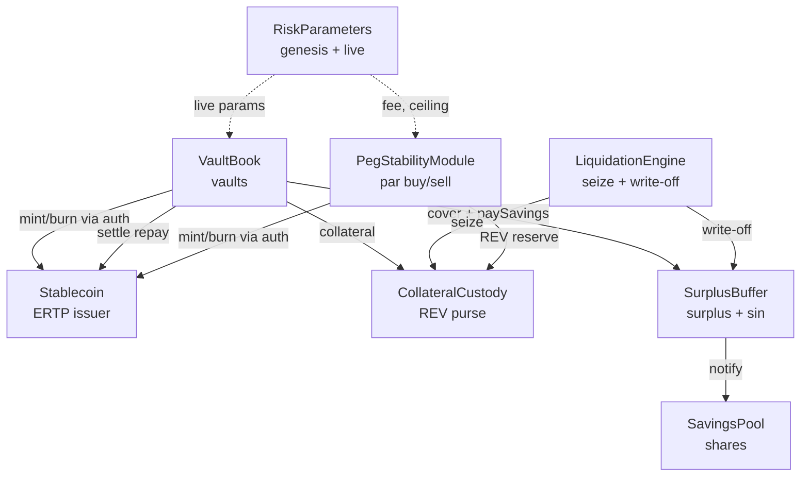

# The stablecoin issuer

Each currency in R-Cash has its own stablecoin, and each stablecoin has its own issuer. The
issuer is not a single contract but a cluster of eight components created by one signed
deploy. This chapter explains why the cluster exists, what each part does, and how a currency
is listed.

## One currency, one system

A currency code maps to exactly one issuer system. The system is created by deploying
`31_stablecoin.rho` with the sponsor's signed parameters. The deploy:

1. verifies the sponsor signature over
   `rcash:stablecoin-create:v1|currency|paramsHash|sponsor`;
2. validates the parameters with `Bounds.checkIssuer`;
3. hashes the signed parameters and checks the hash;
4. creates the eight components;
5. returns their URIs plus an attestation.

The eight components are:

| Component | What it owns |
|---|---|
| `Stablecoin` | The ERTP issuer, mint/burn, settlement of repayments |
| `CollateralCustody` | The REV purse that backs the currency |
| `RiskParameters` | The signed genesis parameters and the live (governed) parameters |
| `VaultBook` | Vault state: collateral, debt, last height; open/deposit/mint/repay/withdraw/liquidate |
| `LiquidationEngine` | The liquidation arithmetic and write-off path |
| `SurplusBuffer` | Interest surplus, outstanding bad debt (`sin`), the savings share |
| `SavingsPool` | Per-owner savings shares and the pool's stablecoin purse |
| `PegStabilityModule` | Par issuance/redemption against a REV reserve |



## Why one deploy?

The short answer is capabilities. The mint, burn, custody, liquidation, settlement, PSM and
buffer capabilities must not cross a deploy boundary. If the issuer were split across
independent deploys, one contract would have to hand a live capability to another, or store it
in a registry, or let a caller pass it in. Each of those would create an authority path that
the capability rules forbid.

Creating the cluster in one deploy lets the components be wired by closure at creation time:
the `VaultBook` holds the settlement capability, the `SurplusBuffer` holds the pay and cover
capabilities, the PSM holds the PSM mint and burn capabilities. No live capability is ever
returned, stored in a map or bundled.

The cost is a large deploy. The platform's 65,536-byte term limit and 128-level parser depth
shape how the term is built and minified. The installer and `tools/build_contracts.py` handle
that; a currency deployment is an installation step, not something a user does in a browser.

## Parameters

The signed parameter set is `rcash:stablecoin-params:v2`, 11 values:

```
currency, mcrBps, bonusBps, closeFactorBps, ratePerBlock, debtCeiling,
minDebt, maxDebt, maxOracleAge, savingsShareBps, psmFeeBps
```

`Bounds.checkIssuer` enforces:

| Parameter | Range |
|---|---|
| `mcrBps` | 10,000–50,000 (100%–500%) |
| `bonusBps` | 0–5,000 |
| `closeFactorBps` | 1–10,000 |
| `ratePerBlock` | 0–50,000 |
| `debtCeiling` | $10^{10}$–$10^{15}$ base units |
| `minDebt` | $10^4$–$10^9$ |
| `maxDebt` | `minDebt`–`ceiling` |
| `maxOracleAge` | 1–1,000 blocks |
| `savingsShareBps` | 0–10,000 |
| `psmFeeBps` | 0–1,000 |

The parameters are not immutable. `RiskParameters` keeps the genesis hash and the live
values. A governed `setRiskParams` through the timelock changes the live values for subsequent
arms; the genesis hash remains the registry identity. The [governance chapter](governance.md)
explains the timelock.

## Listing a currency

Creating the system is only half of listing. `CurrencyRegistry.register`:

1. takes all eight URIs plus the params hash and sponsor;
2. verifies the sponsor signature over the v3 preimage
   `rcash:currency-register:v3|code|sc|custody|params|vault|liq|savings|psm|buffer|paramsHash|sponsor`;
3. verifies the live `attest` (template and currency);
4. writes the registry entry and the `StablecoinDirectory` in one commit.

Only after that can a client discover the currency through `ListingViews` and resolve its
asset through `AssetResolver`.

A duplicate listing refuses `"currency exists"` or `"duplicate"`. A currency with a stale or
mismatched attestation is not listed. The directory is written only after the live attestation
matches; a caller cannot register a URI that does not answer with the expected identity.

## Risk isolation

Every economic variable is per currency:

- collateral is held in that currency's `CollateralCustody`;
- the debt ceiling is that currency's parameter;
- the surplus and `sin` are that currency's buffer;
- the savings pool is that currency's pool;
- the PSM's REV reserve and stablecoin debt are that currency's PSM.

A run on rNGN cannot draw on rKES collateral or savings. A bad-debt event in one currency does
not raise another currency's mint halt. This is the main reason the design uses a cluster per
currency rather than a shared multi-collateral system.

## The economic shape

The issuer is **DAI-shaped but simpler**:

- REV-only collateral, not a basket;
- no stability fee recipient token, no MKR analogue, no debt auction;
- interest is split on repayment: principal is burned, interest goes to the buffer;
- bad debt is absorbed by the buffer and the residual `sin` halts new minting;
- savers earn the interest through the buffer's savings share;
- the PSM provides a par floor and ceiling against a finite REV reserve.

The next six chapters take the loop apart: vaults and interest, liquidation, the buffer,
savings, the PSM, and then the markets where the stablecoin trades.

> **Where to go deeper.** Issuance requirements are in
> [`docs/SPEC.md` §7](https://github.com/PatrickMockridge/r-cash/blob/main/docs/SPEC.md#7-stablecoin-issuance).
> The creation and listing flow is in
> [`docs/spec/flows/01-issuer.yaml`](https://github.com/PatrickMockridge/r-cash/blob/main/docs/spec/flows/01-issuer.yaml).
> The component split is in
> [`docs/spec/10-COMPONENTS.md`](https://github.com/PatrickMockridge/r-cash/blob/main/docs/spec/10-COMPONENTS.md).
