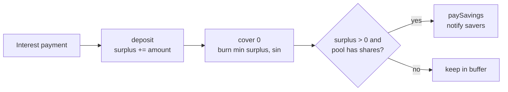

# The surplus buffer

The surplus buffer is the protocol's first-loss absorber. It collects the interest borrowers
pay, absorbs bad debt from liquidations, and distributes the configured share of its surplus
to savers. It is the piece that turns a collection of vaults into a solvent currency.

## State

The buffer holds:

```
{ surplus, sin, savingsShareBps, rev }
```

plus a stablecoin purse. `surplus` is stablecoin it owns. `sin` is outstanding bad debt net
of surplus. `savingsShareBps` is the share of surplus paid to the savings pool. `rev` is the
revalidation counter.

## Deposit: where interest arrives

`deposit(payment, bufferDepositAuth)` measures the payment, deposits it into the buffer's
purse, and adds the amount to `surplus`. Only `Stablecoin.settle` holds the deposit
capability. A borrower's interest payment reaches the buffer through the repay waterfall; it
cannot be spoofed by a caller.

## Cover: absorbing bad debt

`cover(additional, bufferCoverAuth)` accepts `additional >= 0`:

1. `sin += additional`;
2. `cancelled = min(surplus, sin)`;
3. if `cancelled > 0`, withdraw and burn it;
4. `sin -= cancelled`, `surplus -= cancelled`.

`additional = 0` is a **reconciliation**: it matches existing `sin` against new surplus. The
repay waterfall calls `cover(0)` after every interest deposit, so a currency that has recovered
begins to clear its bad debt automatically.

The burn is real. The stablecoin that was counted as surplus is destroyed, so it cannot be
double-counted as both backing and surplus. `SPEC-BUF-08` states this explicitly.

## Pay savings: the yield path

`paySavings(bufferPayAuth)` computes:

$$
\text{move} = \left\lfloor \frac{\text{surplus} \times \text{savingsShareBps}}{10{,}000} \right\rfloor
$$

If `move > 0` and `SavingsPool.totalShares > 0`, it withdraws `move` and calls the savings
pool's `notify`. If the pool has no shares, it skips the transfer; the interest stays in the
buffer rather than being stranded in an empty pool.

There is no rounding in the protocol's favour. The share is floored, and the remainder stays
in the buffer.

## The order

Every interest settlement follows the same order:

```
deposit → cover(0) → paySavings
```

Solvency before yield. The buffer first absorbs any outstanding bad debt, then pays savers
from what remains. If the buffer is short, savers do not get a distribution that would deepen
the shortfall.



## The savings share

`savingsShareBps` is a signed parameter seeded at issuer creation. It is not changed by a
single admin key. A change is scheduled through the governor and executed after the 100-block
timelock:

- `scheduleShare(bps, nonce, sigs)` stores a pending action;
- `applyShare(nonce)` executes it after the timelock.

`bps` is 0–10,000. A value of 5,000 means half of the buffer's surplus is paid to savers on
each settlement; the other half stays as first-loss capital.

## Why a buffer at all?

Without a buffer, every bad debt would be a permanent hole in the backing. With a buffer:

- interest that is not paid out to savers becomes a reserve against future losses;
- a liquidation shortfall is absorbed before it becomes a supply problem;
- the residual `sin` is visible and blocks new minting, so the currency cannot grow while it
  is insolvent;
- savers have a claim on the surplus, which gives the stablecoin a yield without a separate
  inflationary token.

The buffer is not a guarantee. If a loss exceeds the surplus, `sin` remains and the currency
is under-collateralised until interest recapitalises it. The protocol reports that state
rather than hiding it.

## Views

`info` returns `{surplus, sin, savingsShareBps, rev}`. `totals` on the vault book exposes the
same buffer values alongside debt, accrued interest, collateral and `badDebt`. A client can
show whether the currency is recapitalised and whether new minting is open.

## Failure modes

- A deposit by a caller without the capability is refused.
- A `cover` with a negative `additional` is refused.
- A share change executed before the timelock refuses `"early"`.
- A share change without 2-of-3 signatures refuses `"below threshold"`.
- A savings notification to an empty pool is skipped, not failed.

> **Where to go deeper.** Buffer requirements are in
> [`docs/SPEC.md` §9](https://github.com/PatrickMockridge/r-cash/blob/main/docs/SPEC.md#9-surplus-buffer).
> The buffer/savings transition table is
> [`docs/spec/flows/03-buffer-savings.yaml`](https://github.com/PatrickMockridge/r-cash/blob/main/docs/spec/flows/03-buffer-savings.yaml).
> The Lean model is `spec/lean/Rholphin/Model/BufferSavings.lean`.
