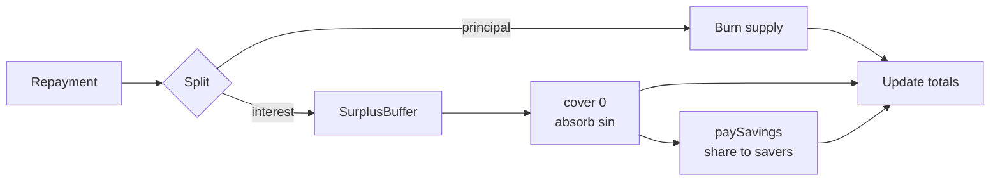

# Vaults, collateral and interest

A vault is the primary way new stablecoin enters circulation. An owner locks native REV,
mints the local stablecoin against it, and later repays with interest to unlock the
collateral. The mechanism is deliberately close to DAI's vault, with a simpler collateral
set and a tighter accounting loop.

## The vault

A vault is a small record:

```
{ auth, collateral, debt, lastHeight }
```

- `auth` is a one-shot capability created by the account and never returned.
- `collateral` is the REV held in `CollateralCustody` for this vault.
- `debt` is the stablecoin owed, before accrued interest.
- `lastHeight` is the height at which interest was last accrued.

`VaultBook.open` creates the vault and returns the auth. `VaultBook.deposit` accrues
interest, adds collateral and updates the totals. `mint`, `withdraw` and `repay` are the
operations that change the debt or the collateral.

## Health

A vault is healthy when its collateral value covers the debt at the minimum collateral ratio.
With `rate` the REV price in stablecoin base units per REV:

$$
\left\lfloor \frac{\text{collateral} \times \text{rate}}{10^8} \right\rfloor
\times 10{,}000 \;\ge\; \text{debt} \times \text{mcrBps}
$$

`mcrBps` is the minimum collateral ratio in basis points. A 15,000 bps MCR means 150%
over-collateralisation. `mint` and `withdraw` check health on the new state; a violation
refuses `"mcr"` (or `"below MCR"` in the construction path).

Health is always computed with the **accrued** debt, not the stored debt. A vault that looked
healthy at its last interaction can be unhealthy later because interest has accrued. The
`vault` view accrues before it computes health, and returns the rate and a freshness flag so
the client can show the real position.

## Interest

Interest accrues per block on the outstanding debt:

$$
\text{accrued} = \text{debt} +
\left\lceil \frac{\text{debt} \times \text{ratePerBlock} \times (\text{now} - \text{lastHeight})}{10^{12}} \right\rceil
$$

The result is ceiled in the protocol's favour: a borrower never pays less than the exact
amount. `ratePerBlock` is a parameter, not a floating rate. There is no utilization curve;
the rate is set by the signed parameters and can be changed by governance through the
timelock.

Interest is not compounded every block in storage. It is computed on demand from the last
height, so a vault that is untouched for a long time accrues one large delta at the next
interaction.

## Repayment and the waterfall

Repayment is where the economic loop closes. Let:

```
delta       = accrued - vault.debt
interestDue = delta
interestPaid = min(amount, interestDue)
principalPaid = amount - interestPaid
```

The arm then:

1. refuses `amount > accrued` with `"amount"` and returns the payment;
2. calls `Stablecoin.settle(payment, principalPaid, interestPaid, settlementAuth)`, which
   **burns** `principalPaid` and **deposits** `interestPaid` into the `SurplusBuffer`;
3. updates totals: `totalDebt += delta - amount` and
   `totalAccruedInterest += delta - interestPaid`;
4. calls `SurplusBuffer.cover(0, bufferCoverAuth)` to reconcile any outstanding bad debt;
5. calls `SurplusBuffer.paySavings(bufferPayAuth)` to distribute the configured savings
   share.

All of this happens in one deploy. If a later step fails, the burn and the deposit roll back
with it.



A payment with zero principal and positive interest leaves supply unchanged and reduces
unpaid interest. That is intentional: a borrower can pay interest without reducing principal.
`totalAccruedInterest` is **net unsettled interest**, not a lifetime total.

## Views

`VaultBook.vault(ownerId)` accrues before computing and returns:

```
{ collateral, debt: accrued, accruedInterest, health, rate, fresh }
```

It never returns the auth. `totals` returns
`{ totalDebt, totalAccruedInterest, totalCollateral, badDebt, sin, psmDebt, paused, rev }`.
`params` returns the live parameters and both the genesis and current hash.

The client uses these views to show collateral, debt, health and liquidation price. A keeper
uses them to find unhealthy vaults. A user can see the effect of interest before deciding to
repay.

## Pause behaviour

A currency pause is a risk control, not a full stop. It gates:

- `mint` (no new stablecoin);
- `withdraw` (no collateral flight at a stale or manipulated price);
- PSM `buyStable` (no new issuance through the PSM).

It does **not** gate:

- `open` and `deposit` (a user can still add collateral);
- `repay` (a user can always reduce debt);
- `liquidate` (a keeper can still clean up an unhealthy vault, subject to a fresh feed);
- savings deposit/withdraw;
- PSM `sellStable` (redemption remains available).

The asymmetry is deliberate. A pause should stop risk-increasing actions, not trap users.

## Failure modes

- **A stale feed** refuses mint, withdraw and liquidation. Repay remains available.
- **An overpayment** returns the payment; the vault is not changed.
- **A vault owned by another deployer** refuses `"not owner"` or `"bad vault auth"`.
- **A debt below the minimum or above the maximum** refuses `"min debt"` or `"max debt"`.
- **A debt above the ceiling** refuses `"ceiling"`.
- **A mint while the buffer is short** refuses `"recapitalise"`; the buffer must recover
  before new supply can be issued.

The next chapter explains what happens when a vault becomes unhealthy and cannot be repaid.

> **Where to go deeper.** Vault and interest requirements are in
> [`docs/SPEC.md` §7.2–7.3](https://github.com/PatrickMockridge/r-cash/blob/main/docs/SPEC.md#72-vault-lifecycle).
> The transition tables are
> [`01-issuer.yaml`](https://github.com/PatrickMockridge/r-cash/blob/main/docs/spec/flows/01-issuer.yaml)
> and [`02-vault.yaml`](https://github.com/PatrickMockridge/r-cash/blob/main/docs/spec/flows/02-vault.yaml).
> The Lean model is `spec/lean/Rholphin/Model/Vault.lean`.
