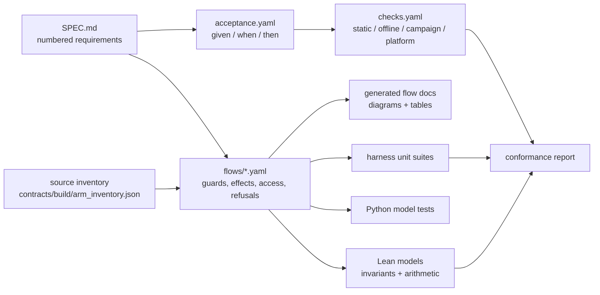

# How the protocol is verified

R-Cash treats the specification as an executable artifact. Requirements map to acceptance
criteria, acceptance criteria map to evidence, contract arms map to a transition model, and
the model is checked by Lean and TLA+. This chapter explains the chain and, just as
importantly, where it stops.

## The chain



The source of truth for the arm list is not a hand-written list. `tools/rho_inventory.py`
parses the deploy sources with a brace-matching scope tree and writes
`contracts/build/arm_inventory.json`. The flow YAML must cover every arm; a missing arm fails
the check.

## The flow specification

Each subsystem has a YAML transition table. A transition is the **net state change of one
deploy path**, including nested pinned calls. A nested call is not automatically a
transition; it is an internal effect of the outer transition.

Each arm records:

- `arm`, `transition`, `lean`, `kind`;
- the source file and line;
- `guards` with their refusal reason, phase and whether they repost or fail;
- `effects` with formulas;
- `access` (peek, consume, post) by actor and phase;
- `nested_calls` with protocol labels;
- `refusals`;
- `invariants`;
- `status`.

`tools/check_flows.py --check --strict` enforces completeness: every inventory arm is
present, access is consistent, every refusal has a decision, and every token is used. Strict
mode accepts only `verified`, or `blocked` with a named blocker. `blocked` is never
conformance.

The Markdown files under `docs/spec/flows/` are **generated** from the YAML by
`tools/render_flows.py`. They carry a "do not edit" header. Edit the YAML, then regenerate.

## The linear-cell discipline

The calculus defines a linear store `CellId → List α` with three operations:

```
peek c     requires s c = v :: rest; leaves s unchanged
take c     requires s c = [v]; sets s c = []; adds c to held
put c v    requires s c = [] and c ∈ held; sets s c = [v]; removes c from held
call A     requires A ∩ held = ∅; leaves the store unchanged
```

A trace is well formed when it finishes with `held = []`. The Lean model proves that six
defect shapes are rejected:

| Defect | Shape | Rejected because |
|---|---|---|
| D1 duplicate cell | `peek c; put c v` | `put` requires `c ∈ held` |
| D2 lost cell | `take c; refusal` with no `put` | final `held` is non-empty |
| D3 nested take | a nested call touching a held cell | `call` requires disjoint access |
| D4 lost update | `peek; ...; put` without a `take` | `put` requires a `take` |
| D5 duplicate binder | an outer `new x` shadowed before use | reported by the inventory |
| D6 sort confusion | a value used as a name or vice versa | reported by the source scan |

A refusal after a `take` must either `put` the unchanged cell or fail the deploy. A graceful
refusal with neither is a D2 defect.

## Lean

The Lean 4 project is at `spec/lean/`, package `rholphin`, pinned by `lean-toolchain`, with no
Mathlib dependency. It contains:

- `Invariants.lean` — the S1–S12 wiring;
- `Arith/` — arithmetic lemmas for the AMM, issuer, PSM and savings;
- `Linear/` — the cell store and the D1–D6 rejection theorems;
- `Model/` — per-subsystem transition models, one Lean name per arm.

The invariant set includes:

| ID | Informal statement |
|---|---|
| S1 | Supply conservation |
| S2 | Vault totals equal the sum of vaults |
| S3 | `totalDebt + sin + psmDebt = supply + totalAccruedInterest` |
| S4 | Health is preserved by a valid mint/withdraw |
| S5 | Close factor bounds a liquidation |
| S6 | Write-off books bad debt and `sin` |
| S7 | Settle burns principal and deposits interest |
| S8 | One system per currency; listing needs the sponsor signature and live attestation |
| S9 | Buffer waterfall order |
| S10 | Savings notification does not mint shares |
| S11 | PSM ceiling and floor |
| S12 | Timelock: not early, ready, nonce monotone |

`tools/check_lean.py` builds the project and rejects `sorry`, `admit`, `native_decide` and
project-local `axiom`. It runs `#print axioms` on the main theorems and accepts only the
standard axioms (`propext`, `Classical.choice`, `Quot.sound`). It requires a minimum number of
audited theorems, so a theorem cannot be silently dropped.

**The boundary:** Lean models the transition relation, the arithmetic and the linear-cell
discipline. It does **not** formalise Rholang syntax, the node scheduler or phlo. The link to
the deployed code is traceability plus tests, not extraction. A Lean theorem about
`VaultBook.mint` is a theorem about the model named in the flow, not a proof that the Rholang
term has no bug.

## TLA+

The TLA+ models are in `spec/tla/`:

| Model | Property |
|---|---|
| `CellLinearity` | A cell is not consumed twice |
| `TransferExclusivity` | Claim and refund cannot both succeed |
| `PoolConservation` | Pool reserves and shares are conserved |
| `CapabilityProvenance` | A capability is not returned or stored |
| `AdminNonce` | An admin action cannot be replayed |

They are checked with TLC over deliberately small bounded domains. The models do not cover
phlo, the scheduler or the parser. TLC is a Java tool and is optional (`make tla-check` skips
if it is not installed); the finite models are committed so they can be checked separately.

## Merge safety

rholo's merge semantics are not Ethereum's. A HAZOP of the shared channels classified every
channel and stated a conflict rule: one pre→post diff per channel, and a whole-deploy
rejection on conflict. The analysis is part of the contract-safety record. It is a design
review, not a proof; the merge-gossip arms were not reached on the available devnet and are
recorded as blocked.

## Traceability

`tools/check_traceability.py --check --strict` requires:

- every MUST in `docs/SPEC.md` has an entry in `docs/spec/acceptance.yaml`;
- every requirement has at least one acceptance criterion with a valid `AC-SPEC-*` id and
  non-empty given/when/then;
- every criterion's `checks` resolve in `docs/spec/checks.yaml`;
- every flow arm's `lean:` name exists;
- the sets are bidirectionally equal: no orphan requirement, criterion, check or arm.

`docs/spec/checks.yaml` is the evidence registry. It has four kinds:

- `static` — text, structure, models, vectors, captures;
- `offline` — pure tests and client tests;
- `campaign` — devnet/testnet behavioural suites;
- `platform` — native rholo/ERTP assumptions.

A check is a command or an artifact with evidence. A requirement with no check is a defect in
the spec.

## What is proven, and what is not

**Proven (in the model):**

- the invariant identities, under the modelled transitions;
- the arithmetic bounds (fees, floors, ceil, close factor, accrual monotonicity);
- the linear-cell defect rejections;
- the TLA+ safety properties over bounded domains.

**Not proven:**

- that the Rholang implements the model line by line;
- that the node executes the term as intended in every scheduler interleaving;
- that the economic parameters are safe under real market conditions;
- that the clients are free of bugs;
- that the system is audited.

The gap is covered by the flow traceability, the behavioural suites and the platform probes.
It is not closed.

> **Where to go deeper.** The calculus is in
> [`docs/spec/00-CALCULUS.md`](https://github.com/PatrickMockridge/r-cash/blob/main/docs/spec/00-CALCULUS.md);
> the invariants are in
> [`docs/spec/20-INVARIANTS.md`](https://github.com/PatrickMockridge/r-cash/blob/main/docs/spec/20-INVARIANTS.md);
> the flow method is in
> [`docs/spec/flows/README.md`](https://github.com/PatrickMockridge/r-cash/blob/main/docs/spec/flows/README.md).
> The Lean project is `spec/lean/`; the TLA+ models are `spec/tla/`.
