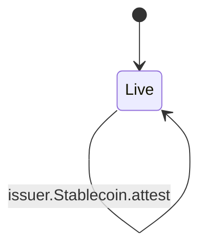
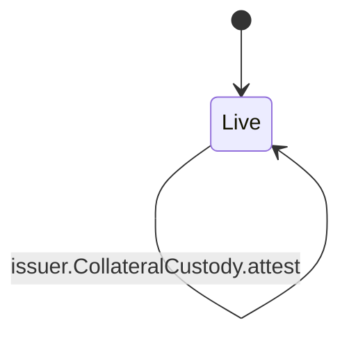
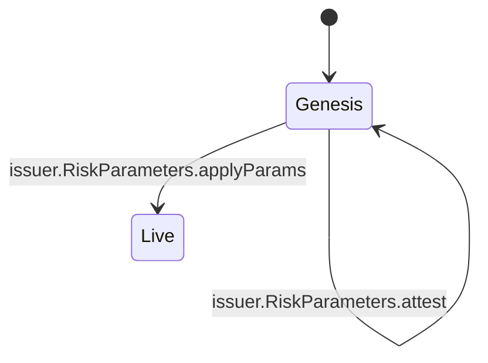

<!-- GENERATED by tools/render_flows.py from 01-issuer.yaml; do not edit -->

# Flow: issuer

Schema: `rcash.flows/v1`
Source: `contracts/src/deploy/v3/31_stablecoin.rho`

### Stablecoin

#### Stablecoin arms

| arm | transition | kind | guards | effects | access | refusals | invariants | status | source |
|---|---|---|---|---|---|---|---|---|---|
| `Stablecoin@"brand"` | `issuer.Stablecoin.brand` | read | — | reply = (true, brand) | — | — | — | verified | contracts/src/deploy/v3/31_stablecoin.rho:594 |
| `Stablecoin@"issuer"` | `issuer.Stablecoin.issuer` | read | — | reply = (true, issuer) | — | — | — | verified | contracts/src/deploy/v3/31_stablecoin.rho:598 |
| `Stablecoin@"supply"` | `issuer.Stablecoin.supply` | read | — | reply = (true, totalPrincipal) | peek issuerState (arm) | — | S1 | verified | contracts/src/deploy/v3/31_stablecoin.rho:602 |
| `Stablecoin@"mint"` | `issuer.Stablecoin.mint` | mutate | auth = mintAuth or auth = psmMintAuth → bad mint authority amount > 0 → amount not (sin > surplus) → recapitalise totalPrincipal + amount <= maxSupply → max supply issuerState.rev = rev_read → changed not (sin2 > surplus2) → recapitalise | totalPrincipal = totalPrincipal + amount supply = totalPrincipal + amount caller = mintPayment(brand, amount) | peek bufferState (arm) peek issuerState (arm) consume issuerState (arm) post issuerState (arm) | amount (pre) bad mint authority (pre) changed (pre) max supply (pre) recapitalise (pre) | S1 S3 S5 S9 | verified | contracts/src/deploy/v3/31_stablecoin.rho:606 |
| `Stablecoin@"burn"` | `issuer.Stablecoin.burn` | mutate | auth = burnAuth or auth = psmBurnAuth → bad burn authority isStablecoinPayment(payment) → not a stablecoin payment 0 < amount and amount <= maxAmount → amount totalPrincipal >= amount → supply issuerState.rev = rev_read → changed | totalPrincipal = totalPrincipal - amount supply = totalPrincipal - amount burnPurse = burnPurse + amount | peek issuerState (arm) consume issuerState (arm) post issuerState (arm) | amount (pre) bad burn authority (pre) changed (pre) not a stablecoin payment (pre) supply (pre) | S1 S3 S7 | verified | contracts/src/deploy/v3/31_stablecoin.rho:648 |
| `Stablecoin@"settle"` | `issuer.Stablecoin.settle` | read | auth = settlementAuth → bad settlement authority principal >= 0 and interest >= 0 → amount total = principal + interest → amount isStablecoinPayment(payment) → asset | supply = supply - principal totalPrincipal = totalPrincipal - principal buffer.surplus = surplus + (interest if principal = 0 else interest) reply = (true, principal, interest) | — | amount (pre) asset (pre) bad settlement authority (pre) | S1 S3 S7 S9 | verified | contracts/src/deploy/v3/31_stablecoin.rho:692 |
| `Stablecoin@"amountOf"` | `issuer.Stablecoin.amountOf` | read | — | reply = issuer.amountOf(payment) | — | — | — | verified | contracts/src/deploy/v3/31_stablecoin.rho:767 |
| `Stablecoin@"attest"` | `issuer.Stablecoin.attest` | read | — | reply = (true, {currency, paramsHash, sponsor, template}) | — | — | S8 | verified | contracts/src/deploy/v3/31_stablecoin.rho:771 |

### CollateralCustody

#### CollateralCustody arms

| arm | transition | kind | guards | effects | access | refusals | invariants | status | source |
|---|---|---|---|---|---|---|---|---|---|
| `CollateralCustody@"deposit"` | `issuer.CollateralCustody.deposit` | read | auth = custodyAuth → bad custody authority isRevPayment(payment) → not a REV payment | custody.rev = custody.rev + amount | — | bad custody authority (pre) not a REV payment (pre) | S7 | verified | contracts/src/deploy/v3/31_stablecoin.rho:780 |
| `CollateralCustody@"withdraw"` | `issuer.CollateralCustody.withdraw` | read | auth = custodyAuth → bad custody authority amount > 0 → amount | custody.rev = custody.rev - amount caller = REV payment amount | — | amount (pre) bad custody authority (pre) | S7 | verified | contracts/src/deploy/v3/31_stablecoin.rho:803 |
| `CollateralCustody@"balance"` | `issuer.CollateralCustody.balance` | read | — | reply = custody.rev | — | — | S7 | verified | contracts/src/deploy/v3/31_stablecoin.rho:813 |
| `CollateralCustody@"attest"` | `issuer.CollateralCustody.attest` | read | — | reply = (true, {currency, kind: rev, template}) | — | — | — | verified | contracts/src/deploy/v3/31_stablecoin.rho:817 |

### RiskParameters

#### RiskParameters arms

| arm | transition | kind | guards | effects | access | refusals | invariants | status | source |
|---|---|---|---|---|---|---|---|---|---|
| `RiskParameters@"params"` | `issuer.RiskParameters.params` | read | — | reply = (true, params) | peek paramsState (arm) | — | — | verified | contracts/src/deploy/v3/31_stablecoin.rho:825 |
| `RiskParameters@"info"` | `issuer.RiskParameters.info` | read | — | reply = (true, {params, hash, rev}) | peek paramsState (arm) | — | — | verified | contracts/src/deploy/v3/31_stablecoin.rho:829 |
| `RiskParameters@"scheduleParams"` | `issuer.RiskParameters.scheduleParams` | create | Bounds.checkIssuer(newParams) → params hash argsHash = H(rcash:stablecoin-params:v2, values) → params hash | governor.pending = pending[stablecoin:currency, nonce] = {action: setRiskParams, argsHash, args: newParams} | — | — | S12 | verified | contracts/src/deploy/v3/31_stablecoin.rho:837 |
| `RiskParameters@"applyParams"` | `issuer.RiskParameters.applyParams` | mutate | action = "setRiskParams" → action argsHash = H(rcash:stablecoin-params:v2, values) → params hash Bounds.checkIssuer(args) → params hash | paramsState.params = args paramsState.hash = H(rcash:stablecoin-params:v2, values(args)) paramsState.rev = rev + 1 reply = (true, {params: args, currentHash: hash}) | consume paramsState (arm) post paramsState (arm) | action (pre) params hash (pre) | S12 | verified | contracts/src/deploy/v3/31_stablecoin.rho:873 |
| `RiskParameters@"attest"` | `issuer.RiskParameters.attest` | read | — | reply = (true, {currency, paramsHash, sponsor, template}) | — | — | — | verified | contracts/src/deploy/v3/31_stablecoin.rho:923 |
