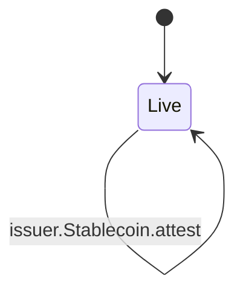
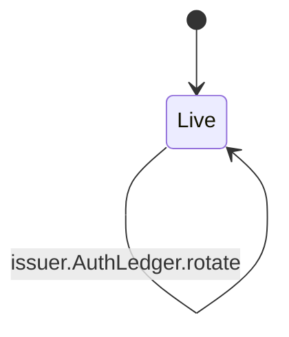
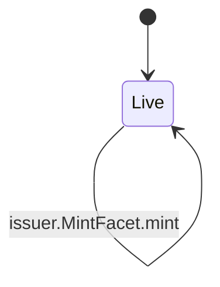
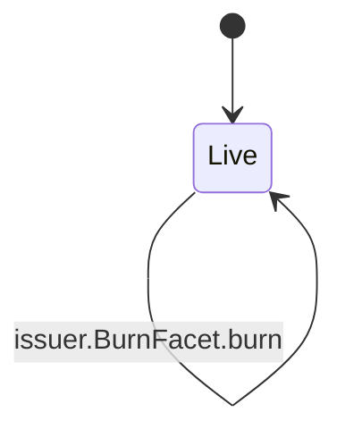
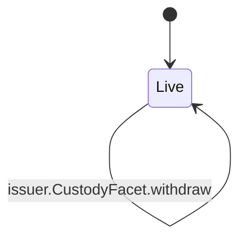
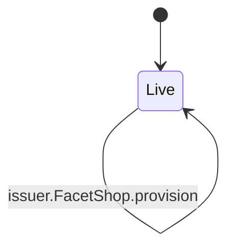
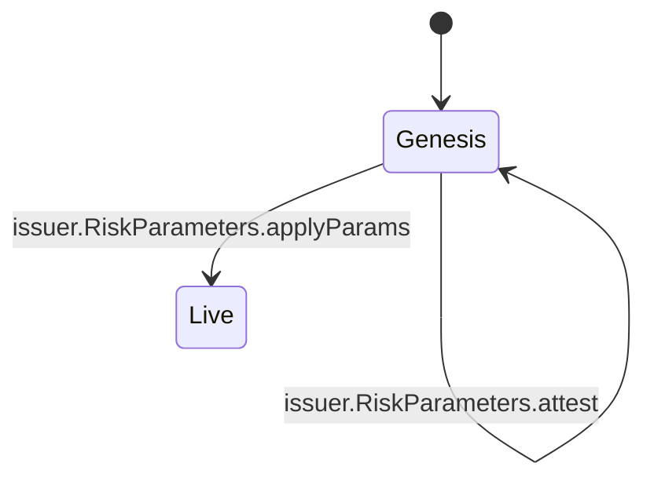

<!-- GENERATED by tools/render_flows.py from 01-issuer.yaml; do not edit -->

# Flow: issuer

Schema: `rcash.flows/v1`
Source: `contracts/src/deploy/v3/31_params.rho`, `contracts/src/deploy/v3/31_issuer.rho`

### Stablecoin

#### Stablecoin arms

| arm | transition | kind | guards | effects | access | refusals | invariants | status | source |
|---|---|---|---|---|---|---|---|---|---|
| `Stablecoin@"brand"` | `issuer.Stablecoin.brand` | read | — | — | — | — | — | blocked | contracts/src/deploy/v3/31_issuer.rho:92 |
| `Stablecoin@"issuer"` | `issuer.Stablecoin.issuer` | read | — | — | — | — | — | blocked | contracts/src/deploy/v3/31_issuer.rho:96 |
| `Stablecoin@"supply"` | `issuer.Stablecoin.supply` | read | — | — | peek issuerState (arm) | — | — | blocked | contracts/src/deploy/v3/31_issuer.rho:100 |
| `Stablecoin@"amountOf"` | `issuer.Stablecoin.amountOf` | read | — | — | — | — | — | blocked | contracts/src/deploy/v3/31_issuer.rho:104 |
| `Stablecoin@"info"` | `issuer.Stablecoin.info` | read | — | — | peek issuerState (arm) | — | — | blocked | contracts/src/deploy/v3/31_issuer.rho:108 |
| `Stablecoin@"attest"` | `issuer.Stablecoin.attest` | read | — | reply = (true, {currency, paramsHash, sponsor, kind}) | — | — | — | blocked | contracts/src/deploy/v3/31_issuer.rho:120 |

### CollateralCustody

#### CollateralCustody arms

| arm | transition | kind | guards | effects | access | refusals | invariants | status | source |
|---|---|---|---|---|---|---|---|---|---|
| `CollateralCustody@"balance"` | `issuer.CollateralCustody.balance` | read | — | reply = custody.rev | — | — | — | blocked | contracts/src/deploy/v3/31_issuer.rho:129 |
| `CollateralCustody@"attest"` | `issuer.CollateralCustody.attest` | read | — | reply = (true, {currency, paramsHash, sponsor, kind}) | — | — | — | blocked | contracts/src/deploy/v3/31_issuer.rho:133 |

### AuthLedger

#### AuthLedger arms

| arm | transition | kind | guards | effects | access | refusals | invariants | status | source |
|---|---|---|---|---|---|---|---|---|---|
| `AuthLedger@"check"` | `issuer.AuthLedger.check` | read | kind in mint, burn, settle, custody → kind | reply = (true, Nil) or (false, bad auth) | peek mintAuthState (arm) peek burnAuthState (arm) peek settlementAuthState (arm) peek custodyAuthState (arm) | bad auth (pre) kind (pre) | S8 | blocked | contracts/src/deploy/v3/31_issuer.rho:144 |
| `AuthLedger@"rotate"` | `issuer.AuthLedger.rotate` | mutate | kind in mint, burn, settle, custody → kind Governor.authorize(auth:currency:kind, nonce, rotate, kind) → kind | mintAuthState = nextAuth burnAuthState = nextAuth settlementAuthState = nextAuth custodyAuthState = nextAuth reply = (true, Nil) | consume mintAuthState (arm) post mintAuthState (arm) consume burnAuthState (arm) post burnAuthState (arm) consume settlementAuthState (arm) post settlementAuthState (arm) consume custodyAuthState (arm) post custodyAuthState (arm) | kind (pre) | S12 S13 | blocked | contracts/src/deploy/v3/31_issuer.rho:181 |

### MintFacet

#### MintFacet arms

| arm | transition | kind | guards | effects | access | refusals | invariants | status | source |
|---|---|---|---|---|---|---|---|---|---|
| `MintFacet@"mint"` | `issuer.MintFacet.mint` | mutate | auth = mintAuthState → bad auth amount > 0 → amount totalPrincipal + amount <= maxSupply → max supply | totalPrincipal = totalPrincipal + amount supply = totalPrincipal + amount reply = (true, payment, totalPrincipal + amount) | peek mintAuthState (arm) consume issuerState (helper:mintCore) post issuerState (helper:mintCore) | amount (pre) bad auth (pre) max supply (pre) | S1 S3 S5 S9 | blocked | contracts/src/deploy/v3/31_issuer.rho:455 |

### BurnFacet

#### BurnFacet arms

| arm | transition | kind | guards | effects | access | refusals | invariants | status | source |
|---|---|---|---|---|---|---|---|---|---|
| `BurnFacet@"burn"` | `issuer.BurnFacet.burn` | mutate | auth = burnAuthState → bad auth isStablecoinPayment(payment) → not a stablecoin payment 0 < amount and amount <= maxAmount → amount totalPrincipal >= amount → supply | totalPrincipal = totalPrincipal - amount supply = totalPrincipal - amount reply = (true, amount, totalPrincipal - amount) | peek burnAuthState (arm) consume issuerState (helper:burnCore) post issuerState (helper:burnCore) | amount (pre) bad auth (pre) not a stablecoin payment (pre) supply (pre) | S1 S3 S7 | blocked | contracts/src/deploy/v3/31_issuer.rho:459 |

### SettlementFacet

#### SettlementFacet arms

| arm | transition | kind | guards | effects | access | refusals | invariants | status | source |
|---|---|---|---|---|---|---|---|---|---|
| `SettlementFacet@"settle"` | `issuer.SettlementFacet.settle` | mutate | auth = settlementAuthState → bad auth principal >= 0 and interest >= 0 → amount total = principal + interest → amount isStablecoinPayment(payment) → asset | totalPrincipal = totalPrincipal - principal supply = totalPrincipal - principal reply = (true, principal, interest, interestPay) | peek settlementAuthState (arm) peek burnAuthState (helper:settleCore) consume issuerState (helper:settleCore) post issuerState (helper:settleCore) | amount (pre) asset (pre) bad auth (pre) not a stablecoin payment (pre) supply (pre) | S1 S3 S7 S9 | blocked | contracts/src/deploy/v3/31_issuer.rho:465 |

### CustodyFacet

#### CustodyFacet arms

| arm | transition | kind | guards | effects | access | refusals | invariants | status | source |
|---|---|---|---|---|---|---|---|---|---|
| `CustodyFacet@"deposit"` | `issuer.CustodyFacet.deposit` | read | auth = custodyAuthState → bad auth isRevPayment(payment) → not a REV payment | reply = (true, amount) | peek custodyAuthState (arm) | bad auth (pre) not a REV payment (pre) | S7 | blocked | contracts/src/deploy/v3/31_issuer.rho:471 |
| `CustodyFacet@"withdraw"` | `issuer.CustodyFacet.withdraw` | read | auth = custodyAuthState → bad auth amount > 0 → amount | reply = (true, payment) | peek custodyAuthState (arm) | amount (pre) bad auth (pre) | S7 | blocked | contracts/src/deploy/v3/31_issuer.rho:477 |

### FacetShop

#### FacetShop arms

| arm | transition | kind | guards | effects | access | refusals | invariants | status | source |
|---|---|---|---|---|---|---|---|---|---|
| `FacetShop@"isFacet"` | `issuer.FacetShop.isFacet` | read | kind in mint, burn, settle, custody → kind | reply = (true, registered) | — | kind (pre) | — | blocked | contracts/src/deploy/v3/31_issuer.rho:483 |
| `FacetShop@"provision"` | `issuer.FacetShop.provision` | mutate | sponsorHex = shopCfg.sponsor → sponsor Verifier.sigOk(Codec.hash(rcash:provision:v1, values)) → bad sponsor signature kindsValid(kinds) → kind now <= deadline → expired shopState.nonces.get(nonce) = Nil → replay | shopState.nonces = nonces.set(nonce, true) shopState.rev = rev + 1 reply = (true, provisioned) | consume shopState (arm) post shopState (arm) | bad sponsor signature (pre) expired (pre) kind (pre) replay (pre, repost) sponsor (pre) | S8 S9 S12 | blocked | contracts/src/deploy/v3/31_issuer.rho:587 |

### RiskParameters

#### RiskParameters arms

| arm | transition | kind | guards | effects | access | refusals | invariants | status | source |
|---|---|---|---|---|---|---|---|---|---|
| `RiskParameters@"params"` | `issuer.RiskParameters.params` | read | — | reply = (true, params) | peek paramsState (arm) | — | — | blocked | contracts/src/deploy/v3/31_params.rho:56 |
| `RiskParameters@"info"` | `issuer.RiskParameters.info` | read | — | reply = (true, {params, paramsHash, currentHash, genesis, rev}) | peek paramsState (arm) | — | — | blocked | contracts/src/deploy/v3/31_params.rho:60 |
| `RiskParameters@"scheduleParams"` | `issuer.RiskParameters.scheduleParams` | create | Bounds.checkIssuer(newParams) → params hash argsHash = H(rcash:stablecoin-params:v2, values) → params hash | governor.pending = pending[stablecoin:currency, nonce] = {action: setRiskParams, argsHash, args: newParams} | — | — | S12 | blocked | contracts/src/deploy/v3/31_params.rho:68 |
| `RiskParameters@"applyParams"` | `issuer.RiskParameters.applyParams` | mutate | action = setRiskParams → action argsHash = H(rcash:stablecoin-params:v2, values) → params hash Bounds.checkIssuer(args) → params hash | paramsState.params = args paramsState.hash = H(rcash:stablecoin-params:v2, values(args)) paramsState.rev = rev + 1 reply = (true, {params: args, currentHash: hash}) | consume paramsState (arm) post paramsState (arm) | action (pre) params hash (pre) | S12 | blocked | contracts/src/deploy/v3/31_params.rho:104 |
| `RiskParameters@"attest"` | `issuer.RiskParameters.attest` | read | — | reply = (true, {currency, paramsHash, sponsor, kind:params}) | — | — | — | blocked | contracts/src/deploy/v3/31_params.rho:156 |
