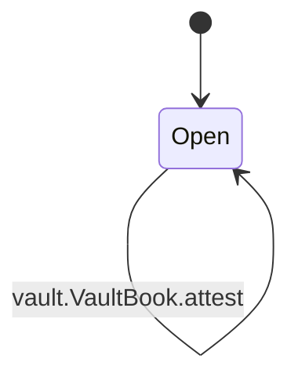
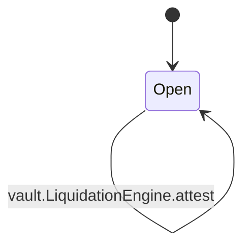
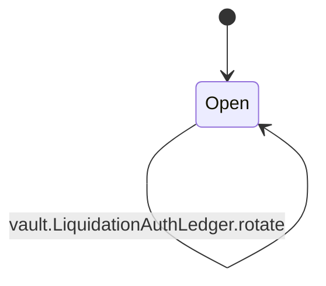
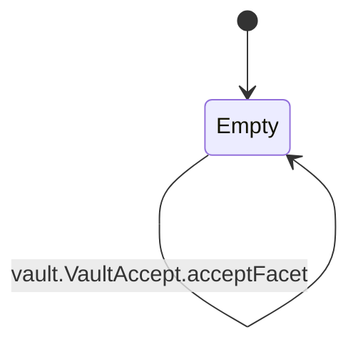

<!-- GENERATED by tools/render_flows.py from 02-vault.yaml; do not edit -->

# Flow: vault

Schema: `rcash.flows/v1`
Source: `contracts/src/deploy/v3/31_vault.rho`

### VaultBook

#### VaultBook arms

| arm | transition | kind | guards | effects | access | refusals | invariants | status | source |
|---|---|---|---|---|---|---|---|---|---|
| `VaultBook@"rotate"` | `vault.VaultBook.rotate` | mutate | vault exists → no vault vaults[ownerId].auth = auth → bad vault auth | vaults[ownerId].auth = newAuth | consume vaultState (arm) post vaultState (arm) | no vault (pre) bad vault auth (pre) | I21 | verified | contracts/src/deploy/v3/31_vault.rho:476 |
| `VaultBook@"open"` | `vault.VaultBook.open` | mutate | AccountFactory.verify(ownerId, proof) → verify failed | vaults[ownerId] = {auth: fresh, collateral: 0, debt: 0, lastHeight: now} reply = (true, auth) | peek vaultState (arm) consume vaultState (arm) post vaultState (arm) | not owner (pre) verify failed (pre) | — | verified | contracts/src/deploy/v3/31_vault.rho:494 |
| `VaultBook@"deposit"` | `vault.VaultBook.deposit` | mutate | provisionedState.custody = true → no slot vaults[ownerId] != Nil → no vault vaults[ownerId].auth = auth → bad vault auth | vaults[ownerId].collateral = c + amount vaults[ownerId].debt = accrue(d, lastHeight, now, ratePerBlock) vaults[ownerId].lastHeight = now totalCollateral = totalCollateral + amount totalDebt = totalDebt + (accrued - d) totalAccruedInterest = totalAccruedInterest + (accrued - d) vaults.rev = rev + 1 | peek provisionedState (arm) peek vaultState (arm) consume vaultState (helper:vaultCommit) post vaultState (helper:vaultCommit) | bad vault auth (pre) no slot (pre) no vault (pre) | S2 S3 S4 | verified | contracts/src/deploy/v3/31_vault.rho:546 |
| `VaultBook@"mint"` | `vault.VaultBook.mint` | mutate | amount > 0 → amount provisionedState.mint = true → no slot not paused → paused vaults[ownerId] != Nil → no vault vaults[ownerId].auth = auth → bad vault auth fresh → stale feed rate > 0 → no rate accrued + amount >= minDebt → min debt accrued + amount <= maxDebt → max debt totalDebt + (accrued - d) + amount <= debtCeiling → ceiling health(c, accrued + amount, rate, mcrBps) → below MCR not (sin > surplus) → recapitalise | vaults[ownerId].debt = accrued + amount vaults[ownerId].lastHeight = now totalDebt = totalDebt + (accrued - d) + amount totalAccruedInterest = totalAccruedInterest + (accrued - d) supply = totalPrincipal + amount vaults.rev = rev + 1 | peek provisionedState (arm) peek vaultState (arm) consume vaultState (helper:vaultMintCommit) post vaultState (helper:vaultMintCommit) | amount (pre) bad vault auth (pre) below MCR (pre) ceiling (pre) max debt (pre) min debt (pre) no rate (pre) no slot (pre) no vault (pre) paused (pre) recapitalise (pre) stale feed (pre) | S1 S2 S3 S4 S9 | verified | contracts/src/deploy/v3/31_vault.rho:612 |
| `VaultBook@"withdraw"` | `vault.VaultBook.withdraw` | mutate | amount > 0 → amount provisionedState.custody = true → no slot vaults[ownerId] != Nil → no vault not paused → paused vaults[ownerId].auth = auth → bad vault auth c >= amount → amount fresh → stale feed rate > 0 → no rate health(c - amount, accrued, rate, mcrBps) → below MCR | vaults[ownerId].collateral = c - amount vaults[ownerId].debt = accrued vaults[ownerId].lastHeight = now totalCollateral = totalCollateral - amount totalDebt = totalDebt + (accrued - d) totalAccruedInterest = totalAccruedInterest + (accrued - d) custody.rev = custody.rev - amount vaults.rev = rev + 1 | peek provisionedState (arm) peek vaultState (arm) consume vaultState (helper:vaultCommit) post vaultState (helper:vaultCommit) | amount (pre) bad vault auth (pre) below MCR (pre) no rate (pre) no slot (pre) no vault (pre) paused (pre) stale feed (pre) | S2 S3 S4 S7 | verified | contracts/src/deploy/v3/31_vault.rho:691 |
| `VaultBook@"repay"` | `vault.VaultBook.repay` | mutate | provisionedState.settle = true and provisionedState.buffer = true → no slot vaults[ownerId] != Nil → no vault vaults[ownerId].auth = auth → bad vault auth amount > 0 → amount amount <= accrued → amount accrued - amount = 0 or accrued - amount >= minDebt → min debt Stablecoin.amountOf(payment) → asset | interestPaid = min(amount, accrued - d) principalPaid = amount - interestPaid cancelled = min(surplus, sin) move = floor((surplus - cancelled) * savingsShareBps / 10000) vaults[ownerId].debt = accrued - amount vaults[ownerId].lastHeight = now totalDebt = totalDebt + (accrued - d) - amount totalAccruedInterest = totalAccruedInterest + (accrued - d) - interestPaid supply = supply - principalPaid - cancelled sin = sin - cancelled surplus = surplus - cancelled - move vaults.rev = rev + 1 | peek provisionedState (arm) peek vaultState (arm) consume vaultState (helper:repayCommit) post vaultState (helper:repayCommit) | amount (pre) asset (pre) bad vault auth (pre) min debt (pre) no slot (pre) no vault (pre) | S3 S7 S9 S10 | verified | contracts/src/deploy/v3/31_vault.rho:784 |
| `VaultBook@"liquidate"` | `vault.VaultBook.liquidate` | mutate | auth = liquidationAuthState → bad liquidation authority Stablecoin.amountOf(payment) → not a stablecoin payment amount > 0 → amount provisionedState.burn = true and provisionedState.custody = true and provisionedState.buffer = true → no slot vaults[ownerId] != Nil → no vault fresh → stale feed rate > 0 → no rate not health(c, accrued, rate, mcrBps) → healthy amount <= ceil(accrued * closeFactorBps / 10000) → close factor payout(amount, bonusBps, rate) <= c or amount * 1e8 >= c * rate → underwater repayment seized >= minCollateral → slippage | supply = supply - amount custody.rev = custody.rev - seized vaults[ownerId].collateral = c - seized vaults[ownerId].debt = 0 if writeOff else accrued - amount vaults[ownerId].lastHeight = now totalCollateral = totalCollateral - seized totalDebt = totalDebt + (accrued - d) - amount totalAccruedInterest = totalAccruedInterest + (accrued - d) badDebt = badDebt + (accrued - amount if writeOff else 0) sin = sin + (accrued - amount if writeOff else 0) - cancelled surplus = surplus - cancelled vaults.rev = rev + 1 | peek liquidationAuthState (arm) peek provisionedState (arm) peek vaultState (arm) consume vaultState (helper:vaultLiquidateDecide) post vaultState (helper:vaultLiquidateDecide) | amount (pre) bad liquidation authority (pre) close factor (pre) healthy (pre) no rate (pre) no slot (pre) no vault (pre) not a stablecoin payment (pre) slippage (pre) stale feed (pre) underwater repayment (pre) | S3 S5 S6 S7 S9 | verified | contracts/src/deploy/v3/31_vault.rho:861 |
| `VaultBook@"vault"` | `vault.VaultBook.vault` | read | vaults[ownerId] != Nil → no vault | reply = (true, {collateral, debt: accrued, health, fresh, rate}) | peek vaultState (arm) | no vault (pre) | S2 | verified | contracts/src/deploy/v3/31_vault.rho:933 |
| `VaultBook@"vaults"` | `vault.VaultBook.vaults` | read | — | reply = (true, keys(vaults)) | peek vaultState (arm) | — | — | verified | contracts/src/deploy/v3/31_vault.rho:981 |
| `VaultBook@"totals"` | `vault.VaultBook.totals` | read | — | reply = (true, {totalDebt, totalAccruedInterest, totalCollateral, badDebt, sin, psmDebt, paused, rev}) | peek vaultState (arm) | — | S3 | verified | contracts/src/deploy/v3/31_vault.rho:985 |
| `VaultBook@"params"` | `vault.VaultBook.params` | read | — | reply = (true, params) | — | — | — | verified | contracts/src/deploy/v3/31_vault.rho:1014 |
| `VaultBook@"pause"` | `vault.VaultBook.pause` | mutate | Governor.authorize(setPaused, paused.toString()) → authorize | vaultState.paused = paused vaultState.pausedRev = pausedRev + 1 vaultState.rev = rev + 1 | peek vaultState (arm) consume vaultState (arm) post vaultState (arm) | — | S12 | verified | contracts/src/deploy/v3/31_vault.rho:1018 |
| `VaultBook@"attest"` | `vault.VaultBook.attest` | read | — | reply = (true, {currency, paramsHash, sponsor, kind, template}) | — | — | — | verified | contracts/src/deploy/v3/31_vault.rho:1050 |

### LiquidationEngine

#### LiquidationEngine arms

| arm | transition | kind | guards | effects | access | refusals | invariants | status | source |
|---|---|---|---|---|---|---|---|---|---|
| `LiquidationEngine@"liquidate"` | `vault.LiquidationEngine.liquidate` | mutate | — | delegate = VaultBook.liquidate(ownerId, liquidationAuthState, payment, minCollateral) | peek liquidationAuthState (arm) | — | S5 S7 | verified | contracts/src/deploy/v3/31_vault.rho:1062 |
| `LiquidationEngine@"attest"` | `vault.LiquidationEngine.attest` | read | — | reply = (true, {currency, paramsHash, sponsor, kind, template}) | — | — | — | verified | contracts/src/deploy/v3/31_vault.rho:1068 |

### LiquidationAuthLedger

#### LiquidationAuthLedger arms

| arm | transition | kind | guards | effects | access | refusals | invariants | status | source |
|---|---|---|---|---|---|---|---|---|---|
| `LiquidationAuthLedger@"rotate"` | `vault.LiquidationAuthLedger.rotate` | mutate | Governor.authorize(auth:currency:liquidation, nonce, rotateLiquidationAuth) → replay | liquidationAuthState = fresh reply = (true, Nil) | consume liquidationAuthState (arm) post liquidationAuthState (arm) | — | I21 | verified | contracts/src/deploy/v3/31_vault.rho:1082 |

### VaultAccept

#### VaultAccept arms

| arm | transition | kind | guards | effects | access | refusals | invariants | status | source |
|---|---|---|---|---|---|---|---|---|---|
| `VaultAccept@"acceptFacet"` | `vault.VaultAccept.acceptFacet` | mutate | Shop.isFacet(kind, facet) → verify failed provisionedState[kind] != true → no slot | provisionedState[kind] = True slots[kind] = facet reply = (true, provisioned) | peek provisionedState (helper:vaultInstallSlot) consume provisionedState (helper:vaultInstallSlot) post provisionedState (helper:vaultInstallSlot) | no slot (pre) no slot (after_consume, repost) unknown (pre) verify failed (pre) | — | verified | contracts/src/deploy/v3/31_vault.rho:1110 |
