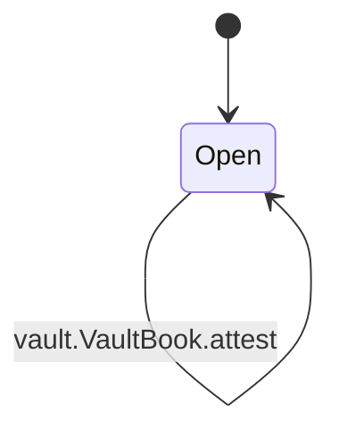
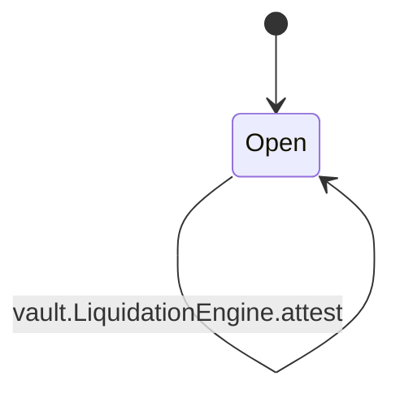

<!-- GENERATED by tools/render_flows.py from 02-vault.yaml; do not edit -->

# Flow: vault

Schema: `rcash.flows/v1`
Source: `contracts/src/deploy/v3/31_stablecoin.rho`

### VaultBook

#### VaultBook arms

| arm | transition | kind | guards | effects | access | refusals | invariants | status | source |
|---|---|---|---|---|---|---|---|---|---|
| `VaultBook@"open"` | `vault.VaultBook.open` | mutate | AccountFactory.verify(ownerId, proof) → verify failed | vaults[ownerId] = {auth: fresh, collateral: 0, debt: 0, lastHeight: now} reply = (true, auth) | peek vaultState (arm) consume vaultState (arm) post vaultState (arm) | not owner (pre) verify failed (pre) | — | verified | contracts/src/deploy/v3/31_stablecoin.rho:932 |
| `VaultBook@"deposit"` | `vault.VaultBook.deposit` | mutate | vaults[ownerId] != Nil → no vault vaults[ownerId].auth = auth → bad vault auth CollateralCustody.deposit ok → custody | vaults[ownerId].collateral = c + amount vaults[ownerId].debt = accrue(d, lastHeight, now, ratePerBlock) vaults[ownerId].lastHeight = now totalCollateral = totalCollateral + amount totalDebt = totalDebt + (accrued - d) totalAccruedInterest = totalAccruedInterest + (accrued - d) vaults.rev = rev + 1 | peek paramsState (arm) peek vaultState (arm) consume vaultState (arm) post vaultState (arm) | bad vault auth (pre) custody (pre) no vault (pre) | S2 S3 S4 | verified | contracts/src/deploy/v3/31_stablecoin.rho:981 |
| `VaultBook@"mint"` | `vault.VaultBook.mint` | mutate | amount > 0 → amount vaults[ownerId] != Nil → no vault vaults[ownerId].auth = auth → bad vault auth not paused → paused fresh → stale feed rate > 0 → no rate accrued + amount >= minDebt → min debt accrued + amount <= maxDebt → max debt totalDebt + (accrued - d) + amount <= debtCeiling → ceiling health(c, accrued + amount, rate, mcrBps) → below MCR not (sin > surplus) → recapitalise | vaults[ownerId].debt = accrued + amount vaults[ownerId].lastHeight = now totalDebt = totalDebt + (accrued - d) + amount totalAccruedInterest = totalAccruedInterest + (accrued - d) supply = totalPrincipal + amount vaults.rev = rev + 1 | peek bufferState (helper:vaultMintCommit) peek paramsState (arm) peek vaultState (arm) consume vaultState (helper:vaultMintCommit) post vaultState (helper:vaultMintCommit) | amount (pre) bad vault auth (pre) below MCR (pre) ceiling (pre) max debt (pre) min debt (pre) no rate (pre) no vault (pre) paused (pre) recapitalise (after_consume, repost) stale feed (pre) | S1 S2 S3 S4 S9 | verified | contracts/src/deploy/v3/31_stablecoin.rho:1043 |
| `VaultBook@"withdraw"` | `vault.VaultBook.withdraw` | mutate | amount > 0 → amount vaults[ownerId] != Nil → no vault not paused → paused vaults[ownerId].auth = auth → bad vault auth c >= amount → amount fresh → stale feed rate > 0 → no rate health(c - amount, accrued, rate, mcrBps) → below MCR | vaults[ownerId].collateral = c - amount vaults[ownerId].debt = accrued vaults[ownerId].lastHeight = now totalCollateral = totalCollateral - amount totalDebt = totalDebt + (accrued - d) totalAccruedInterest = totalAccruedInterest + (accrued - d) custody.rev = custody.rev - amount vaults.rev = rev + 1 | peek paramsState (arm) peek vaultState (arm) consume vaultState (arm) post vaultState (arm) | amount (pre) bad vault auth (pre) below MCR (pre) no rate (pre) no vault (pre) paused (pre) stale feed (pre) | S2 S3 S4 S7 | verified | contracts/src/deploy/v3/31_stablecoin.rho:1107 |
| `VaultBook@"repay"` | `vault.VaultBook.repay` | mutate | vaults[ownerId] != Nil → no vault vaults[ownerId].auth = auth → bad vault auth amount > 0 → amount amount <= accrued → amount accrued - amount = 0 or accrued - amount >= minDebt → min debt isStablecoinPayment(payment) → asset | interestPaid = min(amount, accrued - d) principalPaid = amount - interestPaid cancelled = min(surplus, sin) move = floor((surplus - cancelled) * savingsShareBps / 10000) vaults[ownerId].debt = accrued - amount vaults[ownerId].lastHeight = now totalDebt = totalDebt + (accrued - d) - amount totalAccruedInterest = totalAccruedInterest + (accrued - d) - interestPaid supply = supply - principalPaid - cancelled sin = sin - cancelled surplus = surplus - cancelled - move savings.totalAssets = totalAssets + move vaults.rev = rev + 1 | peek paramsState (arm) peek vaultState (arm) consume vaultState (helper:repayCommit) post vaultState (helper:repayCommit) | amount (pre) asset (pre) bad vault auth (pre) min debt (pre) no vault (pre) | S3 S7 S9 S10 | verified | contracts/src/deploy/v3/31_stablecoin.rho:1191 |
| `VaultBook@"liquidate"` | `vault.VaultBook.liquidate` | mutate | auth = liquidationAuth → bad liquidation authority isStablecoinPayment(payment) → not a stablecoin payment amount > 0 → amount vaults[ownerId] != Nil → no vault fresh → stale feed rate > 0 → no rate not health(c, accrued, rate, mcrBps) → healthy amount <= ceil(accrued * closeFactorBps / 10000) → close factor payout(amount, bonusBps, rate) <= c or amount * 1e8 >= c * rate → underwater repayment seized >= minCollateral → slippage | supply = supply - amount custody.rev = custody.rev - seized vaults[ownerId].collateral = c - seized vaults[ownerId].debt = 0 if writeOff else accrued - amount vaults[ownerId].lastHeight = now totalCollateral = totalCollateral - seized totalDebt = totalDebt + (accrued - d) - amount totalAccruedInterest = totalAccruedInterest + (accrued - d) badDebt = badDebt + (accrued - amount if writeOff else 0) sin = sin + (accrued - amount if writeOff else 0) - cancelled surplus = surplus - cancelled vaults.rev = rev + 1 | peek paramsState (arm) peek vaultState (arm) peek vaultState (helper:vaultLiquidateCommit) consume vaultState (helper:vaultLiquidateCommit) post vaultState (helper:vaultLiquidateCommit) | amount (pre) bad liquidation authority (pre) close factor (pre) healthy (pre) no rate (pre) no vault (pre) not a stablecoin payment (pre) slippage (pre) stale feed (pre) underwater repayment (pre) | S3 S5 S6 S7 S9 | verified | contracts/src/deploy/v3/31_stablecoin.rho:1253 |
| `VaultBook@"vault"` | `vault.VaultBook.vault` | read | vaults[ownerId] != Nil → no vault | reply = (true, {collateral, debt: accrued, health, fresh, rate}) | peek paramsState (arm) peek vaultState (arm) | no vault (pre) | S2 | verified | contracts/src/deploy/v3/31_stablecoin.rho:1345 |
| `VaultBook@"vaults"` | `vault.VaultBook.vaults` | read | — | reply = (true, keys(vaults)) | peek vaultState (arm) | — | — | verified | contracts/src/deploy/v3/31_stablecoin.rho:1387 |
| `VaultBook@"totals"` | `vault.VaultBook.totals` | read | — | reply = (true, {totalDebt, totalAccruedInterest, totalCollateral, badDebt, sin, psmDebt, paused, rev}) | peek bufferState (arm) peek psmState (arm) peek vaultState (arm) | — | S3 | verified | contracts/src/deploy/v3/31_stablecoin.rho:1391 |
| `VaultBook@"params"` | `vault.VaultBook.params` | read | — | reply = (true, params) | peek paramsState (arm) | — | — | verified | contracts/src/deploy/v3/31_stablecoin.rho:1406 |
| `VaultBook@"pause"` | `vault.VaultBook.pause` | mutate | Governor.authorize(setPaused, paused.toString()) → authorize | vaultState.paused = paused vaultState.rev = rev + 1 | peek vaultState (arm) consume vaultState (arm) post vaultState (arm) | — | S12 | verified | contracts/src/deploy/v3/31_stablecoin.rho:1410 |
| `VaultBook@"attest"` | `vault.VaultBook.attest` | read | — | reply = (true, {currency, paramsHash, sponsor, template}) | — | — | — | verified | contracts/src/deploy/v3/31_stablecoin.rho:1433 |

### LiquidationEngine

#### LiquidationEngine arms

| arm | transition | kind | guards | effects | access | refusals | invariants | status | source |
|---|---|---|---|---|---|---|---|---|---|
| `LiquidationEngine@"liquidate"` | `vault.LiquidationEngine.liquidate` | mutate | — | delegate = VaultBook.liquidate(ownerId, liquidationAuth, payment, minCollateral) | — | — | S5 S7 | verified | contracts/src/deploy/v3/31_stablecoin.rho:1444 |
| `LiquidationEngine@"attest"` | `vault.LiquidationEngine.attest` | read | — | reply = (true, {currency, template}) | — | — | — | verified | contracts/src/deploy/v3/31_stablecoin.rho:1448 |
