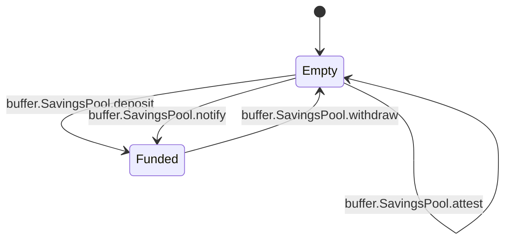
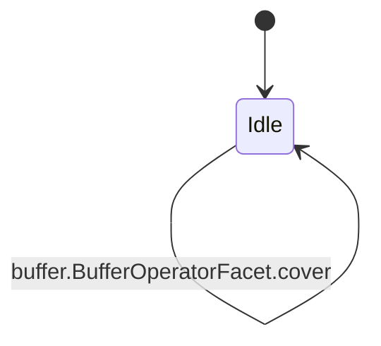
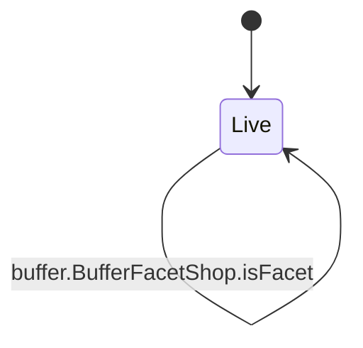

<!-- GENERATED by tools/render_flows.py from 03-buffer-savings.yaml; do not edit -->

# Flow: buffer

Schema: `rcash.flows/v1`
Source: `contracts/src/deploy/v3/31_buffer_savings.rho`

### SavingsPool

#### SavingsPool arms

| arm | transition | kind | guards | effects | access | refusals | invariants | status | source |
|---|---|---|---|---|---|---|---|---|---|
| `SavingsPool@"deposit"` | `buffer.SavingsPool.deposit` | mutate | amount > 0 → amount isStablecoinPayment(payment) → asset shares = (amount if totalShares = 0 else floor(amount * totalShares / totalAssets)) > 0 → shares | shares[ownerId] = held + shares totalShares = totalShares + shares totalAssets = totalAssets + amount | consume savingsState (arm) post savingsState (arm) | amount (pre) asset (pre) shares (pre) | S10 | verified | contracts/src/deploy/v3/31_buffer_savings.rho:82 |
| `SavingsPool@"withdraw"` | `buffer.SavingsPool.withdraw` | mutate | shares[ownerId] = held → shares 0 < shares <= held and totalShares > 0 and totalAssets > 0 → shares savingsPurse.withdraw ok → payment | amount = floor(totalAssets * shares / totalShares) shares[ownerId] = held - shares totalShares = totalShares - shares totalAssets = totalAssets - amount | consume savingsState (arm) post savingsState (arm) | payment (pre) shares (pre) | S10 | verified | contracts/src/deploy/v3/31_buffer_savings.rho:135 |
| `SavingsPool@"notify"` | `buffer.SavingsPool.notify` | mutate | auth = savingsNotifyAuth → bad savings authority isStablecoinPayment(payment) → asset | totalAssets = totalAssets + amount rev = rev + 1 | consume savingsState (arm) post savingsState (arm) | asset (pre) bad savings authority (pre) no shares (pre, repost) | S10 | verified | contracts/src/deploy/v3/31_buffer_savings.rho:171 |
| `SavingsPool@"info"` | `buffer.SavingsPool.info` | read | — | reply = (true, {totalShares, totalAssets, shareValueE8: floor(totalAssets * 1e8 / totalShares), rev}) | peek savingsState (arm) | — | S10 | verified | contracts/src/deploy/v3/31_buffer_savings.rho:211 |
| `SavingsPool@"position"` | `buffer.SavingsPool.position` | read | — | reply = (true, shares[ownerId]) | peek savingsState (arm) | — | S10 | verified | contracts/src/deploy/v3/31_buffer_savings.rho:228 |
| `SavingsPool@"attest"` | `buffer.SavingsPool.attest` | read | — | reply = (true, {currency, paramsHash, sponsor, kind: "savings"}) | — | — | — | verified | contracts/src/deploy/v3/31_buffer_savings.rho:237 |

### SurplusBuffer

#### SurplusBuffer arms

| arm | transition | kind | guards | effects | access | refusals | invariants | status | source |
|---|---|---|---|---|---|---|---|---|---|
| `SurplusBuffer@"acceptFacet"` | `buffer.SurplusBuffer.acceptFacet` | mutate | kind = "burn" → action not bufferFacetState.burn → duplicate | bufferFacetState.burn = true burnSlot = facet | consume bufferFacetState (arm) post bufferFacetState (arm) | action (pre) duplicate (pre, repost) verify failed (pre) | — | verified | contracts/src/deploy/v3/31_buffer_savings.rho:248 |
| `SurplusBuffer@"info"` | `buffer.SurplusBuffer.info` | read | — | reply = (true, {surplus, sin, savingsShareBps, rev}) | peek bufferState (arm) | — | S3 | verified | contracts/src/deploy/v3/31_buffer_savings.rho:274 |
| `SurplusBuffer@"scheduleShare"` | `buffer.SurplusBuffer.scheduleShare` | create | 0 <= bps <= 10000 → bps | governor.pending = pending[stablecoin:currency, nonce] = {action: setSavingsShare, argsHash: bps.toString()} | — | bps (pre) | S12 | verified | contracts/src/deploy/v3/31_buffer_savings.rho:282 |
| `SurplusBuffer@"applyShare"` | `buffer.SurplusBuffer.applyShare` | mutate | action = "setSavingsShare" → action 0 <= args <= 10000 → bps argsHash = args.toString() → params hash | savingsShareBps = args rev = rev + 1 | consume bufferState (arm) post bufferState (arm) | action (pre) bps (pre) params hash (pre) | S12 | verified | contracts/src/deploy/v3/31_buffer_savings.rho:301 |
| `SurplusBuffer@"attest"` | `buffer.SurplusBuffer.attest` | read | — | reply = (true, {currency, paramsHash, sponsor, kind: "buffer"}) | — | — | — | verified | contracts/src/deploy/v3/31_buffer_savings.rho:333 |

### BufferOperatorFacet

#### BufferOperatorFacet arms

| arm | transition | kind | guards | effects | access | refusals | invariants | status | source |
|---|---|---|---|---|---|---|---|---|---|
| `BufferOperatorFacet@"deposit"` | `buffer.BufferOperatorFacet.deposit` | mutate | isStablecoinPayment(payment) → asset | surplus = surplus + amount rev = rev + 1 | consume bufferState (arm) post bufferState (arm) | asset (pre) | S3 S9 | verified | contracts/src/deploy/v3/31_buffer_savings.rho:344 |
| `BufferOperatorFacet@"paySavings"` | `buffer.BufferOperatorFacet.paySavings` | mutate | bufferPayAuthCell → payment bufferPurse.withdraw ok → payment | move = floor(surplus * savingsShareBps / 10000) surplus = surplus - (move if move > 0 and savings.totalShares > 0 else 0) savings.totalAssets = totalAssets + (move if move > 0 and savings.totalShares > 0 else 0) rev = rev + 1 | peek bufferState (arm) consume bufferState (arm) post bufferState (arm) | no shares (pre) payment (pre) | S9 S10 | verified | contracts/src/deploy/v3/31_buffer_savings.rho:373 |
| `BufferOperatorFacet@"cover"` | `buffer.BufferOperatorFacet.cover` | mutate | badDebt >= 0 → amount bufferPurse.withdraw ok → payment | newSin = sin + badDebt cancelled = min(surplus, newSin) sin = newSin - cancelled surplus = surplus - cancelled supply = supply - cancelled rev = rev + 1 | peek bufferState (arm) consume bufferState (arm) post bufferState (arm) | amount (pre) payment (pre) | S3 S6 S9 | verified | contracts/src/deploy/v3/31_buffer_savings.rho:425 |

### BufferAuthLedger

#### BufferAuthLedger arms

| arm | transition | kind | guards | effects | access | refusals | invariants | status | source |
|---|---|---|---|---|---|---|---|---|---|
| `BufferAuthLedger@"rotate"` | `buffer.BufferAuthLedger.rotate` | create | Governor.authorize ok → replay kind = "bufferDeposit" or kind = "bufferPay" or kind = "bufferCover" or kind = "savingsNotify" → action | auth = fresh new-bound auth | — | action (pre) | — | verified | contracts/src/deploy/v3/31_buffer_savings.rho:492 |

### BufferFacetShop

#### BufferFacetShop arms

| arm | transition | kind | guards | effects | access | refusals | invariants | status | source |
|---|---|---|---|---|---|---|---|---|---|
| `BufferFacetShop@"provision"` | `buffer.BufferFacetShop.provision` | mutate | sponsorHex = sponsorPublic → bad sponsor kinds = "buffer" → action sigOk over canonical payload → bad sponsor signature deadline >= block height → expired nonce unused → replay | nonces[nonce] = consumed facet = BufferOperatorFacet | consume bufferShopUriState (arm) post bufferShopUriState (arm) consume bufferNonceState (arm) post bufferNonceState (arm) | action (pre) bad sponsor (pre) bad sponsor signature (pre) expired (pre) replay (pre, repost) | — | verified | contracts/src/deploy/v3/31_buffer_savings.rho:546 |
| `BufferFacetShop@"isFacet"` | `buffer.BufferFacetShop.isFacet` | read | — | reply = true or false | — | — | — | verified | contracts/src/deploy/v3/31_buffer_savings.rho:609 |
