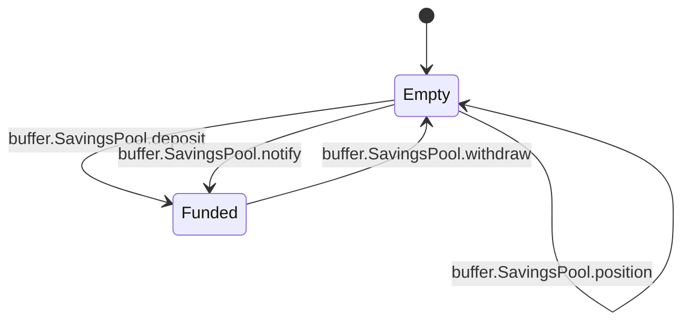
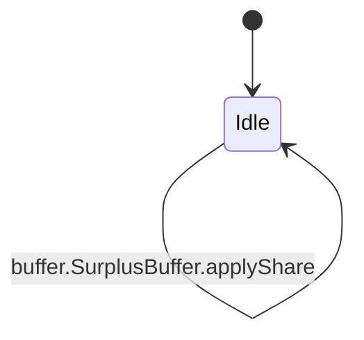

<!-- GENERATED by tools/render_flows.py from 03-buffer-savings.yaml; do not edit -->

# Flow: buffer

Schema: `rcash.flows/v1`
Source: `contracts/src/deploy/v3/31_stablecoin.rho`

### SavingsPool

#### SavingsPool arms

| arm | transition | kind | guards | effects | access | refusals | invariants | status | source |
|---|---|---|---|---|---|---|---|---|---|
| `SavingsPool@"deposit"` | `buffer.SavingsPool.deposit` | mutate | amount > 0 → amount isStablecoinPayment(payment) → asset shares = (amount if totalShares = 0 else floor(amount * totalShares / totalAssets)) > 0 → shares savingsPurse.deposit ok → deposit | shares[ownerId] = held + shares totalShares = totalShares + shares totalAssets = totalAssets + amount | consume savingsState (arm) post savingsState (arm) | amount (pre) asset (pre) deposit (pre) shares (pre) | S10 | verified | contracts/src/deploy/v3/31_stablecoin.rho:1469 |
| `SavingsPool@"withdraw"` | `buffer.SavingsPool.withdraw` | mutate | shares[ownerId] = held → shares 0 < shares <= held and totalShares > 0 and totalAssets > 0 → shares savingsPurse.withdraw ok → payment | amount = floor(totalAssets * shares / totalShares) shares[ownerId] = held - shares totalShares = totalShares - shares totalAssets = totalAssets - amount | consume savingsState (arm) post savingsState (arm) | payment (pre) shares (pre) | S10 | verified | contracts/src/deploy/v3/31_stablecoin.rho:1521 |
| `SavingsPool@"notify"` | `buffer.SavingsPool.notify` | mutate | auth = savingsNotifyAuth → bad savings authority isStablecoinPayment(payment) → asset savingsPurse.deposit ok → deposit | totalAssets = totalAssets + amount rev = rev + 1 | consume savingsState (arm) post savingsState (arm) | asset (pre) bad savings authority (pre) deposit (pre) | S10 | verified | contracts/src/deploy/v3/31_stablecoin.rho:1556 |
| `SavingsPool@"info"` | `buffer.SavingsPool.info` | read | — | reply = (true, {totalShares, totalAssets, shareValueE8: floor(totalAssets * 1e8 / totalShares), rev}) | peek savingsState (arm) | — | S10 | verified | contracts/src/deploy/v3/31_stablecoin.rho:1584 |
| `SavingsPool@"position"` | `buffer.SavingsPool.position` | read | — | reply = (true, shares[ownerId]) | peek savingsState (arm) | — | S10 | verified | contracts/src/deploy/v3/31_stablecoin.rho:1601 |

### SurplusBuffer

#### SurplusBuffer arms

| arm | transition | kind | guards | effects | access | refusals | invariants | status | source |
|---|---|---|---|---|---|---|---|---|---|
| `SurplusBuffer@"deposit"` | `buffer.SurplusBuffer.deposit` | mutate | auth = bufferDepositAuth → bad buffer authority isStablecoinPayment(payment) → asset bufferPurse.deposit ok → deposit | surplus = surplus + amount rev = rev + 1 | consume bufferState (arm) post bufferState (arm) | asset (pre) bad buffer authority (pre) deposit (pre) | S3 S9 | verified | contracts/src/deploy/v3/31_stablecoin.rho:1610 |
| `SurplusBuffer@"paySavings"` | `buffer.SurplusBuffer.paySavings` | mutate | auth = bufferPayAuth → bad buffer authority | move = floor(surplus * savingsShareBps / 10000) surplus = surplus - (move if move > 0 and savings.totalShares > 0 else 0) savings.totalAssets = totalAssets + (move if move > 0 and savings.totalShares > 0 else 0) | peek savingsState (arm) consume bufferState (arm) post bufferState (arm) | bad buffer authority (pre) payment (pre) | S9 S10 | verified | contracts/src/deploy/v3/31_stablecoin.rho:1638 |
| `SurplusBuffer@"cover"` | `buffer.SurplusBuffer.cover` | mutate | auth = bufferCoverAuth → bad buffer authority badDebt >= 0 → amount bufferPurse.withdraw ok → payment | newSin = sin + badDebt cancelled = min(surplus, newSin) sin = newSin - cancelled surplus = surplus - cancelled supply = supply - cancelled rev = rev + 1 | peek bufferState (arm) consume bufferState (arm) post bufferState (arm) | amount (pre) bad buffer authority (pre) payment (pre) | S3 S6 S9 | verified | contracts/src/deploy/v3/31_stablecoin.rho:1681 |
| `SurplusBuffer@"info"` | `buffer.SurplusBuffer.info` | read | — | reply = (true, {surplus, sin, savingsShareBps, rev}) | peek bufferState (arm) | — | S3 | verified | contracts/src/deploy/v3/31_stablecoin.rho:1737 |
| `SurplusBuffer@"scheduleShare"` | `buffer.SurplusBuffer.scheduleShare` | create | 0 <= bps <= 10000 → bps | governor.pending = pending[stablecoin:currency, nonce] = {action: setSavingsShare, argsHash: bps.toString()} | — | bps (pre) | S12 | verified | contracts/src/deploy/v3/31_stablecoin.rho:1745 |
| `SurplusBuffer@"applyShare"` | `buffer.SurplusBuffer.applyShare` | mutate | action = "setSavingsShare" → action 0 <= args <= 10000 → bps argsHash = args.toString() → params hash | savingsShareBps = args rev = rev + 1 | consume bufferState (arm) post bufferState (arm) | action (pre) bps (pre) params hash (pre) | S12 | verified | contracts/src/deploy/v3/31_stablecoin.rho:1764 |
