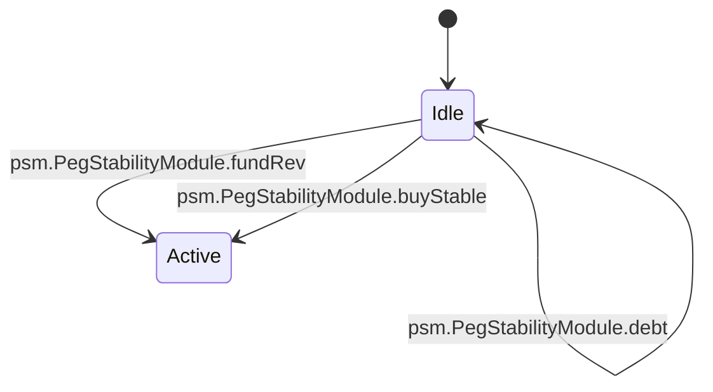

<!-- GENERATED by tools/render_flows.py from 04-psm.yaml; do not edit -->

# Flow: psm

Schema: `rcash.flows/v1`
Source: `contracts/src/deploy/v3/31_stablecoin.rho`

### PegStabilityModule

#### PegStabilityModule arms

| arm | transition | kind | guards | effects | access | refusals | invariants | status | source |
|---|---|---|---|---|---|---|---|---|---|
| `PegStabilityModule@"fundRev"` | `psm.PegStabilityModule.fundRev` | read | isRevPayment(payment) → asset psmRevPurse.deposit ok → deposit | psmRev = psmRev + amount | — | asset (pre) deposit (pre) | — | verified | contracts/src/deploy/v3/31_stablecoin.rho:1794 |
| `PegStabilityModule@"sellStable"` | `psm.PegStabilityModule.sellStable` | mutate | isStablecoinPayment(payment) → asset fresh and rate > 0 → stale feed gross = floor(amount * 1e8 / rate) → asset fee = ceil(gross * feeBps / 10000) → asset gross - fee > 0 → min rev gross - fee >= minRev → min rev gross - fee <= psmRev → buffer stableDebt - amount + maxSupply >= 0 → psm floor | supply = supply - amount stableDebt = stableDebt - amount psmRev = psmRev - (gross - fee) caller = REV payment (gross - fee) | peek issuerState (arm) peek paramsState (arm) peek psmState (arm) consume psmState (helper:psmSellCommit) post psmState (helper:psmSellCommit) | asset (pre) balance (pre) buffer (pre) burn (pre) min rev (pre) stale feed (pre) psm floor (pre) | S3 S11 | verified | contracts/src/deploy/v3/31_stablecoin.rho:1814 |
| `PegStabilityModule@"buyStable"` | `psm.PegStabilityModule.buyStable` | mutate | isRevPayment(payment) → asset not vault.paused → paused fresh and rate > 0 → stale feed gross = floor(amount * rate / 1e8) → asset fee = ceil(gross * feeBps / 10000) → asset gross - fee > 0 → min stable gross - fee >= minStable → min stable stableDebt + (gross - fee) <= ceiling → ceiling | psmRev = psmRev + amount supply = totalPrincipal + (gross - fee) stableDebt = stableDebt + (gross - fee) caller = stablecoin payment (gross - fee) | peek paramsState (arm) peek psmState (arm) peek vaultState (arm) consume psmState (helper:psmBuyCommit) post psmState (helper:psmBuyCommit) | asset (pre) ceiling (pre) deposit (pre) min stable (pre) paused (pre) stale feed (pre) | S3 S11 | verified | contracts/src/deploy/v3/31_stablecoin.rho:1869 |
| `PegStabilityModule@"schedulePolicy"` | `psm.PegStabilityModule.schedulePolicy` | create | 0 <= feeBps <= 1000 → psm fee ceiling >= 0 → ceiling | governor.pending = pending[stablecoin:currency, nonce] = {action: setPsmPolicy, argsHash: feeBps.toString() ++ '\|' ++ ceiling.toString()} | — | ceiling (pre) psm fee (pre) | S12 | verified | contracts/src/deploy/v3/31_stablecoin.rho:1919 |
| `PegStabilityModule@"applyPolicy"` | `psm.PegStabilityModule.applyPolicy` | mutate | action = "setPsmPolicy" → action 0 <= feeBps <= 1000 → psm fee ceiling >= 0 → ceiling argsHash = feeBps.toString() ++ '\|' ++ ceiling.toString() → params hash ceiling >= stableDebt → ceiling | feeBps = feeBps ceiling = ceiling rev = rev + 1 | consume psmState (arm) post psmState (arm) | action (pre) ceiling (after_consume, repost) params hash (pre) psm fee (pre) | S12 | verified | contracts/src/deploy/v3/31_stablecoin.rho:1942 |
| `PegStabilityModule@"info"` | `psm.PegStabilityModule.info` | read | — | reply = (true, {stableDebt, feeBps, ceiling, revBalance, rev}) | peek psmState (arm) | balance (pre) | S11 | verified | contracts/src/deploy/v3/31_stablecoin.rho:1989 |
| `PegStabilityModule@"debt"` | `psm.PegStabilityModule.debt` | read | — | reply = (true, stableDebt) | peek psmState (arm) | — | S11 | verified | contracts/src/deploy/v3/31_stablecoin.rho:2007 |
