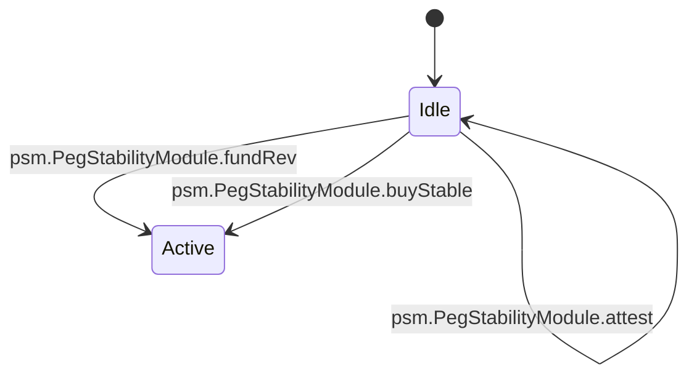
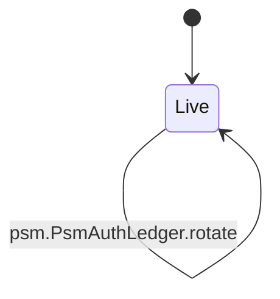

<!-- GENERATED by tools/render_flows.py from 04-psm.yaml; do not edit -->

# Flow: psm

Schema: `rcash.flows/v1`
Source: `contracts/src/deploy/v3/31_psm.rho`

### PegStabilityModule

#### PegStabilityModule arms

| arm | transition | kind | guards | effects | access | refusals | invariants | status | source |
|---|---|---|---|---|---|---|---|---|---|
| `PegStabilityModule@"acceptFacet"` | `psm.PegStabilityModule.acceptFacet` | mutate | kind = "mint" or kind = "burn" → action not psmFacetState[kind] → duplicate | psmFacetState[kind] = true mintSlot = facet burnSlot = facet | consume psmFacetState (arm) post psmFacetState (arm) | action (pre) duplicate (pre, repost) verify failed (pre) | — | verified | contracts/src/deploy/v3/31_psm.rho:278 |
| `PegStabilityModule@"fundRev"` | `psm.PegStabilityModule.fundRev` | read | isRevPayment(payment) → asset | psmRev = psmRev + amount | — | asset (pre) | — | verified | contracts/src/deploy/v3/31_psm.rho:307 |
| `PegStabilityModule@"sellStable"` | `psm.PegStabilityModule.sellStable` | mutate | isStablecoinPayment(payment) → asset fresh and rate > 0 → stale feed gross = floor(amount * 1e8 / rate) → asset fee = ceil(gross * feeBps / 10000) → asset gross - fee > 0 → min rev gross - fee >= minRev → min rev gross - fee <= psmRev → buffer stableDebt - amount + maxSupply >= 0 → psm floor | supply = supply - amount stableDebt = stableDebt - amount psmRev = psmRev - (gross - fee) caller = REV payment (gross - fee) | peek psmState (arm) consume psmState (helper:psmSellCommit) post psmState (helper:psmSellCommit) | asset (pre) balance (pre) buffer (pre) min rev (pre) stale feed (pre) psm floor (pre) | S3 S11 | verified | contracts/src/deploy/v3/31_psm.rho:327 |
| `PegStabilityModule@"buyStable"` | `psm.PegStabilityModule.buyStable` | mutate | isRevPayment(payment) → asset not vault.paused → paused not (sin > surplus) → recapitalise supply + (gross - fee) <= maxSupply → max supply fresh and rate > 0 → stale feed gross = floor(amount * rate / 1e8) → asset fee = ceil(gross * feeBps / 10000) → asset gross - fee > 0 → min stable gross - fee >= minStable → min stable stableDebt + (gross - fee) <= ceiling → ceiling | psmRev = psmRev + amount supply = totalPrincipal + (gross - fee) stableDebt = stableDebt + (gross - fee) caller = stablecoin payment (gross - fee) | peek psmState (arm) consume psmState (helper:psmBuyCommit) post psmState (helper:psmBuyCommit) | asset (pre) ceiling (pre) max supply (pre) min stable (pre) paused (pre) recapitalise (pre) stale feed (pre) | S3 S11 | verified | contracts/src/deploy/v3/31_psm.rho:386 |
| `PegStabilityModule@"schedulePolicy"` | `psm.PegStabilityModule.schedulePolicy` | create | 0 <= feeBps <= 1000 → psm fee ceiling >= 0 → ceiling | governor.pending = pending[stablecoin:currency, nonce] = {action: setPsmPolicy, argsHash: rcash:psm-policy:v1\|len(feeBps):feeBps\|len(ceiling):ceiling} | — | ceiling (pre) psm fee (pre) | S12 | verified | contracts/src/deploy/v3/31_psm.rho:455 |
| `PegStabilityModule@"applyPolicy"` | `psm.PegStabilityModule.applyPolicy` | mutate | action = "setPsmPolicy" → action 0 <= feeBps <= 1000 → psm fee ceiling >= 0 → ceiling argsHash = canonical(rcash:psm-policy:v1, [feeBps, ceiling]) → params hash ceiling >= stableDebt → ceiling | feeBps = feeBps ceiling = ceiling rev = rev + 1 | consume psmState (arm) post psmState (arm) | action (pre) ceiling (after_consume, repost) params hash (pre) psm fee (pre) | S12 | verified | contracts/src/deploy/v3/31_psm.rho:486 |
| `PegStabilityModule@"info"` | `psm.PegStabilityModule.info` | read | — | reply = (true, {stableDebt, feeBps, ceiling, revBalance, rev}) | peek psmState (arm) | balance (pre) | S11 | verified | contracts/src/deploy/v3/31_psm.rho:544 |
| `PegStabilityModule@"debt"` | `psm.PegStabilityModule.debt` | read | — | reply = (true, stableDebt) | peek psmState (arm) | — | S11 | verified | contracts/src/deploy/v3/31_psm.rho:562 |
| `PegStabilityModule@"attest"` | `psm.PegStabilityModule.attest` | read | — | reply = (true, {currency, paramsHash, sponsor, kind: "psm"}) | — | — | — | verified | contracts/src/deploy/v3/31_psm.rho:566 |

### PsmAuthLedger

#### PsmAuthLedger arms

| arm | transition | kind | guards | effects | access | refusals | invariants | status | source |
|---|---|---|---|---|---|---|---|---|---|
| `PsmAuthLedger@"rotate"` | `psm.PsmAuthLedger.rotate` | create | Governor.authorize ok → replay kind = "psmMint" or kind = "psmBurn" → action | auth = fresh new-bound auth | — | action (pre) | — | verified | contracts/src/deploy/v3/31_psm.rho:579 |
