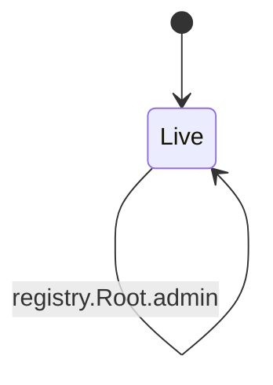
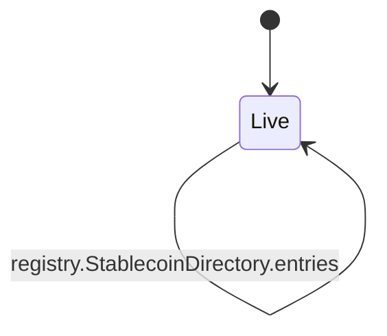
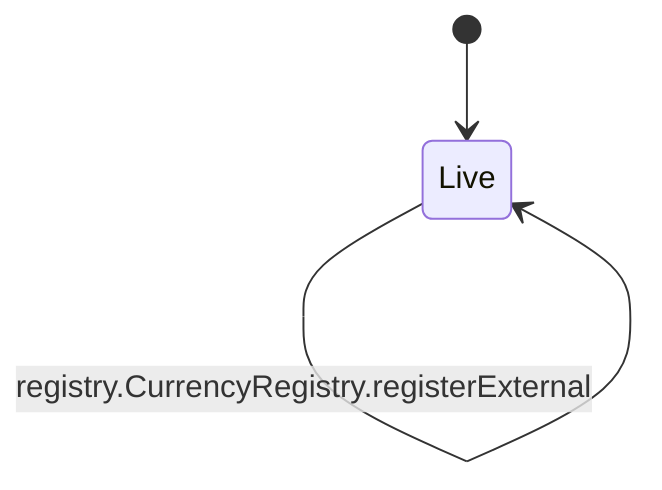
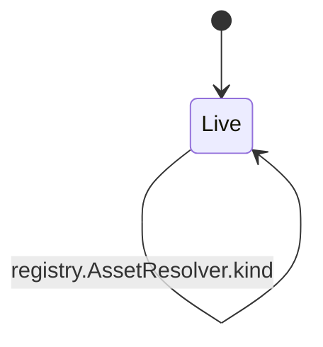

<!-- GENERATED by tools/render_flows.py from 05-registry.yaml; do not edit -->

# Flow: registry

Schema: `rcash.flows/v1`
Source: `contracts/src/deploy/v3/00_root.rho`, `contracts/src/deploy/v3/32_currency_registry.rho`, `contracts/src/deploy/v3/14_asset_resolver.rho`

### Root

#### Root arms

| arm | transition | kind | guards | effects | access | refusals | invariants | status | source |
|---|---|---|---|---|---|---|---|---|---|
| `Root@"resolve"` | `registry.Root.resolve` | read | entries[key] != Nil → unknown component entries[key].status != "retired" → retired entries[key].version >= minVersion → stale | reply = (true, entries[key].uri, entries[key].version) | peek rootState (arm) | retired (pre) stale (pre) unknown component (pre) | I20 | verified | contracts/src/deploy/v3/00_root.rho:29 |
| `Root@"get"` | `registry.Root.get` | read | entries[key] != Nil → unknown component | reply = (true, entries[key]) | peek rootState (arm) | unknown component (pre) | — | verified | contracts/src/deploy/v3/00_root.rho:44 |
| `Root@"keys"` | `registry.Root.keys` | read | — | reply = (true, keys(entries)) | peek rootState (arm) | — | — | verified | contracts/src/deploy/v3/00_root.rho:53 |
| `Root@"register"` | `registry.Root.register` | mutate | not frozen → frozen pk = installer → not installer version >= 1 → bad version entries[key] = Nil → duplicate | entries[key] = {uri: uri, version: version, kind: kind, status: active} | consume rootState (arm) post rootState (arm) | bad version (pre) duplicate (pre) frozen (pre) not installer (pre) | I20 | verified | contracts/src/deploy/v3/00_root.rho:57 |
| `Root@"rotate"` | `registry.Root.rotate` | mutate | not frozen → frozen entries[key] != Nil → unknown component entries[key].version = expectedVersion → stale AdminGuard.verify(root, nonce, rotate, argsHash) → below threshold nonce > govNonce → replay entries[key].version = expectedVersion → stale | entries[key].uri = newUri entries[key].version = newVersion entries[key].status = active govNonce = nonce | peek rootState (arm) consume rootState (arm) post rootState (arm) | frozen (pre) replay (pre) stale (pre) unknown component (pre) | I19 I20 | verified | contracts/src/deploy/v3/00_root.rho:85 |
| `Root@"deprecate"` | `registry.Root.deprecate` | mutate | not frozen → frozen AdminGuard.verify(root, nonce, deprecate, key) → below threshold nonce > govNonce → replay entries[key] != Nil → unknown component | entries[key].status = retired govNonce = nonce | peek rootState (arm) consume rootState (arm) post rootState (arm) | frozen (pre) replay (pre) unknown component (pre) | I19 I20 | verified | contracts/src/deploy/v3/00_root.rho:136 |
| `Root@"freeze"` | `registry.Root.freeze` | mutate | not frozen → frozen AdminGuard.verify(root, nonce, freeze, empty) → below threshold nonce > govNonce → replay | frozen = true govNonce = nonce | peek rootState (arm) consume rootState (arm) post rootState (arm) | frozen (pre) replay (pre) | I19 I20 | verified | contracts/src/deploy/v3/00_root.rho:170 |
| `Root@"admin"` | `registry.Root.admin` | mutate | not frozen → frozen AdminGuard.verify(root, nonce, action, args) → below threshold nonce > govNonce → replay 1 <= newThreshold <= len(newAdmins) → threshold | admins = newAdmins if action = setAdmins else admins threshold = newThreshold govNonce = nonce | peek rootState (arm) consume rootState (arm) post rootState (arm) | frozen (pre) replay (pre) threshold (pre) unknown admin action (pre) | I19 | verified | contracts/src/deploy/v3/00_root.rho:197 |

### StablecoinDirectory

#### StablecoinDirectory arms

| arm | transition | kind | guards | effects | access | refusals | invariants | status | source |
|---|---|---|---|---|---|---|---|---|---|
| `StablecoinDirectory@"register"` | `registry.StablecoinDirectory.register` | mutate | auth = directoryAuth → bad directory authority systems[code] = Nil → exists | systems[code] = entry rev = rev + 1 | consume stablecoinDirectoryState (arm) post stablecoinDirectoryState (arm) | bad directory authority (pre) exists (pre) | I2 | verified | contracts/src/deploy/v3/32_currency_registry.rho:19 |
| `StablecoinDirectory@"lookup"` | `registry.StablecoinDirectory.lookup` | read | systems[code] != Nil → no system | reply = (true, systems[code]) | peek stablecoinDirectoryState (arm) | no system (pre) | I2 | verified | contracts/src/deploy/v3/32_currency_registry.rho:39 |
| `StablecoinDirectory@"entries"` | `registry.StablecoinDirectory.entries` | read | — | reply = (true, keys(systems)) | peek stablecoinDirectoryState (arm) | — | I2 | verified | contracts/src/deploy/v3/32_currency_registry.rho:48 |

### CurrencyRegistry

#### CurrencyRegistry arms

| arm | transition | kind | guards | effects | access | refusals | invariants | status | source |
|---|---|---|---|---|---|---|---|---|---|
| `CurrencyRegistry@"register"` | `registry.CurrencyRegistry.register` | mutate | currencies[code] = Nil → exists Verifier.sigOk(H(rcash:currency-register:v3\|...), sig, sponsor) → bad sponsor signature attestation.currency = code → currency mismatch attestation.paramsHash = paramsHash → params hash attestation.sponsor = sponsorHex → sponsor mismatch StablecoinDirectory.register ok → exists currencies[code] = Nil → exists | currencies[code] = entry directory.systems[code] = entry rev = rev + 1 | peek currencyState (arm) consume currencyState (arm) post currencyState (arm) | bad attestation (pre) bad sponsor signature (pre) currency mismatch (pre) exists (pre) params hash (pre) sponsor mismatch (pre) | I2 S8 | verified | contracts/src/deploy/v3/32_currency_registry.rho:88 |
| `CurrencyRegistry@"currency"` | `registry.CurrencyRegistry.currency` | read | currencies[code] != Nil → no currency | reply = (true, currencies[code]) | peek currencyState (arm) | no currency (pre) | I2 | verified | contracts/src/deploy/v3/32_currency_registry.rho:293 |
| `CurrencyRegistry@"currencies"` | `registry.CurrencyRegistry.currencies` | read | — | reply = (true, keys(currencies)) | peek currencyState (arm) | — | I2 | verified | contracts/src/deploy/v3/32_currency_registry.rho:302 |
| `CurrencyRegistry@"setPaused"` | `registry.CurrencyRegistry.setPaused` | mutate | currencies[code] != Nil → no currency entry.kind != external implies VaultBook.pause(paused, nonce, sigs) ok → authorize entry.kind = external implies Governor.authorize(currency:code, nonce, setPaused, paused.toString()) → below threshold currencies[code] != Nil → no currency | currencies[code].status = paused ? paused : active rev = rev + 1 | peek currencyState (arm) consume currencyState (helper:registrySetStatus) post currencyState (helper:registrySetStatus) | no currency (pre) | S12 I23 | verified | contracts/src/deploy/v3/32_currency_registry.rho:308 |
| `CurrencyRegistry@"registerExternal"` | `registry.CurrencyRegistry.registerExternal` | mutate | currencies[code] = Nil → exists Verifier.sigOk(H(rcash:external-asset-register:v1\|code\|assetUri\|sponsor), sig, sponsor) → bad sponsor signature attestation.asset = code → asset mismatch attestation.kind = external → external kind attestation.sponsor = sponsorHex → sponsor mismatch attestation.decimals = 8 → external decimals adapter attestation returned → external attestation currencies[code] = Nil → exists | currencies[code] = {kind: external, assetUri: assetUri, decimals: 8, sponsor: sponsorHex, status: active} directory.systems[code] = currencies[code] rev = rev + 1 | peek currencyState (arm) consume currencyState (arm) post currencyState (arm) | bad sponsor signature (pre) asset mismatch (pre) external kind (pre) sponsor mismatch (pre) external decimals (pre) external attestation (pre) exists (pre) | I2 I23 | verified | contracts/src/deploy/v3/32_currency_registry.rho:198 |

### AssetResolver

#### AssetResolver arms

| arm | transition | kind | guards | effects | access | refusals | invariants | status | source |
|---|---|---|---|---|---|---|---|---|---|
| `AssetResolver@"issuer"` | `registry.AssetResolver.issuer` | read | (assetId = REV) or currencies[assetId] != Nil → unknown asset | reply = (true, brand, issuer) | — | unknown asset (pre) | I2 | verified | contracts/src/deploy/v3/14_asset_resolver.rho:15 |
| `AssetResolver@"kind"` | `registry.AssetResolver.kind` | read | (assetId = REV) or currencies[assetId] != Nil → unknown asset | reply = (true, rev \| stablecoin) | — | unknown asset (pre) | I2 | verified | contracts/src/deploy/v3/14_asset_resolver.rho:79 |
