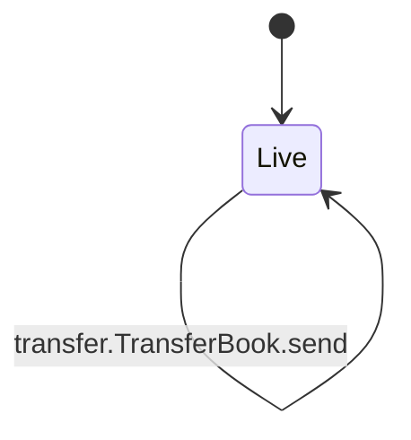
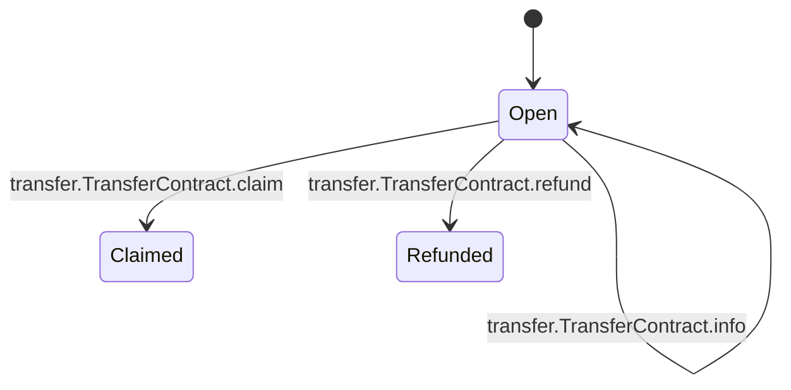

<!-- GENERATED by tools/render_flows.py from 06-transfer.yaml; do not edit -->

# Flow: transfer

Schema: `rcash.flows/v1`
Source: `contracts/src/deploy/v3/40_transfer.rho`

### TransferBook

#### TransferBook arms

| arm | transition | kind | guards | effects | access | refusals | invariants | status | source |
|---|---|---|---|---|---|---|---|---|---|
| `TransferBook@"send"` | `transfer.TransferBook.send` | mutate | amount >= minAmount and amount > 0 → amount now < expiry <= now + maxExpiryBlocks → expiry len(memo) <= maxMemoBytes → memo len(opId) <= maxOpIdBytes → opId 0 <= stipend <= maxStipend → stipend actual = amount → amount mismatch asset resolves → asset | transferState = {status: open, memo: memo, opId: opId, stipend: stipend} reply = (true, id, transferUri) | peek bookParamsState (arm) post transferState (arm) | amount (pre) amount mismatch (pre) asset (pre) expiry (pre) memo (pre) opId (pre) stipend (pre) | I14 I15 | verified | contracts/src/deploy/v3/40_transfer.rho:84 |

### TransferContract

#### TransferContract arms

| arm | transition | kind | guards | effects | access | refusals | invariants | status | source |
|---|---|---|---|---|---|---|---|---|---|
| `TransferContract@"claim"` | `transfer.TransferContract.claim` | mutate | status = "open" → closed now < expiry → expired H(secret) = secretHash → bad secret | status = claimed recipient = payment amount | consume transferState (arm) post transferState (arm) | bad secret (pre) closed (pre) expired (pre) | I14 I15 | verified | contracts/src/deploy/v3/40_transfer.rho:102 |
| `TransferContract@"refund"` | `transfer.TransferContract.refund` | mutate | status = "open" → closed now >= expiry → not expired caller = senderId → not sender | status = refunded refund = payment amount | consume transferState (arm) post transferState (arm) | closed (pre) not expired (pre) not sender (pre) | I14 I15 | verified | contracts/src/deploy/v3/40_transfer.rho:150 |
| `TransferContract@"info"` | `transfer.TransferContract.info` | read | — | reply = (true, {sender, asset, amount, secretHash, expiry, status, memo, opId, stipend}) | peek transferState (arm) | — | I14 | verified | contracts/src/deploy/v3/40_transfer.rho:201 |
