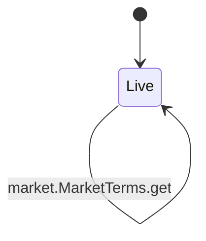
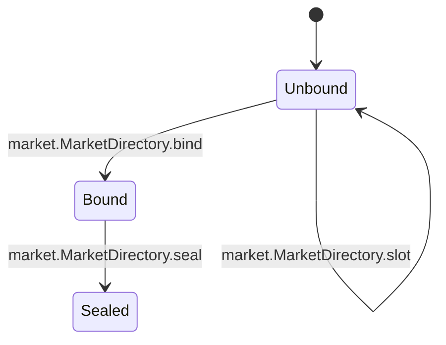
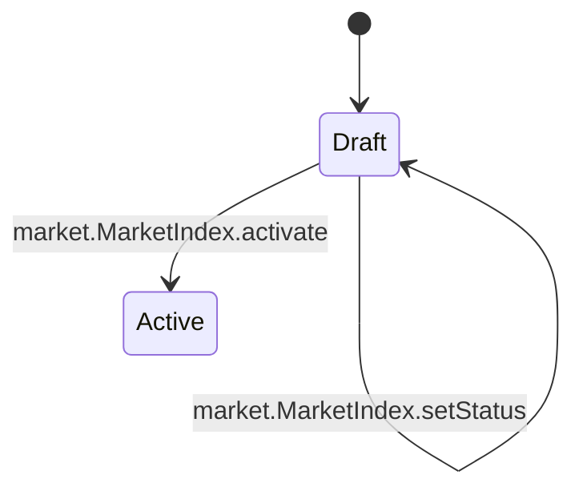
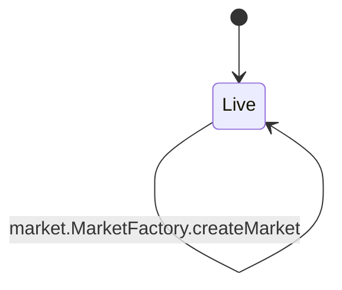
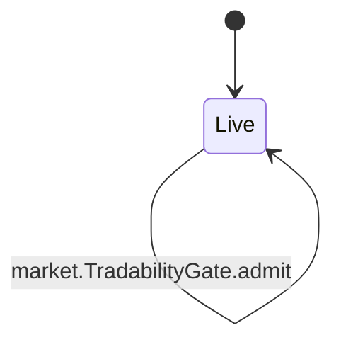

<!-- GENERATED by tools/render_flows.py from 07-market.yaml; do not edit -->

# Flow: market

Schema: `rcash.flows/v1`
Source: `contracts/src/deploy/v3/50_market.rho`

### MarketTerms

#### MarketTerms arms

| arm | transition | kind | guards | effects | access | refusals | invariants | status | source |
|---|---|---|---|---|---|---|---|---|---|
| `MarketTerms@"put"` | `market.MarketTerms.put` | mutate | Bounds.checkTerms(terms, values) → terms fields hash = Codec.canonical(rcash:market-terms:v4, values) → terms fields | terms[hash] = {terms: terms, values: values} rev = rev + 1 reply = (true, hash) | consume termsState (arm) post termsState (arm) | — | I5 | verified | contracts/src/deploy/v3/50_market.rho:105 |
| `MarketTerms@"get"` | `market.MarketTerms.get` | read | terms[hash] != Nil → no terms | reply = (true, terms[hash]) | peek termsState (arm) | no terms (pre) | I5 | verified | contracts/src/deploy/v3/50_market.rho:146 |

### MarketDirectory

#### MarketDirectory arms

| arm | transition | kind | guards | effects | access | refusals | invariants | status | source |
|---|---|---|---|---|---|---|---|---|---|
| `MarketDirectory@"bind"` | `market.MarketDirectory.bind` | mutate | auth = marketAuth → bad directory authority slots[marketId] = Nil or not sealed → sealed | slots[marketId] = slot rev = rev + 1 | consume directoryState (arm) post directoryState (arm) | bad directory authority (pre) sealed (pre) | I6 | verified | contracts/src/deploy/v3/50_market.rho:155 |
| `MarketDirectory@"seal"` | `market.MarketDirectory.seal` | mutate | auth = marketAuth → bad directory authority slots[marketId] != Nil → no slot | slots[marketId].sealed = true rev = rev + 1 | consume directoryState (arm) post directoryState (arm) | bad directory authority (pre) no slot (pre) | I6 | verified | contracts/src/deploy/v3/50_market.rho:179 |
| `MarketDirectory@"byId"` | `market.MarketDirectory.byId` | read | slots[marketId] != Nil → no slot | reply = (true, slot) | peek directoryState (arm) | no slot (pre) | I6 | verified | contracts/src/deploy/v3/50_market.rho:196 |
| `MarketDirectory@"slot"` | `market.MarketDirectory.slot` | read | slots[marketId] != Nil → no slot | reply = (true, slot) | peek directoryState (arm) | no slot (pre) | I6 | verified | contracts/src/deploy/v3/50_market.rho:205 |

### MarketIndex

#### MarketIndex arms

| arm | transition | kind | guards | effects | access | refusals | invariants | status | source |
|---|---|---|---|---|---|---|---|---|---|
| `MarketIndex@"stage"` | `market.MarketIndex.stage` | mutate | auth = marketAuth → bad index authority markets[marketId] = Nil → exists bySlug[slug] = Nil → slug byPair[pairKey] absent or prior delisted and version > prior.version → pair active version > prior.version → version | markets[marketId] = record byPair[pairKey] = marketId bySlug[slug] = marketId rev = rev + 1 | consume indexState (arm) post indexState (arm) post indexState (helper:stagePairCheck) | bad index authority (pre) exists (pre) pair active (pre) slug (pre) version (pre) | I3 I4 | verified | contracts/src/deploy/v3/50_market.rho:294 |
| `MarketIndex@"activate"` | `market.MarketIndex.activate` | mutate | status = "draft" → not draft directory.slots[marketId].sealed → not sealed terms[termsHash] exists → no terms lock.funded → lock unfunded lock.untilHeight >= terms.lockUntilHeight → lock height pool.seeded and rb >= seedBase and rq >= seedQuote → seed mismatch totalShares >= seedInitialShares → shares mismatch pool.termsHash = record.termsHash → terms mismatch rq >= depthFloorQuote → depth | markets[marketId].status = active rev = rev + 1 | peek indexState (arm) consume indexState (helper:activatePool) post indexState (helper:activatePool) | depth (pre) lock height (pre) lock unfunded (pre) no attestation (pre) no lock (pre) no market (pre) not draft (pre) not sealed (pre) not seeded (pre) seed mismatch (pre) shares mismatch (pre) terms mismatch (pre) | I3 I4 I12 | verified | contracts/src/deploy/v3/50_market.rho:311 |
| `MarketIndex@"market"` | `market.MarketIndex.market` | read | markets[marketId] != Nil → no market | reply = (true, record) | peek indexState (arm) | no market (pre) | I3 | verified | contracts/src/deploy/v3/50_market.rho:363 |
| `MarketIndex@"markets"` | `market.MarketIndex.markets` | read | — | reply = (true, markets) | peek indexState (arm) | — | I3 | verified | contracts/src/deploy/v3/50_market.rho:372 |
| `MarketIndex@"marketFor"` | `market.MarketIndex.marketFor` | read | byPair[market:base/quote] resolves → no market | reply = (true, record) | peek indexState (arm) | no market (pre) | I3 | verified | contracts/src/deploy/v3/50_market.rho:376 |
| `MarketIndex@"setStatus"` | `market.MarketIndex.setStatus` | mutate | Governor.authorize(market-index, nonce, setStatus, marketId\|status) → below threshold markets[marketId] != Nil → no market legal(status, next) → transition | markets[marketId].status = status rev = rev + 1 | consume indexState (arm) post indexState (arm) | no market (pre) transition (pre) | I4 S12 | verified | contracts/src/deploy/v3/50_market.rho:390 |

### MarketFactory

#### MarketFactory arms

| arm | transition | kind | guards | effects | access | refusals | invariants | status | source |
|---|---|---|---|---|---|---|---|---|---|
| `MarketFactory@"createMarket"` | `market.MarketFactory.createMarket` | mutate | MarketTerms.put(terms, values) = (true, termsHash) → terms fields Verifier.sigOk(H(rcash:market-create:v1\|marketId\|termsHash\|sponsor), sig) → bad sponsor signature terms.sponsorPubKey = sponsorHex → sponsor mismatch marketOwnerCheck(terms, sponsorHex) → lock beneficiary base feed policy matches and active → base feed policy quote feed policy matches and active → quote feed policy PoolTemplate.create ok → no attestation MarketDirectory.bind ok → sealed MarketDirectory.seal ok → no slot MarketIndex.stage ok → exists | terms[termsHash] = {terms, values} directory.slots[marketId] = {poolUri, lockUri, termsHash, sealed} markets[marketId] = {marketId, slug, pairKey, base, quote, version, termsHash, status: draft} reply = (true, marketId, poolUri, lockUri, termsHash) | — | bad sponsor signature (pre) base feed policy (pre) feed inactive (pre) lock beneficiary (pre) lock too short (pre) quote feed policy (pre) sponsor mismatch (pre) sponsor owner (pre) | I3 I5 I6 | verified | contracts/src/deploy/v3/50_market.rho:564 |

### ListingViews

#### ListingViews arms

| arm | transition | kind | guards | effects | access | refusals | invariants | status | source |
|---|---|---|---|---|---|---|---|---|---|
| `ListingViews@"marketFor"` | `market.ListingViews.marketFor` | read | — | reply = MarketIndex.marketFor | — | — | — | verified | contracts/src/deploy/v3/50_market.rho:449 |
| `ListingViews@"market"` | `market.ListingViews.market` | read | — | reply = MarketIndex.market | — | — | — | verified | contracts/src/deploy/v3/50_market.rho:466 |
| `ListingViews@"isActive"` | `market.ListingViews.isActive` | read | — | reply = (true, record.status = active) | — | no market (pre) | I4 | verified | contracts/src/deploy/v3/50_market.rho:481 |
| `ListingViews@"terms"` | `market.ListingViews.terms` | read | — | reply = MarketTerms.get | — | — | — | verified | contracts/src/deploy/v3/50_market.rho:504 |
| `ListingViews@"currency"` | `market.ListingViews.currency` | read | — | reply = CurrencyRegistry.currency | — | — | — | verified | contracts/src/deploy/v3/50_market.rho:519 |
| `ListingViews@"currencies"` | `market.ListingViews.currencies` | read | — | reply = CurrencyRegistry.currencies | — | — | — | verified | contracts/src/deploy/v3/50_market.rho:534 |
| `ListingViews@"markets"` | `market.ListingViews.markets` | read | — | reply = MarketIndex.markets | — | — | — | verified | contracts/src/deploy/v3/50_market.rho:549 |

### TradabilityGate

#### TradabilityGate arms

| arm | transition | kind | guards | effects | access | refusals | invariants | status | source |
|---|---|---|---|---|---|---|---|---|---|
| `TradabilityGate@"admit"` | `market.TradabilityGate.admit` | read | status = "active" → not active fresh → stale inputValue >= minTicketQuote → min ticket inputValue * 10000 <= poolValue * maxTradeBps → max trade | reply = (true, Nil) | — | max trade (pre) min ticket (pre) not active (pre) stale (pre) | I12 | verified | contracts/src/deploy/v3/50_market.rho:433 |
