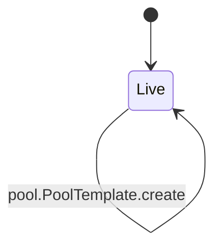
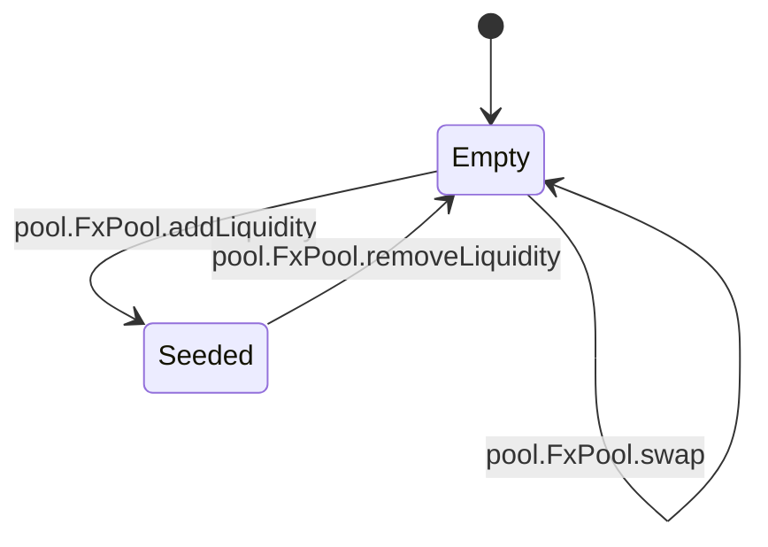
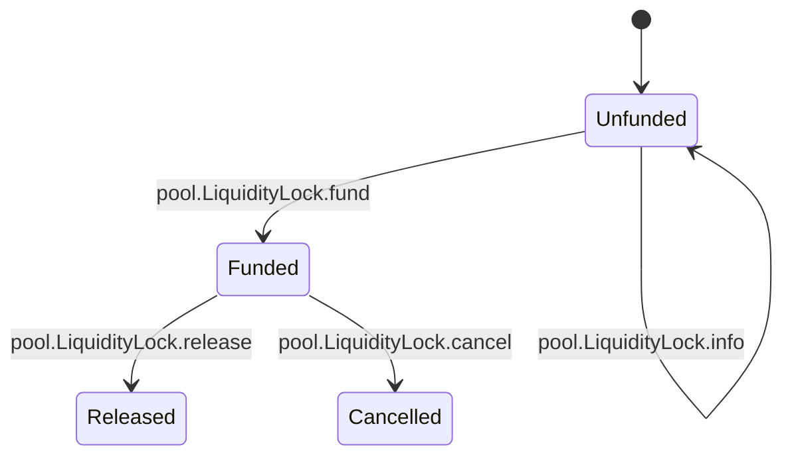

<!-- GENERATED by tools/render_flows.py from 08-pool.yaml; do not edit -->

# Flow: pool

Schema: `rcash.flows/v1`
Source: `contracts/src/deploy/v3/51_pool.rho`

### PoolTemplate

#### PoolTemplate arms

| arm | transition | kind | guards | effects | access | refusals | invariants | status | source |
|---|---|---|---|---|---|---|---|---|---|
| `PoolTemplate@"create"` | `pool.PoolTemplate.create` | mutate | termsHash = H(terms) → terms fields AssetResolver.issuer(base) ok → not base AssetResolver.issuer(quote) ok → not quote | pool = {rb: 0, rq: 0, totalShares: 0, seeded: false} lock = {funded: false, released: false, cancelled: false, untilHeight: 0, shares: 0} reply = (true, poolUri, lockUri) | post lockState (helper:assemblePool) post poolState (helper:assemblePool) | — | I10 I11 I13 | verified | contracts/src/deploy/v3/51_pool.rho:674 |

### FxPool

#### FxPool arms

| arm | transition | kind | guards | effects | access | refusals | invariants | status | source |
|---|---|---|---|---|---|---|---|---|---|
| `FxPool@"pair"` | `pool.FxPool.pair` | read | — | reply = (true, base, quote) | — | — | — | verified | contracts/src/deploy/v3/51_pool.rho:244 |
| `FxPool@"reserves"` | `pool.FxPool.reserves` | read | — | reply = (true, {rb, rq, totalShares, seeded}) | peek poolState (arm) | — | I10 | verified | contracts/src/deploy/v3/51_pool.rho:247 |
| `FxPool@"balances"` | `pool.FxPool.balances` | read | — | reply = (true, basePurse.balance, quotePurse.balance) | — | — | I10 | verified | contracts/src/deploy/v3/51_pool.rho:254 |
| `FxPool@"attest"` | `pool.FxPool.attest` | read | — | reply = (true, {marketId, termsHash, base, quote, rb, rq, totalShares, seeded}) | peek poolState (arm) | — | I10 I11 | verified | contracts/src/deploy/v3/51_pool.rho:262 |
| `FxPool@"quote"` | `pool.FxPool.quote` | read | market active → not active fresh and rate > 0 → stale feed | reply = (true, out, fee, rate) | peek poolState (arm) | not active (pre) stale feed (pre) | I9 I12 | verified | contracts/src/deploy/v3/51_pool.rho:276 |
| `FxPool@"swap"` | `pool.FxPool.swap` | mutate | market active → not active fresh and rate > 0 → stale feed payment brand = input asset → not this asset out > 0 and out >= minOut → output TradabilityGate.admit ok → not active deposit and withdraw ok → payment | rb = rb + amount if dir = b2q else rb - out rq = rq - out if dir = b2q else rq + amount poolValue = value(rb, rq, rate) fee = fee(weight(rb, rq, rate), baseSpreadBps, skewSpreadBps) out = out(dir, amount, rate, fee) | consume poolState (arm) post poolState (arm) | not active (pre) not this asset (pre) output (pre) stale feed (pre) | I9 I10 I12 | verified | contracts/src/deploy/v3/51_pool.rho:312 |
| `FxPool@"addLiquidity"` | `pool.FxPool.addLiquidity` | mutate | market draft or active → not active fresh and rate > 0 → stale feed payments are base and quote → not base first deposit within tolerance → first deposit balance depositValue >= minLiquidity → min liquidity sharesOut > 0 and sharesOut >= minShares → shares deposits and LP mint ok → payment | rb = rb + baseAmt rq = rq + quoteAmt totalShares = totalShares + sharesOut seeded = true sharesOut = if first: value(rb + b, rq + q, rate) - 1e8; else: floor((value(rb + b, rq + q) - value(rb, rq)) * totalShares / value(rb, rq)) | consume poolState (arm) post poolState (arm) post poolState (helper:commitLiquidity) | first deposit balance (pre) min liquidity (pre) not active (pre) not base (pre) not quote (pre) shares (pre) stale feed (pre) | I10 I11 I12 | verified | contracts/src/deploy/v3/51_pool.rho:413 |
| `FxPool@"removeLiquidity"` | `pool.FxPool.removeLiquidity` | mutate | 0 < shares <= totalShares → shares baseOut >= minBase and quoteOut >= minQuote → minimum LP burn and withdrawals ok → payment | baseOut = floor(rb * shares / totalShares) quoteOut = floor(rq * shares / totalShares) rb = rb - baseOut rq = rq - quoteOut totalShares = totalShares - shares seeded = totalShares - shares > 0 | consume poolState (arm) post poolState (arm) | minimum (pre) not an LP payment (pre) shares (pre) | I10 I11 | verified | contracts/src/deploy/v3/51_pool.rho:457 |

### LiquidityLock

#### LiquidityLock arms

| arm | transition | kind | guards | effects | access | refusals | invariants | status | source |
|---|---|---|---|---|---|---|---|---|---|
| `LiquidityLock@"fund"` | `pool.LiquidityLock.fund` | mutate | not funded → funded untilHeight > 0 → height untilHeight >= now + terms.lockMinBlocks → lock too short LP payment measured → not LP | funded = true untilHeight = untilHeight beneficiary = beneficiaryId funder = caller address shares = LP amount | consume lockState (arm) post lockState (arm) | funded (pre) height (pre) not LP (pre) lock too short (after_consume, repost) | I13 | verified | contracts/src/deploy/v3/51_pool.rho:522 |
| `LiquidityLock@"release"` | `pool.LiquidityLock.release` | mutate | funded → unfunded not released and not cancelled → closed now >= untilHeight → locked caller = beneficiary → not beneficiary LP withdraw ok → payment | released = true caller = LP shares | consume lockState (arm) post lockState (arm) | closed (pre) locked (pre) not beneficiary (pre) payment (pre) unfunded (pre) | I13 | verified | contracts/src/deploy/v3/51_pool.rho:563 |
| `LiquidityLock@"cancel"` | `pool.LiquidityLock.cancel` | mutate | Governor.authorize(liquidity-lock, nonce, cancel, marketId) → below threshold funded and not released and not cancelled → closed caller = funder or caller = beneficiary → not funder LP withdraw ok → payment | cancelled = true caller = LP shares | consume lockState (arm) post lockState (arm) | closed (pre) not funder (pre) payment (pre) | I13 S12 | verified | contracts/src/deploy/v3/51_pool.rho:603 |
| `LiquidityLock@"info"` | `pool.LiquidityLock.info` | read | — | reply = (true, {marketId, funded, released, cancelled, untilHeight, beneficiary, funder, shares}) | peek lockState (arm) | — | I13 | verified | contracts/src/deploy/v3/51_pool.rho:647 |
