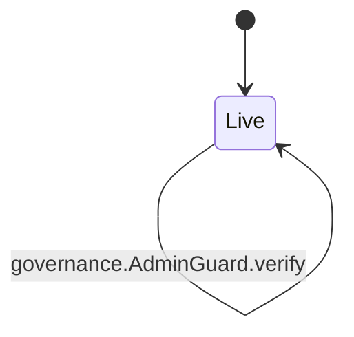
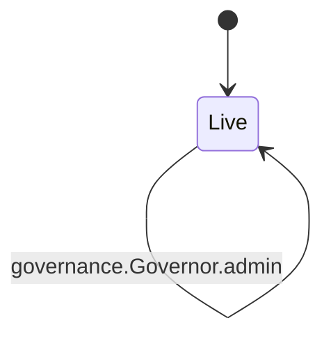

<!-- GENERATED by tools/render_flows.py from 09-governance.yaml; do not edit -->

# Flow: governance

Schema: `rcash.flows/v1`
Source: `contracts/src/deploy/v3/03_admin_guard.rho`, `contracts/src/deploy/v3/04_governor.rho`

### AdminGuard

#### AdminGuard arms

| arm | transition | kind | guards | effects | access | refusals | invariants | status | source |
|---|---|---|---|---|---|---|---|---|---|
| `AdminGuard@"verify"` | `governance.AdminGuard.verify` | read | adminCount(H(rcash:admin:v1\|...), sigs, admins) >= threshold → below threshold | reply = (true, Nil) | — | below threshold (pre) | I19 | verified | contracts/src/deploy/v3/03_admin_guard.rho:49 |

### Governor

#### Governor arms

| arm | transition | kind | guards | effects | access | refusals | invariants | status | source |
|---|---|---|---|---|---|---|---|---|---|
| `Governor@"authorize"` | `governance.Governor.authorize` | mutate | nonce > last(domain) → replay AdminGuard.verify(domain, nonce, action, argsHash) → below threshold nonce > last(domain) → replay | nonces[domain] = nonce | peek governorState (arm) consume governorState (arm) post governorState (arm) | replay (pre) | I19 S12 | verified | contracts/src/deploy/v3/04_governor.rho:35 |
| `Governor@"schedule"` | `governance.Governor.schedule` | mutate | nonce > last(domain) → replay pending[domain\|nonce] = Nil → pending AdminGuard.verify(domain, nonce, action, argsHash) → below threshold nonce > last(domain) → replay | pending[domain\|nonce] = {action, argsHash, args, readyAt: height + timelock} reply = (true, height + timelock) | peek governorState (arm) consume governorState (arm) post governorState (arm) | pending (pre) replay (pre) | I19 S12 | verified | contracts/src/deploy/v3/04_governor.rho:76 |
| `Governor@"execute"` | `governance.Governor.execute` | mutate | pending[domain\|nonce] != Nil → unknown height >= readyAt → early nonce > last(domain) → replay | nonces[domain] = nonce pending[domain\|nonce] = Nil reply = (true, action, argsHash, args) | peek governorState (arm) consume governorState (arm) post governorState (arm) | early (pre) replay (pre) unknown (pre) | I19 S12 | verified | contracts/src/deploy/v3/04_governor.rho:122 |
| `Governor@"pending"` | `governance.Governor.pending` | read | pending[domain\|nonce] != Nil → unknown | reply = (true, action, argsHash, args, readyAt) | peek governorState (arm) | unknown (pre) | S12 | verified | contracts/src/deploy/v3/04_governor.rho:152 |
| `Governor@"admins"` | `governance.Governor.admins` | read | — | reply = (true, admins, threshold) | peek governorState (arm) | — | I19 | verified | contracts/src/deploy/v3/04_governor.rho:164 |
| `Governor@"admin"` | `governance.Governor.admin` | mutate | nonce > last(governor) → replay AdminGuard.verify(governor, nonce, action, args) → below threshold 1 <= newThreshold <= len(admins) → threshold 1 <= newTimelock <= 1296000 → timelock | admins = newAdmins if setAdmins else admins threshold = newThreshold if setThreshold else threshold timelock = newTimelock if setTimelock else timelock nonces[governor] = nonce | peek governorState (arm) consume governorState (arm) post governorState (arm) | replay (pre) threshold (pre) timelock (pre) unknown admin action (pre) | I19 | verified | contracts/src/deploy/v3/04_governor.rho:170 |
