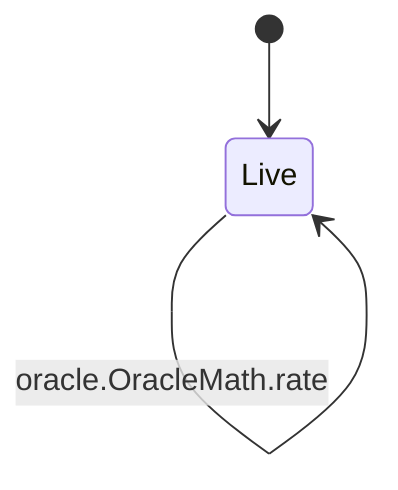
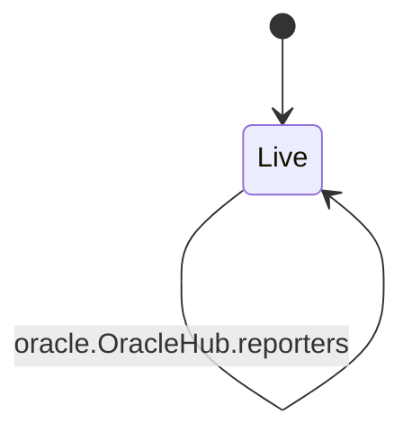
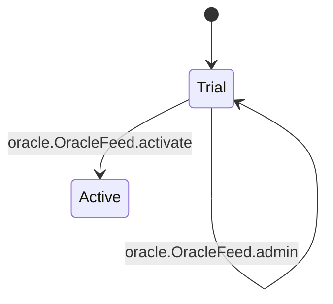

<!-- GENERATED by tools/render_flows.py from 10-oracle.yaml; do not edit -->

# Flow: oracle

Schema: `rcash.flows/v1`
Source: `contracts/src/deploy/v3/07_oracle_math.rho`, `contracts/src/deploy/v3/12_oracle_registry.rho`, `contracts/src/deploy/v3/13_oracle_hub.rho`, `contracts/src/deploy/v3/31_feed.rho`

### OracleMath

#### OracleMath arms

| arm | transition | kind | guards | effects | access | refusals | invariants | status | source |
|---|---|---|---|---|---|---|---|---|---|
| `OracleMath@"median3"` | `oracle.OracleMath.median3` | read | — | reply = median3(a, b, c) | — | — | I7 | verified | contracts/src/deploy/v3/07_oracle_math.rho:43 |
| `OracleMath@"fresh"` | `oracle.OracleMath.fresh` | read | — | reply = (true, median3(p0,p1,p2), Nil) if count >= quorum and fresh and spread bound else (false, 0, reason) | — | — | I7 | verified | contracts/src/deploy/v3/07_oracle_math.rho:48 |
| `OracleMath@"rate"` | `oracle.OracleMath.rate` | read | — | reply = floor(basePrice * 1e8 / quotePrice) if quotePrice > 0 else 0 | — | — | I9 | verified | contracts/src/deploy/v3/07_oracle_math.rho:81 |

### OracleRegistry

#### OracleRegistry arms

| arm | transition | kind | guards | effects | access | refusals | invariants | status | source |
|---|---|---|---|---|---|---|---|---|---|
| `OracleRegistry@"registerFeed"` | `oracle.OracleRegistry.registerFeed` | mutate | caller pubkey = sponsorHex → bad sponsor Verifier.sigOk(H(feed-bind), sig, sponsor) → bad sponsor signature feed attestation matches code, feedId, sponsor, policy → feed attestation 3 distinct reporter keys → reporters all reporters allowlisted → reporter not allowlisted sponsor occupies at most one slot → sponsor slots feeds[code] = Nil → duplicate | feeds[code] = {uri: feedUri, feedId, policyHash, sponsor, status: active} | peek oracleRegState (arm) consume oracleRegState (helper:regBind) post oracleRegState (helper:regBind) | bad sponsor (pre) bad sponsor signature (pre) duplicate (pre) feed attestation (pre) feed info (pre) reporter not allowlisted (pre) reporters (pre) sponsor slots (pre) | I8 | verified | contracts/src/deploy/v3/12_oracle_registry.rho:160 |
| `OracleRegistry@"feedEntry"` | `oracle.OracleRegistry.feedEntry` | read | feeds[code] != Nil → no feed | reply = (true, feeds[code]) | peek oracleRegState (arm) | no feed (pre) | I8 | verified | contracts/src/deploy/v3/12_oracle_registry.rho:212 |
| `OracleRegistry@"info"` | `oracle.OracleRegistry.info` | read | — | reply = (true, {feeds, allowlist}) | peek oracleRegState (arm) | — | I8 | verified | contracts/src/deploy/v3/12_oracle_registry.rho:221 |
| `OracleRegistry@"admin"` | `oracle.OracleRegistry.admin` | mutate | Governor.authorize(oracle-registry, nonce, action, args) → below threshold reporter not already allowlisted → duplicate | allowlist = add or remove reporter | peek oracleRegState (arm) consume oracleRegState (arm) post oracleRegState (arm) | duplicate (pre) unknown admin action (pre) | I8 S12 | verified | contracts/src/deploy/v3/12_oracle_registry.rho:227 |

### OracleHub

#### OracleHub arms

| arm | transition | kind | guards | effects | access | refusals | invariants | status | source |
|---|---|---|---|---|---|---|---|---|---|
| `OracleHub@"get"` | `oracle.OracleHub.get` | read | — | reply = feed.get | — | — | — | verified | contracts/src/deploy/v3/13_oracle_hub.rho:62 |
| `OracleHub@"feedStatus"` | `oracle.OracleHub.feedStatus` | read | — | reply = feed.info | — | — | — | verified | contracts/src/deploy/v3/13_oracle_hub.rho:74 |
| `OracleHub@"getPair"` | `oracle.OracleHub.getPair` | read | quote feed resolves → quote feed base feed resolves → base feed | reply = (true, {rate, fresh, basePrice, quotePrice, baseAge, quoteAge}) | — | base feed (pre) quote feed (pre) | I9 | verified | contracts/src/deploy/v3/13_oracle_hub.rho:86 |
| `OracleHub@"reporters"` | `oracle.OracleHub.reporters` | read | — | reply = feed.info | — | — | I8 | verified | contracts/src/deploy/v3/13_oracle_hub.rho:134 |

### OracleFeed

#### OracleFeed arms

| arm | transition | kind | guards | effects | access | refusals | invariants | status | source |
|---|---|---|---|---|---|---|---|---|---|
| `OracleFeed@"submit"` | `oracle.OracleFeed.submit` | mutate | not paused → paused 0 <= index <= 2 → bad index pubKey = reporters[index] → not reporter height <= now → future price now - height <= 1000 → stale submit Verifier.sigOk(submit payload) → bad signature not paused and rev unchanged → changed height > priorHeight → height not monotonic | prices[index] = {price: price, height: height} seenN = true trialSubmits = trialSubmits + 1 rev = rev + 1 | peek feedState (arm) consume feedState (arm) post feedState (arm) | bad index (pre) bad signature (pre) changed (pre) future price (pre) height not monotonic (pre) not reporter (pre) paused (pre) stale submit (pre) | I7 | verified | contracts/src/deploy/v3/31_feed.rho:166 |
| `OracleFeed@"get"` | `oracle.OracleFeed.get` | read | — | reply = (true, {fresh, price, age, reason}) | peek feedState (arm) | — | I7 | verified | contracts/src/deploy/v3/31_feed.rho:235 |
| `OracleFeed@"activate"` | `oracle.OracleFeed.activate` | mutate | not active → already active not paused → paused now - trialStart >= trialBlocks → trial trialSubmits >= trialMinSubmits → trial submits seen >= quorum → quorum median fresh → quorum not active and not paused and rev unchanged → changed | active = true listedAt = now rev = rev + 1 | peek feedState (arm) consume feedState (arm) post feedState (arm) | already active (pre) changed (pre) paused (pre) quorum (pre) trial (pre) trial submits (pre) | I7 | verified | contracts/src/deploy/v3/31_feed.rho:256 |
| `OracleFeed@"info"` | `oracle.OracleFeed.info` | read | — | reply = (true, {feedId, currency, reporters, sponsor, quorum, policyHash, active, paused, rev}) | peek feedState (arm) | — | I7 | verified | contracts/src/deploy/v3/31_feed.rho:307 |
| `OracleFeed@"admin"` | `oracle.OracleFeed.admin` | mutate | Governor.authorize(oracle:currency, nonce, action, arg) → below threshold | paused = arg if setPaused trial = reset if restartTrial rev = rev + 1 | peek feedState (arm) consume feedState (arm) post feedState (arm) | unknown admin action (pre) | S12 | verified | contracts/src/deploy/v3/31_feed.rho:331 |
