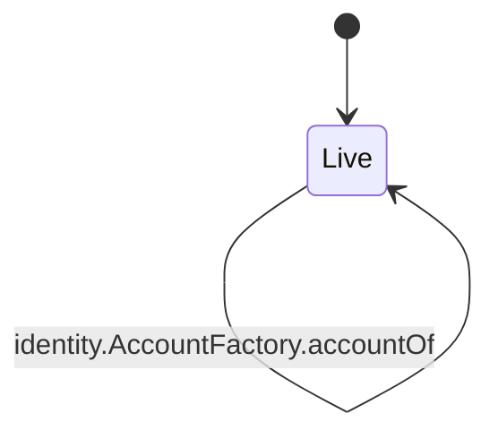
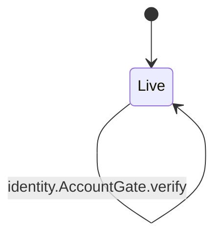
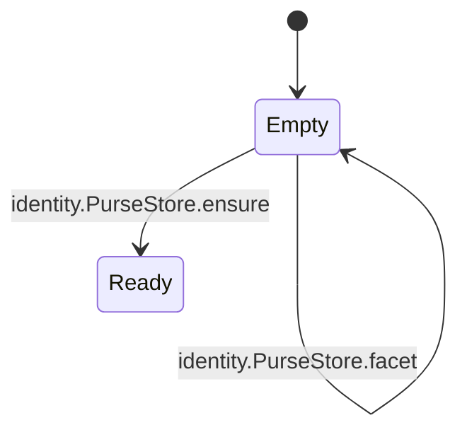
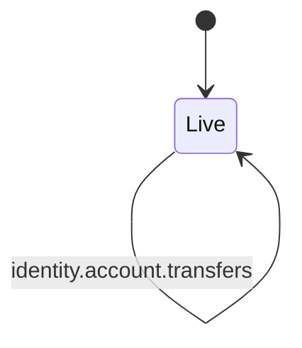

<!-- GENERATED by tools/render_flows.py from 11-identity.yaml; do not edit -->

# Flow: identity

Schema: `rcash.flows/v1`
Source: `contracts/src/deploy/v3/09_identity.rho`

### AccountFactory

#### AccountFactory arms

| arm | transition | kind | guards | effects | access | refusals | invariants | status | source |
|---|---|---|---|---|---|---|---|---|---|
| `AccountFactory@"getOrCreate"` | `identity.AccountFactory.getOrCreate` | mutate | ownerId = revAddress(pubKeyBytes) → verify failed accounts[ownerId] = Nil or return existing → exists | accounts[ownerId] = {account: bundle, proof: proof} purseState = {purses: {}, rev: 0} accountState = {nextTransferId: 0, ops: {}, rev: 0} | peek factoryState (arm) consume factoryState (arm) post accountState (arm) post factoryState (arm) post purseState (arm) | — | I21 | verified | contracts/src/deploy/v3/09_identity.rho:19 |
| `AccountFactory@"verify"` | `identity.AccountFactory.verify` | read | — | reply = (true, stored.proof = proof) | peek factoryState (arm) | — | I21 | verified | contracts/src/deploy/v3/09_identity.rho:515 |
| `AccountFactory@"accountOf"` | `identity.AccountFactory.accountOf` | read | accounts[ownerId] != Nil → no account | reply = (true, account) | peek factoryState (arm) | no account (pre) | I21 | verified | contracts/src/deploy/v3/09_identity.rho:524 |

### AccountGate

#### AccountGate arms

| arm | transition | kind | guards | effects | access | refusals | invariants | status | source |
|---|---|---|---|---|---|---|---|---|---|
| `AccountGate@"verify"` | `identity.AccountGate.verify` | read | revAddress(deployerId.pubKey) = ownerId → not owner | reply = (true, Nil) | — | not owner (pre) | I21 | verified | contracts/src/deploy/v3/09_identity.rho:32 |

### PurseStore

#### PurseStore arms

| arm | transition | kind | guards | effects | access | refusals | invariants | status | source |
|---|---|---|---|---|---|---|---|---|---|
| `PurseStore@"ensure"` | `identity.PurseStore.ensure` | mutate | AssetResolver.issuer(assetId) ok → no purse | purses[assetId] = existing or {purse: makeEmptyPurse(issuer), brand: brand} rev = rev + 1 | peek purseState (arm) consume purseState (arm) post purseState (arm) | — | S7 | verified | contracts/src/deploy/v3/09_identity.rho:45 |
| `PurseStore@"deposit"` | `identity.PurseStore.deposit` | read | purses[assetId] != Nil → no purse purse.deposit ok → deposit | purse.balance = balance + amount | peek purseState (arm) | no purse (pre) | S7 | verified | contracts/src/deploy/v3/09_identity.rho:92 |
| `PurseStore@"withdraw"` | `identity.PurseStore.withdraw` | read | amount > 0 → amount purses[assetId] != Nil → no purse purse.withdraw ok → payment | purse.balance = balance - amount caller = payment amount | peek purseState (arm) | amount (pre) no purse (pre) | S7 | verified | contracts/src/deploy/v3/09_identity.rho:115 |
| `PurseStore@"balance"` | `identity.PurseStore.balance` | read | purses[assetId] != Nil → no purse | reply = purse.balance | peek purseState (arm) | no purse (pre) | S7 | verified | contracts/src/deploy/v3/09_identity.rho:143 |
| `PurseStore@"facet"` | `identity.PurseStore.facet` | read | purses[assetId] != Nil → no purse | reply = purse.depositFacet | peek purseState (arm) | no purse (pre) | S7 | verified | contracts/src/deploy/v3/09_identity.rho:166 |

### account

#### account arms

| arm | transition | kind | guards | effects | access | refusals | invariants | status | source |
|---|---|---|---|---|---|---|---|---|---|
| `account@"vaultOpen"` | `identity.account.vaultOpen` | mutate | AccountGate.verify ok → not owner | delegate = VaultBook.open(ownerId, proof) | — | not owner (pre) | I21 | verified | contracts/src/deploy/v3/09_identity.rho:279 |
| `account@"deposit"` | `identity.account.deposit` | mutate | AccountGate.verify ok → not owner | delegate = PurseStore.deposit(assetId, payment) | — | not owner (pre) | S7 | verified | contracts/src/deploy/v3/09_identity.rho:298 |
| `account@"withdraw"` | `identity.account.withdraw` | mutate | AccountGate.verify ok → not owner | delegate = PurseStore.withdraw(assetId, amount) | — | not owner (pre) | S7 | verified | contracts/src/deploy/v3/09_identity.rho:312 |
| `account@"balance"` | `identity.account.balance` | read | AccountGate.verify ok → not owner | delegate = PurseStore.balance(assetId) | — | not owner (pre) | S7 | verified | contracts/src/deploy/v3/09_identity.rho:326 |
| `account@"depositFacet"` | `identity.account.depositFacet` | read | — | delegate = PurseStore.facet(assetId) | — | — | S7 | verified | contracts/src/deploy/v3/09_identity.rho:342 |
| `account@"sendTransfer"` | `identity.account.sendTransfer` | mutate | AccountGate.verify ok → not owner reserveSend ok → pending refund facet ok → no purse purse withdraw ok → payment TransferBook.send ok → asset | accountState.nextTransferId = id + 1 accountState.ops[opId] = {id, uri} accountState.rev = rev + 1 stipend = native REV transferred to recipientPub | consume accountState (helper:dropReserve) consume accountState (helper:reserveSend) consume accountState (helper:sendCommit) post accountState (helper:dropReserve) post accountState (helper:reserveSend) post accountState (helper:sendCommit) | not owner (pre) pending (pre) | I14 I15 I21 | verified | contracts/src/deploy/v3/09_identity.rho:348 |
| `account@"claimTransfer"` | `identity.account.claimTransfer` | mutate | AccountGate.verify ok → not owner | delegate = TransferContract.claim(secret) | — | not owner (pre) | I14 | verified | contracts/src/deploy/v3/09_identity.rho:437 |
| `account@"refundTransfer"` | `identity.account.refundTransfer` | mutate | AccountGate.verify ok → not owner | delegate = TransferContract.refund(deployerId) | — | not owner (pre) | I14 | verified | contracts/src/deploy/v3/09_identity.rho:456 |
| `account@"transfers"` | `identity.account.transfers` | read | AccountGate.verify ok → not owner | reply = (true, accountState.ops) | peek accountState (arm) | not owner (pre) | I14 | verified | contracts/src/deploy/v3/09_identity.rho:475 |
