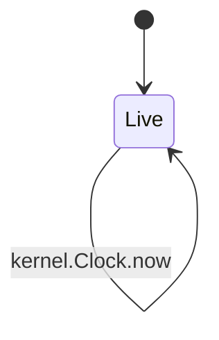
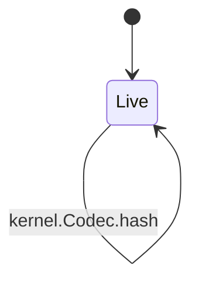
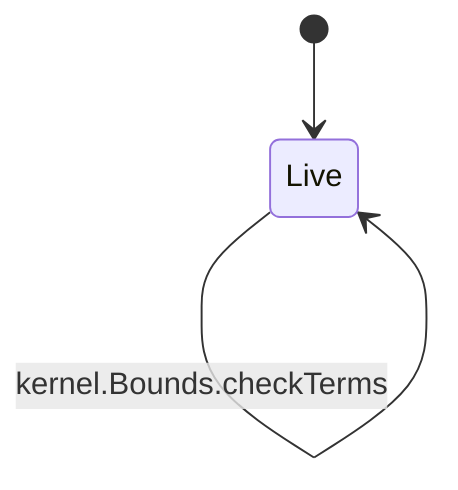
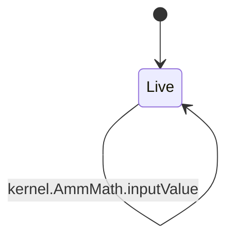
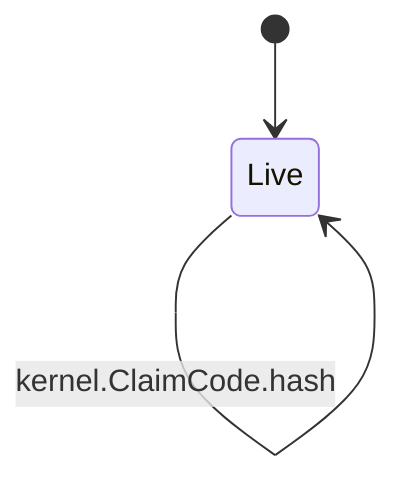

<!-- GENERATED by tools/render_flows.py from 12-kernel.yaml; do not edit -->

# Flow: kernel

Schema: `rcash.flows/v1`
Source: `contracts/src/deploy/v3/01_kernel.rho`, `contracts/src/deploy/v3/02_bounds.rho`, `contracts/src/deploy/v3/05_amm_math.rho`, `contracts/src/deploy/v3/06_collateral_math.rho`, `contracts/src/deploy/v3/08_claim_code.rho`

### Clock

#### Clock arms

| arm | transition | kind | guards | effects | access | refusals | invariants | status | source |
|---|---|---|---|---|---|---|---|---|---|
| `Clock@"now"` | `kernel.Clock.now` | read | — | reply = current block height | — | — | — | verified | contracts/src/deploy/v3/01_kernel.rho:18 |

### Codec

#### Codec arms

| arm | transition | kind | guards | effects | access | refusals | invariants | status | source |
|---|---|---|---|---|---|---|---|---|---|
| `Codec@"canonical"` | `kernel.Codec.canonical` | read | — | reply = schema ++ join('\|', len(v) ++ ':' ++ v) | — | — | I5 | verified | contracts/src/deploy/v3/01_kernel.rho:38 |
| `Codec@"hash"` | `kernel.Codec.hash` | read | — | reply = blake2b256(canonical(schema, values)) | — | — | I5 | verified | contracts/src/deploy/v3/01_kernel.rho:42 |

### Verifier

#### Verifier arms

| arm | transition | kind | guards | effects | access | refusals | invariants | status | source |
|---|---|---|---|---|---|---|---|---|---|
| `Verifier@"hash"` | `kernel.Verifier.hash` | read | — | reply = blake2b256(bytes) | — | — | — | verified | contracts/src/deploy/v3/01_kernel.rho:22 |
| `Verifier@"sigOk"` | `kernel.Verifier.sigOk` | read | — | reply = secp256k1Verify(digest, sig, pub) | — | — | — | verified | contracts/src/deploy/v3/01_kernel.rho:23 |
| `Verifier@"claimHash"` | `kernel.Verifier.claimHash` | read | — | reply = blake2b256(secret) | — | — | I14 | verified | contracts/src/deploy/v3/01_kernel.rho:24 |

### Bounds

#### Bounds arms

| arm | transition | kind | guards | effects | access | refusals | invariants | status | source |
|---|---|---|---|---|---|---|---|---|---|
| `Bounds@"checkIssuer"` | `kernel.Bounds.checkIssuer` | read | 10000 <= mcrBps <= 50000 → mcr 0 <= bonusBps <= 5000 → bonus 1 <= closeFactorBps <= 10000 → close 0 <= ratePerBlock <= 50000 → rate 1e10 <= debtCeiling <= 1e15 → ceiling 10000 <= minDebt <= 1e9 → min debt minDebt <= maxDebt <= debtCeiling → max debt 1 <= maxOracleAge <= 1000 → oracle age 0 <= savingsShareBps <= 10000 → savings share 0 <= psmFeeBps <= 1000 → psm fee | reply = (true, Nil) | — | bonus (pre) ceiling (pre) close (pre) max debt (pre) mcr (pre) min debt (pre) oracle age (pre) psm fee (pre) rate (pre) savings share (pre) | S12 | verified | contracts/src/deploy/v3/02_bounds.rho:13 |
| `Bounds@"checkFeed"` | `kernel.Bounds.checkFeed` | read | 1 <= quorum <= 3 → quorum age >= 1 → age 0 <= spread <= 10000 → spread 0 < minP <= maxP → band trialBlocks >= 1 → trial trialMinSubmits >= quorum → trial submits | reply = (true, Nil) | — | age (pre) band (pre) quorum (pre) spread (pre) trial (pre) trial submits (pre) | I7 | verified | contracts/src/deploy/v3/02_bounds.rho:38 |
| `Bounds@"checkPool"` | `kernel.Bounds.checkPool` | read | 0 <= baseSpreadBps <= 10000 → base spread 0 <= skewSpreadBps <= 10000 → skew 1 <= maxTradeBps <= 10000 → max trade minLiquidity >= 1 → min liquidity 0 <= firstDepositToleranceBps <= 1000 → tolerance depthFloorQuote >= 0 → depth floor minTicketQuote > 0 → min ticket | reply = (true, Nil) | — | base spread (pre) depth floor (pre) max trade (pre) min liquidity (pre) min ticket (pre) skew (pre) tolerance (pre) | I12 | verified | contracts/src/deploy/v3/02_bounds.rho:48 |
| `Bounds@"checkBook"` | `kernel.Bounds.checkBook` | read | defaultExpiryBlocks >= 1 → default expiry defaultExpiryBlocks <= maxExpiryBlocks <= 1296000 → max expiry minAmount >= 0 → min amount 0 <= maxMemoBytes <= 4096 → max memo 0 <= maxOpIdBytes <= 256 → max op id maxStipend >= 0 → max stipend | reply = (true, Nil) | — | default expiry (pre) max expiry (pre) max memo (pre) max op id (pre) max stipend (pre) min amount (pre) | I19 | verified | contracts/src/deploy/v3/02_bounds.rho:67 |
| `Bounds@"checkTransfer"` | `kernel.Bounds.checkTransfer` | read | amount >= minAmount → min amount expiry > now → expiry expiry <= now + maxExpiryBlocks → max expiry | reply = (true, Nil) | — | expiry (pre) max expiry (pre) min amount (pre) | I14 | verified | contracts/src/deploy/v3/02_bounds.rho:84 |
| `Bounds@"checkTerms"` | `kernel.Bounds.checkTerms` | read | len(values) = 25 and all terms fields match → terms fields boundsTermsSemantic(terms) → terms fields checkPool(terms) → base spread | reply = (true, Nil) | — | book expiry (pre) lock height (pre) lock too short (pre) oracle age (pre) pair (pre) seed mismatch (pre) terms fields (pre) version (pre) | I5 I6 I12 | verified | contracts/src/deploy/v3/02_bounds.rho:177 |

### AmmMath

#### AmmMath arms

| arm | transition | kind | guards | effects | access | refusals | invariants | status | source |
|---|---|---|---|---|---|---|---|---|---|
| `AmmMath@"value"` | `kernel.AmmMath.value` | read | — | reply = floor(rb * rate / 1e8) + rq | — | — | I10 | verified | contracts/src/deploy/v3/05_amm_math.rho:12 |
| `AmmMath@"weight"` | `kernel.AmmMath.weight` | read | — | reply = 5000 if value <= 0 else floor(floor(rb*rate/1e8)*10000 / value) | — | — | I12 | verified | contracts/src/deploy/v3/05_amm_math.rho:16 |
| `AmmMath@"fee"` | `kernel.AmmMath.fee` | read | — | reply = baseSpread + floor(abs(weight - 5000) * skewSpread / 5000) | — | — | I12 | verified | contracts/src/deploy/v3/05_amm_math.rho:30 |
| `AmmMath@"out"` | `kernel.AmmMath.out` | read | — | reply = b2q: floor(floor(dx*rate/1e8) * (10000-fee)/10000); q2b: -1 if rate <= 0 else floor(floor(dx*1e8/rate) * (10000-fee)/10000) | — | — | I12 | verified | contracts/src/deploy/v3/05_amm_math.rho:42 |
| `AmmMath@"shares"` | `kernel.AmmMath.shares` | read | — | reply = first: depositValue - 1e8; else 0 if totalShares<=0 or poolValue<=0; else floor(depositValue*totalShares/poolValue) | — | — | I11 | verified | contracts/src/deploy/v3/05_amm_math.rho:65 |
| `AmmMath@"inputValue"` | `kernel.AmmMath.inputValue` | read | — | reply = floor(amount*rate/1e8) if base; amount if quote; -1 | — | — | I12 | verified | contracts/src/deploy/v3/05_amm_math.rho:77 |

### CollateralMath

#### CollateralMath arms

| arm | transition | kind | guards | effects | access | refusals | invariants | status | source |
|---|---|---|---|---|---|---|---|---|---|
| `CollateralMath@"accrue"` | `kernel.CollateralMath.accrue` | read | — | reply = debt if debt<=0 or now<=last or rate<=0 else debt + ceil(debt*rate*(now-last)/1e12) | — | — | S3 | verified | contracts/src/deploy/v3/06_collateral_math.rho:15 |
| `CollateralMath@"health"` | `kernel.CollateralMath.health` | read | — | reply = true if debt<=0 else rate<=0 ? false : floor(collateral*rate/1e8)*10000 >= debt*mcrBps | — | — | S4 | verified | contracts/src/deploy/v3/06_collateral_math.rho:27 |
| `CollateralMath@"payout"` | `kernel.CollateralMath.payout` | read | — | reply = 0 if rate<=0 else floor(amount*(10000+bonusBps)*1e8 / (rate*10000)) | — | — | S6 | verified | contracts/src/deploy/v3/06_collateral_math.rho:41 |
| `CollateralMath@"seize"` | `kernel.CollateralMath.seize` | read | — | reply = payout(amount, bonusBps, rate) | — | — | S6 | verified | contracts/src/deploy/v3/06_collateral_math.rho:50 |

### ClaimCode

#### ClaimCode arms

| arm | transition | kind | guards | effects | access | refusals | invariants | status | source |
|---|---|---|---|---|---|---|---|---|---|
| `ClaimCode@"hash"` | `kernel.ClaimCode.hash` | read | — | reply = blake2b256(secret) | — | — | I14 | verified | contracts/src/deploy/v3/08_claim_code.rho:14 |
