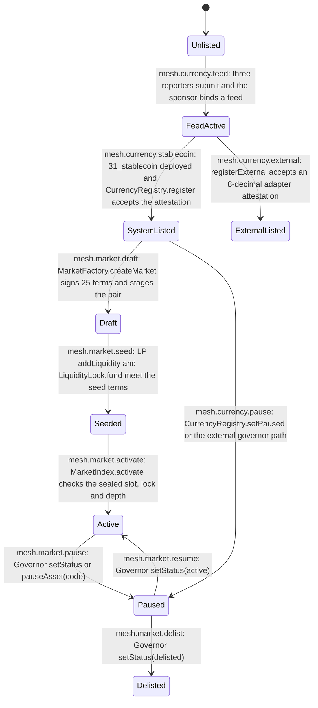

<!-- GENERATED by tools/render_flows.py from 13-mesh.yaml; do not edit -->

# Flow: mesh

Schema: `rcash.flows/v1`

## Lifecycle

| transition | from | to | trigger | requirement |
|---|---|---|---|---|
| `mesh.currency.feed` | Unlisted | FeedActive | three reporters submit and the sponsor binds a feed | `SPEC-ORA-01` |
| `mesh.currency.stablecoin` | FeedActive | SystemListed | 31_stablecoin deployed and CurrencyRegistry.register accepts the attestation | `SPEC-REG-01` |
| `mesh.currency.external` | FeedActive | ExternalListed | registerExternal accepts an 8-decimal adapter attestation | `SPEC-DEX-05` |
| `mesh.market.draft` | SystemListed | Draft | MarketFactory.createMarket signs 25 terms and stages the pair | `SPEC-MKT-03` |
| `mesh.market.seed` | Draft | Seeded | LP addLiquidity and LiquidityLock.fund meet the seed terms | `SPEC-DEX-08` |
| `mesh.market.activate` | Seeded | Active | MarketIndex.activate checks the sealed slot, lock and depth | `SPEC-MKT-07` |
| `mesh.market.pause` | Active | Paused | Governor setStatus or pauseAsset(code) | `SPEC-DEX-07` |
| `mesh.market.resume` | Paused | Active | Governor setStatus(active) | `SPEC-MKT-08` |
| `mesh.market.delist` | Paused | Delisted | Governor setStatus(delisted) | `SPEC-MKT-08` |
| `mesh.currency.pause` | SystemListed | Paused | CurrencyRegistry.setPaused or the external governor path | `SPEC-GOV-09` |

| refusal | reason | requirement |
|---|---|---|
| `mesh.external.kind` | `external kind` | `SPEC-DEX-05` |
| `mesh.external.decimals` | `external decimals` | `SPEC-DEX-05` |
| `mesh.pair.active` | `pair active` | `SPEC-DEX-01` |
| `mesh.pair.version` | `version` | `SPEC-DEX-01` |

| client flow | given | when | then | requirement |
|---|---|---|---|---|
| `mesh.client.default` | no stored preference | the client starts | USD is the display, account and new-market quote; the user may store another default | `SPEC-DEX-03` |
| `mesh.client.matrix` | the tracked mesh config and on-chain markets | Markets renders | every supported pair shows active/draft/paused/unlisted and an indicative rate | `SPEC-DEX-09` |
| `mesh.client.external` | a kind external entry | stablecoin-only screens enumerate currencies | the external asset is excluded; trade/account screens label it external | `SPEC-DEX-06` |
